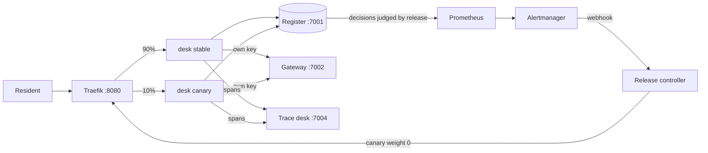
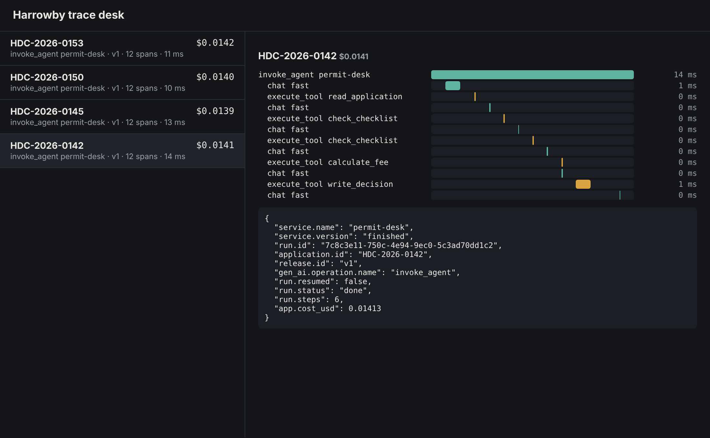

# Orientation: meet the council

You work on the permit desk at Harrowby District Council, a fictional English council. Residents send
permit applications: a house extension, a cafe in an old shop, a shop sign. An agent checks each one against
the council's checklist, then either writes to the resident asking for what is missing or passes the
application to a planning officer.

The agent already works on a laptop. This course takes it to production on your own machine: a container
with its key out of reach, a trace and a price for every run, brakes that stop a runaway run, and a canary
that rolls itself back when a bad release reaches residents.

In this orientation you set up, meet the world, run the finished system, and see the goal.





## Walkthrough

You need Docker (Desktop or Engine, with Compose 2.24 or newer) and Bun 1.4.4. No model key is needed: the
world plays back recorded replies (`LLM_PROVIDER=replay`) until you choose a real provider.

```bash
bun install
bun run setup
```

Expect: `This machine is ready. Next: bun run world`

```bash
bun run world
```

Expect: `The world is running. Model provider: replay.` and the URLs of the register, gateway, sign-in and
trace desk.

```bash
bun run up finished
```

Expect: `The finished permit desk is running on http://localhost:8080`

```bash
bun run run-application HDC-2026-0142
```

Expect: five `tool` lines, the agent's answer, and `Run <id> ended: done, cost $0.0141`

Now look around:

- http://localhost:8080: the resident's page. Pick an application and watch the check stream in.
- http://localhost:7001: the register. HDC-2026-0142 now says `invalid_missing_items`.
- http://localhost:7004: the trace desk. One trace per run, with each model call and tool call, and the cost.
- http://localhost:8080/staff: the staff queue. Sign in with a password from `secrets/passwords`.

See what the finished system does when things go wrong:

```bash
bun run chaos bad-canary
```

Expect: `Alert ReleaseDisagreesWithRules fired for release v2. The controller set the canary to 0%.` and the
number of seconds it took, with no one at the keyboard.

Then do the orientation step, `meet-the-council`, in `meet-the-council/problem/`.

```bash
bun run verify meet-the-council
```

Expect: `Done. All 6 rules pass.` once your `findings.toml` matches what the world holds.

When something fails, look up the message in [troubleshooting.md](troubleshooting.md).

## Use a real model (optional)

Copy `.env.example` to `.env`, set `LLM_PROVIDER` to `anthropic`, `openrouter` or `openai`, and put that one
key in. Then restart the world so the gateway reads it.

```bash
bun run models
```

Expect: `Every role answers.` with a cost per role, and never the key itself.

The checks always run in replay mode, so they cost nothing and give the same answer on every machine.
