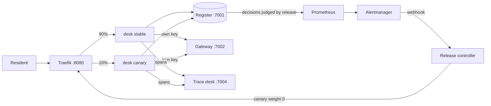

# Orientation: meet the council

You work on the permit desk at Harrowby District Council. It is a council in England, and it is not real.
Residents send permit applications to the council. For example, one resident wants to build a house
extension. Another wants to open a cafe in an old shop. A third wants a new shop sign.

An agent checks each application against the council's checklist. Then it does one of two things. It writes
to the resident and asks for what is missing. Or it passes the application to a planning officer.

The agent already works on a laptop. In this course you take it to production on your own machine.
Production means real users depend on it. You will build four things:

- a container that keeps the model key outside the image;
- a trace and a price for every run;
- brakes that stop a runaway run;
- a canary that rolls itself back when a bad release reaches residents.

A canary is a new release that only a small share of users get first. In this orientation you set up your
machine, meet the world, run the finished system, and see the goal.




## Walkthrough

You need Docker (Desktop or Engine, with Compose 2.24 or newer) and Bun 1.4.4. You do not need a model key.
The world plays back model replies that were recorded before (`LLM_PROVIDER=replay`). You can choose a real
provider later.

```bash
bun install
bun run setup
```

Expect: `This machine is ready. Next: bun run world`

```bash
bun run world
```

Expect: `The world is running. Model provider: replay.` and the URLs of the register, gateway, sign-in and
trace desk.

```bash
bun run up finished
```

Expect: `The finished permit desk is running on http://localhost:8080`

```bash
bun run run-application HDC-2026-0142
```

Expect: five `tool` lines, the agent's answer, and `Run <id> ended: done, cost $0.0141`

Each `tool` line is one tool the agent called. For HDC-2026-0142 they are `read_application`, then
`check_checklist` two times (the checklist has two pages), then `calculate_fee` and `write_decision`.

Now look around:

- http://localhost:8080 is the resident's page. Pick an application and watch the check appear line by line.
- http://localhost:7001 is the register. HDC-2026-0142 now says `invalid_missing_items`.
- http://localhost:7004 is the trace desk. It shows one trace per run, with each model call, each tool call
  and the cost.
- http://localhost:8080/staff is the staff queue. Sign in with a password from `secrets/passwords`.

Now see what the finished system does when something goes wrong:

```bash
bun run chaos bad-canary
```

Expect: `Alert ReleaseDisagreesWithRules fired for release v2. The controller set the canary to 0%.` and the
number of seconds it took, with no one at the keyboard.

Then do the orientation step, `meet-the-council`. Its files are in `meet-the-council/problem/`.

```bash
bun run verify meet-the-council
```

Expect: `Done. All 6 rules pass.` once your `findings.toml` matches what the world holds.

When something fails, look up the message in [troubleshooting.md](troubleshooting.md).

## Use a real model (optional)

1. Copy `.env.example` to `.env`.
2. Set `LLM_PROVIDER` to `anthropic`, `openrouter` or `openai`.
3. Put the key for that one provider in the file.
4. Restart the world: run `bun run world stop`, then `bun run world`. The gateway reads the key when it starts.

```bash
bun run models
```

Expect: `Every role answers.` with a cost per role, and never the key itself.

The checks always run in replay mode. So they cost nothing, and they give the same answer on every machine.
