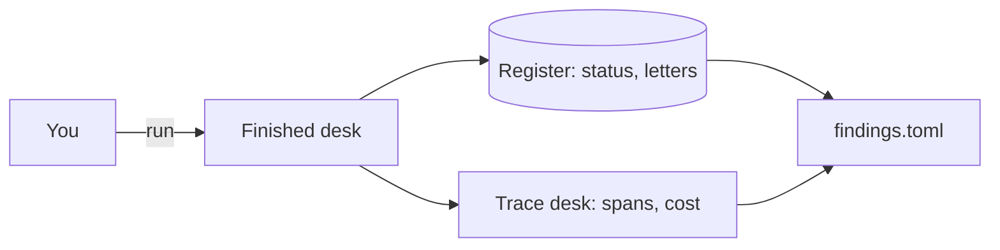
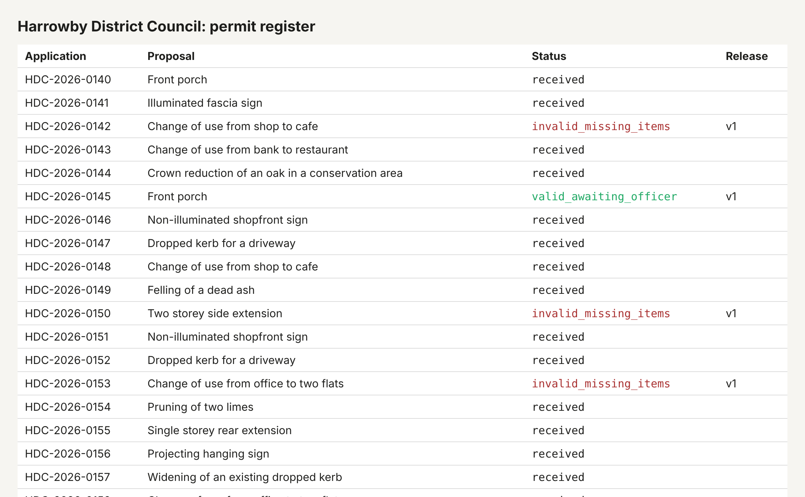

# Meet the council

## The problem

You will spend this course changing a system you have never seen. Before you change it, you need to know
where the truth lives. For the permit desk that is not the agent's reply: it is the register, which holds
every status and letter, and the trace desk, which holds what the agent did and what it cost.

## Your challenge

Run the finished desk on application HDC-2026-0142 (a shop that wants to become a cafe), then fill in
`findings.toml` in this folder from what the world holds, not from what the agent said.

```bash
bun run up finished
bun run run-application HDC-2026-0142
```

Expect: `Run <id> ended: done, cost $0.0141`

1. In the register (http://localhost:7001), read the status of HDC-2026-0142.
2. Read the letter at http://localhost:7001/letters?application_id=HDC-2026-0142 and the decision in
   http://localhost:7001/audit. Write the missing items as the register names them.
3. From `world/data/checklist.json` and the application in `world/data/applications/`, work out the fee
   still owed.
4. In the trace desk (http://localhost:7004), open the trace for HDC-2026-0142. Copy the cost on the root
   span and count the `execute_tool` spans.





## Done when

- `status` is the one the register holds for HDC-2026-0142.
- `missing` lists what the letter asks for, by the register's names.
- `fee_owed_gbp` is what the checklist says is still owed.
- The finished desk runs on this machine and HDC-2026-0142 has a trace with a cost.
- `run_cost_usd` matches the cost on the run's root span.
- `tool_calls` matches the `execute_tool` spans in that trace.

```bash
bun run verify meet-the-council
```

Expect: `Done. All 6 rules pass.`

## If you get stuck

- Nothing on port 8080? Run `bun run up finished` and read what it prints.
- The waterfall shows model calls (`chat fast`) in green and tool calls (`execute_tool ...`) in amber.
- A run that a chaos command interrupted is marked `run.resumed`. The check looks at a clean run, so run the
  application again if you are unsure.

## Words you will use

- **Register**: the council's system of record. If the register does not say it, it did not happen.
- **Trace**: the record of one run, made of spans. A **span** is one piece of work with a start and an end.
- **Root span**: the span for the whole run. The desk writes the run's cost on it.
- **Replay mode**: the gateway plays back recorded model replies, so runs cost nothing and repeat exactly.
