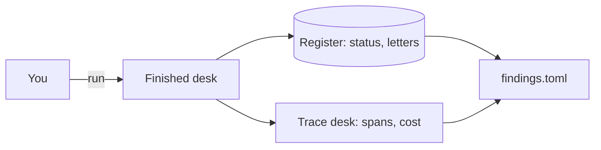

# Meet the council

## The problem

In this course you change a system that you have never seen. Before you change it, you need to know where
the truth is. For the permit desk, the truth is not the agent's reply. It is in two places:

- The register is the council's official record. It holds every status and every letter.
- The trace desk holds what the agent did and what each run cost.

## Your challenge

Run the finished desk on application HDC-2026-0142. In this application, a resident wants to turn a shop
into a cafe. Then fill in `findings.toml` in this folder. Use what the world holds, not what the agent said.

```bash
bun run up finished
bun run run-application HDC-2026-0142
```

Expect: `Run <id> ended: done, cost $0.0141`

1. Open the register at http://localhost:7001. Read the status of HDC-2026-0142.
2. Read the letter at http://localhost:7001/letters?application_id=HDC-2026-0142 and the decision in
   http://localhost:7001/audit. Write the missing items with the names the register uses.
3. Work out the fee that the resident still owes. Use `world/data/checklist.json` and the application in
   `world/data/applications/`.
4. Open the trace desk at http://localhost:7004 and find the trace for HDC-2026-0142. Copy the cost on the
   root span. Count the `execute_tool` spans.

For example, here is how to work out the fee for a different application, HDC-2026-0150. Its file says
`"type": "householder"` and `"fee_paid_gbp": 129`. In the checklist, `householder` has `"fee_gbp": 258`. So
that resident still owes 258 minus 129, which is 129 pounds. Do the same for HDC-2026-0142.




## Done when

- `status` is the one the register holds for HDC-2026-0142.
- `missing` lists what the letter asks for, with the register's names.
- `fee_owed_gbp` is what the checklist says the resident still owes.
- The finished desk runs on this machine, and HDC-2026-0142 has a trace with a cost.
- `run_cost_usd` matches the cost on the run's root span.
- `tool_calls` matches the number of `execute_tool` spans in that trace.

```bash
bun run verify meet-the-council
```

Expect: `Done. All 6 rules pass.`

## If you get stuck

- Nothing on port 8080? Run `bun run up finished` and read what it prints.
- In the waterfall, model calls (`chat fast`) are green and tool calls (`execute_tool ...`) are amber.
- A chaos command can stop a run in the middle. That run is marked `run.resumed`. The check looks at a clean
  run, so if you are not sure, run the application again.

## Words you will use

- **Register**: the council's official record. If the register does not say it, it did not happen.
- **Trace**: the record of one run. It is made of spans.
- **Span**: one piece of work, with a start and an end. For example, one tool call is one span.
- **Root span**: the span for the whole run. The desk writes the run's cost on it.
- **Replay mode**: the gateway plays back model replies that were recorded before. So runs cost nothing, and
  they repeat exactly.
