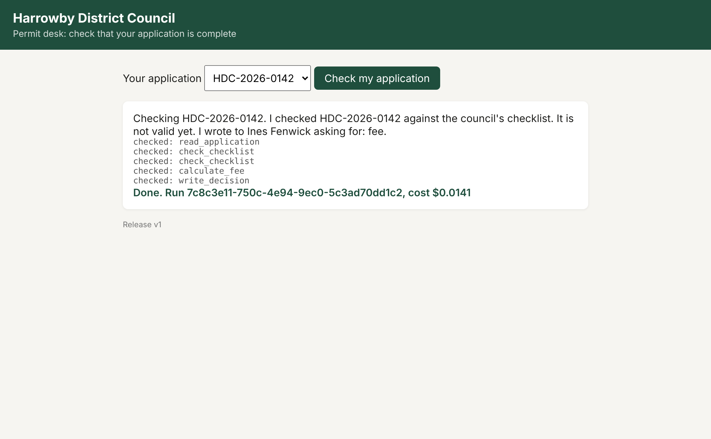
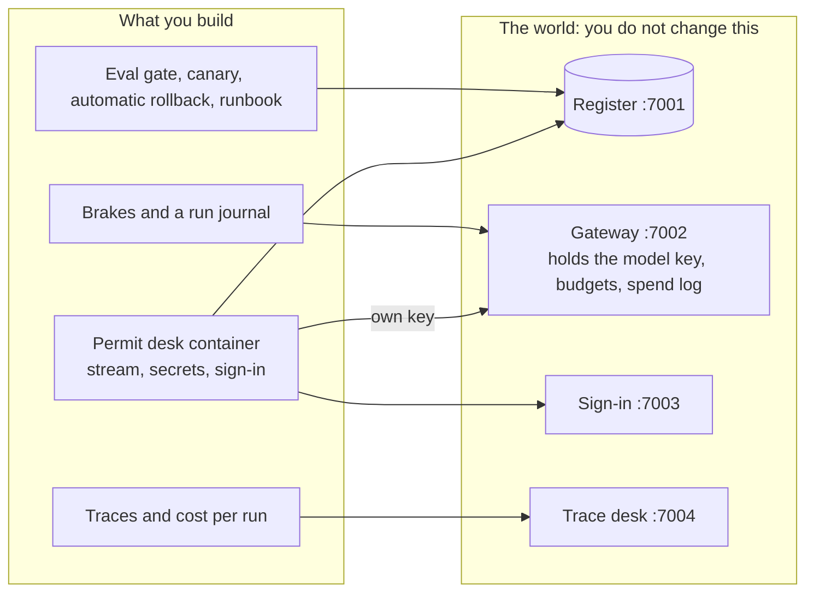

# AI Agents in Production for Engineers

Take an agent from "works on my laptop" to a release you can price, stop and roll back with no human at the
keyboard. Everything runs in Docker Compose on your own machine: no cloud account, no model key needed to
start.

**Who it is for**

- Backend engineers with a first agent and a launch date: you leave with the agent in a non-root container,
  its key out of the image, a trace and a price for every run, and a runaway run that stops itself.
- Platform engineers and SREs who will be paged for it: every model call goes through one gateway with a
  budget per key, and an alert rolls a bad canary back on its own.
- AI engineers who already trace and evaluate: runs survive a kill with one register write and one letter,
  and prompt, model and config ship as one release that an eval gate can block.

## Run the finished system first

You need Docker (with Compose 2.24 or newer) and Bun 1.4.4.

```bash
bun install
bun run world
```

Expect: `The world is running. Model provider: replay.`

```bash
bun run up finished
```

Expect: `The finished permit desk is running on http://localhost:8080`

```bash
bun run run-application HDC-2026-0142
```

Expect: `Run <id> ended: done, cost $0.0141`

```bash
bun run chaos runaway
```

Expect: `The run ended: stopped_budget after 12 model calls, $0.0345` and the message the resident saw.

```bash
bun run chaos bad-canary
```

Expect: `Alert ReleaseDisagreesWithRules fired for release v2. The controller set the canary to 0%.` and how
many seconds it took, with no one at the keyboard.



Open http://localhost:8080 (the resident's page), http://localhost:7004 (every run's trace and cost) and
http://localhost:7001 (the council's register).

## The world

Harrowby District Council is a fictional English council. Its permit desk checks that each application is
complete (the form, the plans, the certificates, the fee) before a planning officer looks at it. The agent
writes the decision to the council's register and sends the resident one letter. The council's word is
public, and its spend is taxpayers' money. Read more in [world/README.md](world/README.md).



## Parts

| Part | Steps | Minutes | You leave with |
|---|---|---|---|
| [Orientation](00-orientation/README.md) | `meet-the-council` | 15 | the world running, and the finished system seen working |
| [1. Ship the desk](parts/01-ship-the-desk/README.md) | `package-the-agent`, `move-secrets-out`, `sign-in-staff` | 55 | a healthy non-root container that streams, its key outside the image, staff sign-in with roles |
| [2. See every run](parts/02-see-every-run/README.md) | `trace-every-run`, `price-each-run` | 35 | a trace for every run and its cost, reconciled with the gateway |
| [3. Bound the runs](parts/03-bound-the-runs/README.md) | `cap-the-spend`, `rate-limit-residents`, `survive-a-restart` | 50 | a runaway run stopped, residents rate limited, runs that survive a kill with no duplicate letter |
| [4. Release safely](parts/04-release-safely/README.md) | `gate-with-evals`, `ship-a-canary`, `roll-back-automatically`, `write-the-runbook` | 75 | a release gate, a canary, a rollback no one has to press, and a runbook |
| [5. Go further](parts/05-go-further/README.md) (stretch) | `shadow-the-canary`, `deploy-to-the-cloud` | 55 | shadow traffic, and the same image on a container host |

Each step has one command: `bun run verify <step-name>`. It prints what passed, what failed and what to try
next. `bun run verify part <part-name>` checks a whole part. `bun run verify --report` writes
`verify-report.json` for a cohort.

How the parts map onto a single sitting, four evenings or a longer cohort is in [schedules.toml](schedules.toml).

## The project

Your copy of the permit desk, production-ready, in a public fork:

- CI runs the checks against the replay model and goes green.
- A scorecard from `bun run verify --report`: every step passed, the cost of one run, where the runaway run
  stopped, and how long the rollback took.
- A recording of `bun run chaos bad-canary`: the alert fires, the canary goes to 0%, no key is pressed.
- `runbook.md`, with every alert pointing at its section.

## Models

One file names every model: [config/models.ts](config/models.ts). Code asks for a role (`fast`, `smart`,
`judge`). `LLM_PROVIDER` picks the provider: `replay` by default (no key, the same answer every time), or
`anthropic`, `openrouter` or `openai` with one key in a git-ignored `.env` (see `.env.example`).

```bash
bun run models
```

Expect: `Every role answers.`

## Read before you start

1. Anthropic, [A postmortem of three recent issues](https://www.anthropic.com/engineering/a-postmortem-of-three-recent-issues).
   How a production change lowered answer quality, and why evaluations now run continuously in production.
2. OWASP GenAI Security Project, [LLM10:2025 Unbounded Consumption](https://genai.owasp.org/llmrisk/llm102025-unbounded-consumption/).
   The risk the brakes in Part 3 close.
3. OpenTelemetry, [semantic-conventions-genai](https://github.com/open-telemetry/semantic-conventions-genai).
   The span and attribute names the trace checks read. They are still marked Development and can change.

Also useful, by part: Anthropic, [Beyond permission prompts](https://www.anthropic.com/engineering/claude-code-sandboxing)
(Part 1); Stripe, [Designing robust and predictable APIs with idempotency](https://stripe.com/blog/idempotency)
(Part 3); Google SRE Workbook, [Canarying releases](https://sre.google/workbook/canarying-releases/) (Part 4);
Anthropic, [How we built our multi-agent research system](https://www.anthropic.com/engineering/built-multi-agent-research-system)
(Parts 3 and 4).

## How this repo works

Start in [00-orientation](00-orientation/README.md). The rules every course repo follows, and the check
behind each one, are in [STANDARD.md](STANDARD.md). `bun run check` runs them all. Part build notes are in
[PARTS.md](PARTS.md).
