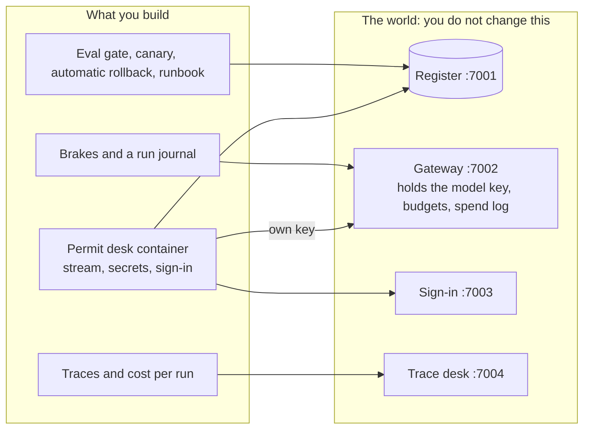

# AI Agents in Production for Engineers

You have an AI agent that works on your laptop. In this course you make it ready for real users. You learn to
price each run, stop a run that goes wrong, and roll back a bad release. No person needs to be at the keyboard.

Everything runs in Docker Compose on your own machine. You do not need a cloud account. You do not need a model
key to start.

**Who it is for**

- Backend engineers with a first agent and a launch date. You leave with the agent in a container that does not
  run as root. Its key is outside the image. Every run has a trace and a price. A runaway run stops itself.
- Platform engineers and SREs who get the alert at night. Every model call goes through one gateway, and each
  key has a budget. An alert rolls back a bad canary on its own.
- AI engineers who already trace and test their agents. Your runs survive a crash with one register write and
  one letter. Prompt, model and config ship together as one release, and a test gate can block it.

## Run the finished system first

You need Docker (with Compose 2.24 or newer) and Bun 1.4.4.

```bash
bun install
bun run world
```

Expect: `The world is running. Model provider: replay.`

```bash
bun run up finished
```

Expect: `The finished permit desk is running on http://localhost:8080`

```bash
bun run run-application HDC-2026-0142
```

Expect: `Run <id> ended: done, cost $0.0141`

For example, HDC-2026-0142 is a real application in `world/data/applications/`. Ines Fenwick wants to turn a
shop at 55 Kestrel Way into a cafe. She sent all six documents, but she has not paid the fee. The agent
calls five tools, one by one. It writes `invalid_missing_items` in the register. Then it sends her one letter
that asks for the fee. The run cost $0.0141.

```bash
bun run chaos runaway
```

Expect: `The run ended: stopped_budget after 12 model calls, $0.0345` and the message the resident saw.

A runaway run is a run that never ends by itself. Here the agent reads a list that "continues on the next
page" forever. The finished desk stops it after 12 model calls.

```bash
bun run chaos bad-canary
```

Expect: `Alert ReleaseDisagreesWithRules fired for release v2. The controller set the canary to 0%.` and how
many seconds it took, with no one at the keyboard.

A canary is a new release that gets only a small share of users first. Here release v2 gets 10% of
residents. It writes wrong letters, so an alert fires and the system turns it off.


Now open these pages in your browser:

- http://localhost:8080 is the resident's page.
- http://localhost:7004 shows the trace and the cost of every run.
- http://localhost:7001 is the council's register.

## The world

Harrowby District Council is a council in England. It is not real. Residents send it permit applications.
Its permit desk checks that each application is complete: the form, the plans, the certificates and the fee.
Only then does a planning officer look at it.

The agent does this check. It writes the decision in the register and sends the resident one letter. The
register is the council's official record. The council's word is public, and it spends taxpayers' money.
Read more in [world/README.md](world/README.md).



## Parts

| Part                                                     | Steps                                                                              | Minutes | You leave with                                                                             |
| -------------------------------------------------------- | ---------------------------------------------------------------------------------- | ------- | ------------------------------------------------------------------------------------------ |
| [Orientation](00-orientation/README.md)                  | `meet-the-council`                                                                 | 15      | the world running, and the finished system working in front of you                         |
| [1. Ship the desk](parts/01-ship-the-desk/README.md)     | `package-the-agent`, `move-secrets-out`, `sign-in-staff`                           | 55      | a healthy container that is not root and streams, its key outside the image, staff sign-in |
| [2. See every run](parts/02-see-every-run/README.md)     | `trace-every-run`, `price-each-run`                                                | 35      | a trace and a cost for every run, which match the gateway's numbers                        |
| [3. Bound the runs](parts/03-bound-the-runs/README.md)   | `cap-the-spend`, `rate-limit-residents`, `survive-a-restart`                       | 50      | a runaway run stopped, a limit per resident, runs that survive a crash with one letter     |
| [4. Release safely](parts/04-release-safely/README.md)   | `gate-with-evals`, `ship-a-canary`, `roll-back-automatically`, `write-the-runbook` | 75      | a test gate, a canary, a rollback that no one has to press, and a runbook                  |
| [5. Go further](parts/05-go-further/README.md) (stretch) | `shadow-the-canary`, `deploy-to-the-cloud`                                         | 55      | shadow traffic, and the same image on a container host                                     |

Each step has one command: `bun run verify <step-name>`. It prints what passed, what failed and what to try
next. `bun run verify part <part-name>` checks a whole part. `bun run verify --report` writes
`verify-report.json` for a class.

For example, `bun run verify meet-the-council` prints one `PASS` or `FAIL` line for each rule. A `FAIL` line
comes with a `Try next:` line. When all rules pass, it prints `Done. All 6 rules pass.`

You can do the course in one sitting, over four evenings, or with a class over a longer time. See how the
parts fit each plan in [schedules.toml](schedules.toml).

## The project

At the end you have your own copy of the permit desk, ready for real users, in a public fork:

- CI runs the checks against the replay model and passes.
- A scorecard from `bun run verify --report`. It shows that every step passed, the cost of one run, where the
  runaway run stopped, and how long the rollback took.
- A recording of `bun run chaos bad-canary`. The alert fires, the canary goes to 0%, and no one presses a key.
- `runbook.md`. A runbook is a page of steps to follow when something goes wrong. Every alert points to its
  section.

## Models

One file names every model: [config/models.ts](config/models.ts). Your code asks for a role (`fast`, `smart`,
`judge`), not a model name. `LLM_PROVIDER` picks the provider. The default is `replay`. Replay needs no key and
gives the same answer every time. You can also pick `anthropic`, `openrouter` or `openai`. Then you put one key
in a `.env` file that git ignores (see `.env.example`).

```bash
bun run models
```

Expect: `Every role answers.`

## Read before you start

1. Anthropic, [A postmortem of three recent issues](https://www.anthropic.com/engineering/a-postmortem-of-three-recent-issues).
   A change in production made answers worse. The post explains why tests now run all the time in production.
2. OWASP GenAI Security Project, [LLM10:2025 Unbounded Consumption](https://genai.owasp.org/llmrisk/llm102025-unbounded-consumption/).
   This is the risk that the brakes in Part 3 close.
3. OpenTelemetry, [semantic-conventions-genai](https://github.com/open-telemetry/semantic-conventions-genai).
   These are the span and attribute names that the trace checks read. They are still marked Development, so
   they can change.

Also useful for each part:

- Part 1: Anthropic, [Beyond permission prompts](https://www.anthropic.com/engineering/claude-code-sandboxing).
- Part 3: Stripe, [safe retries with idempotency keys](https://stripe.com/blog/idempotency).
- Part 4: Google SRE Workbook, [Canarying releases](https://sre.google/workbook/canarying-releases/).
- Parts 3 and 4: Anthropic, [How we built our multi-agent research system](https://www.anthropic.com/engineering/built-multi-agent-research-system).

## How this repo works

Start in [00-orientation](00-orientation/README.md). [STANDARD.md](STANDARD.md) lists the rules that every
course repo follows, and the check behind each rule. `bun run check` runs them all. Notes on how each part is
built are in [PARTS.md](PARTS.md).
