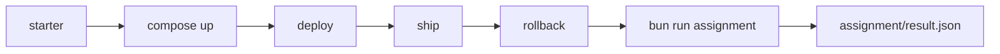

# Assignment: release the desk on Cloud Run with floci-gcp

This assignment is optional in the live session and expected as homework. It is the closing part of the course:
[Part 6, Deploy the agent to Cloud Run with floci-gcp](../parts/06-deploy-the-agent-to-cloud-run-with-floci-gcp/README.md).

## The task

Work in `parts/06-deploy-the-agent-to-cloud-run-with-floci-gcp/01-release-on-cloud-run/problem/`. Fill in
`docker-compose.yml` and `release.ts`. Then write `CHOICE.md`: when is Cloud Run the better choice, and what
did the emulator not do?

Only Docker Compose is needed. Use the fake key in `fake-key.txt`, never a real one.



## Done when

The check script `checks/assignment.ts` tests each line and writes `assignment/result.json`. The file holds one
`pass` or `fail` per line.

- The Compose file runs `floci/floci-gcp:0.12.0` on port 4588.
- The fake key is in Secret Manager and not in your code.
- `desk-00001` serves release v1, and `desk-00002` serves release v2.
- After the rollback, release v1 serves again through `desk-00003`.
- `CHOICE.md` names the secret volume limit and the traffic limit.

```bash
bun run assignment
```

Expect: `Done. All Done-when lines pass.` and `assignment/result.json` with `pass` on every line.

## Rubric

A person reads these lines. There are no points.

- The rollback came from a test on the emulator, and `CHOICE.md` says what the test showed.
- `CHOICE.md` says when a Compose-only release is the better choice.

## Submit

Push a branch named `assignment` and submit its URL. The grader reruns `bun run assignment`.
