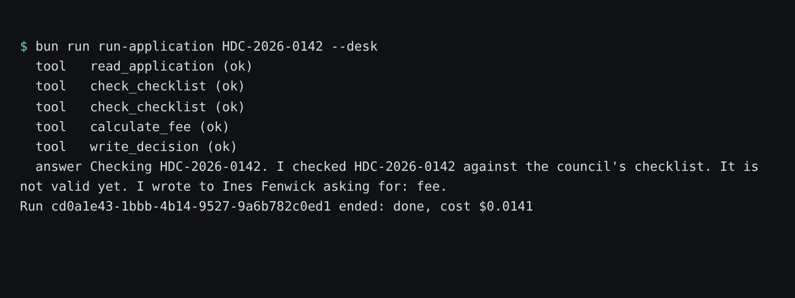

# Package the agent

## The problem

The permit desk works only on one laptop, started with `bun src/server.ts`. A resident asks "is my application complete?" and sees nothing until the run ends. Nobody can tell if the desk is alive, and when the laptop sleeps, the desk is gone.

## Watch it done

Before, the desk has no container and no health answer. For example, with `release.json` saying `"id": "v1"`, the finished desk answers a health call like this:

```json
{ "status": "ok", "version": "v1" }
```



## Your turn

1. Write a `Dockerfile` from `oven/bun:1.4.4-alpine`. Install with `bun install --production --frozen-lockfile`, copy `release.json` and `src/`, and run as the image's `bun` user, not root. End with `CMD ["bun", "src/server.ts"]`.
2. In `compose.yaml`, add a service named `desk`. It builds this folder, publishes port 3000, and has a healthcheck that calls `/healthz`. Pass the gateway key as a build argument: `GATEWAY_KEY: ${GATEWAY_ADMIN_KEY}`. The desk sees it only after `ARG GATEWAY_KEY` and `ENV GATEWAY_KEY=${GATEWAY_KEY}` in the Dockerfile. This is not safe, and you fix it in the next step.
3. In `src/server.ts`, add `GET /healthz`. It answers with the status `ok` and the release id, as in the sample above, without calling the model.
4. Make `POST /v1/runs` stream Server-Sent Events with `streamSSE` from `hono/streaming`. Send one event per agent event (`token`, `tool`, `error`). End with one `done` event with `run_id`, `status` and `cost_usd`. Send a first event before the first model call.
5. Start your desk.

```bash
bun run up package-the-agent
```

Expect: `Your permit desk (package-the-agent, your work) is running on http://localhost:3000`

6. Send one application through it.

```bash
bun run run-application HDC-2026-0142 --desk
```

Expect: five `tool` lines, then `Run <id> ended: done, cost $0.0141`

## Do it on your work

Give one service of your own a health route, and run it in a container as a user that is not root. Good looks like this: the container reports healthy, and a long answer starts before the work ends.

## Done when

- `compose.yaml` has a service named `desk` that builds this folder.
- The image builds, and the container reports healthy.
- The desk runs as a user that is not root.
- `GET /healthz` answers 200 with `status: ok` and the release version.
- `POST /v1/runs` answers with an event stream. The first event arrives within 2 seconds (3 runs).
- Each stream sends `token` events, then one `done` event with `run_id`, `status` and `cost_usd`.
- Each run leaves its decision and exactly one letter in the register.
- A run with no `application_id` gets a 400 answer.

```bash
bun run verify package-the-agent
```

Expect: `Done. All 8 rules pass.`

## Solution

After: a Dockerfile, a `desk` service, a health route and a streamed run route. See `../solution/` and compare with `diff -r . ../solution/`.

## If you get stuck

- The first build is slow.
- Read the desk's own logs: `docker compose -p hdc-desk logs desk`.
- `wget` is in the Alpine Bun image, so the healthcheck can be
  `["CMD", "wget", "-qO-", "http://localhost:3000/healthz"]`.
- Compare with `../solution/` after.

## Words you will use

- **Container**: a program packed with what it needs, so it runs the same on any machine with Docker.
- **Healthcheck**: a command Docker runs again and again to decide if the container is healthy.
- **Server-Sent Events (SSE)**: an HTTP answer that stays open and sends named events one by one.
- **Non-root user**: a user without admin rights, so a bug cannot take over the machine.
