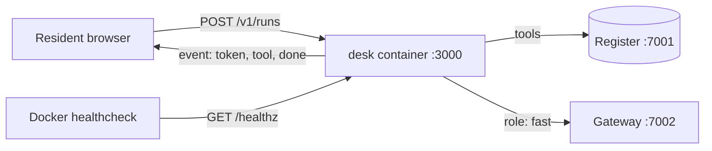
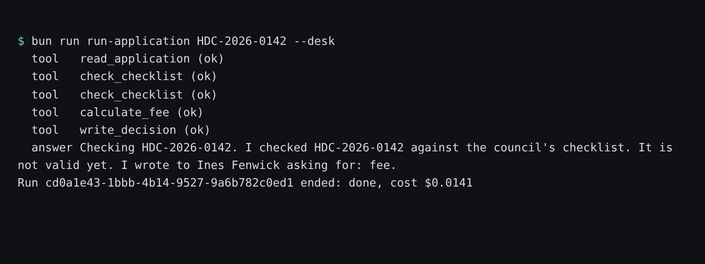

# Package the agent

## The problem

Harrowby's permit desk works, but only on one laptop. Someone types `bun src/server.ts`, and residents who
ask "is my application complete?" wait in silence until the whole run is over, then get everything at once.
Nobody can tell from outside whether the desk is alive. When the laptop sleeps, the desk is gone.

A council service has to run the same way on every machine, say when it is healthy, and show the resident
progress as it happens.

## Your challenge

Turn this folder into a container that Docker Compose runs next to the world.

1. Write a `Dockerfile`: install with `bun install --production --frozen-lockfile`, copy `release.json` and
   `src/`, and run as the image's `bun` user, not root.
2. In `compose.yaml`, add a service named `desk` that builds this folder, publishes port 3000, and has a
   healthcheck that calls `/healthz`. Pass the gateway key the desk uses today as a build argument
   `GATEWAY_KEY: ${GATEWAY_ADMIN_KEY}` (you will fix that in the next step).
3. In `src/server.ts`, add `GET /healthz` that answers `{ "status": "ok", "version": "<release id>" }`
   without calling the model.
4. Make `POST /v1/runs` stream Server-Sent Events with `streamSSE` from `hono/streaming`: one event per agent
   event (`token`, `tool`, `error`), and a last `done` event with `run_id`, `status` and `cost_usd`. Send a
   first event before the first model call, so the resident sees something at once.



Start the world, then your desk:

```bash
bun run up package-the-agent
```

Expect: `Your permit desk (package-the-agent, your work) is running on http://localhost:3000`

```bash
bun run run-application HDC-2026-0142 --desk
```

Expect: five `tool` lines, then `Run <id> ended: done, cost $0.0141`



## Done when

- `compose.yaml` has a service named `desk` that builds this folder.
- The image builds and the container reports healthy.
- The desk runs as a user that is not root.
- `GET /healthz` answers 200 with `status: ok` and the release version.
- `POST /v1/runs` answers with an event stream, and the first event arrives within 2 seconds (3 runs).
- Each stream sends `token` events, then one `done` event with `run_id`, `status` and `cost_usd`.
- Each run leaves its decision and exactly one letter in the register.
- A run with no `application_id` gets a 400 answer.

```bash
bun run verify package-the-agent
```

Expect: `Done. All 8 rules pass.`

## If you get stuck

- The first build is slow because it downloads the Bun image. Later builds reuse it.
- Read the desk's own words: `docker compose -p hdc-desk logs desk`.
- `wget` is in the Alpine Bun image, so the healthcheck can be
  `["CMD", "wget", "-qO-", "http://localhost:3000/healthz"]`.
- Inside the Docker network the desk reaches the world as `http://register:7001` and `http://gateway:7002`.
  The defaults in `src/config.ts` already say so.
- Compare with `../solution/` when you are done, or if you are stuck for long.

## Words you will use

- **Container**: a program packed with everything it needs, so it runs the same on any machine with Docker.
- **Healthcheck**: a command Docker runs again and again to decide whether the container is healthy.
- **Server-Sent Events (SSE)**: an HTTP answer that stays open and sends named events one by one.
- **Non-root user**: a user without admin rights inside the container, so a bug cannot take over the machine.
