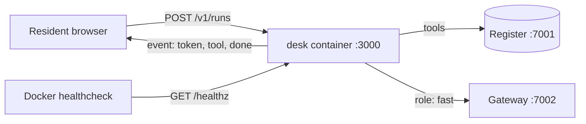

# Package the agent

## The problem

The permit desk works, but only on one laptop. Someone starts it with `bun src/server.ts`. A resident asks
"is my application complete?" and sees nothing until the run is over. Nobody can tell if the desk is alive.
When the laptop sleeps, the desk is gone.

A council service must run the same way on every machine. It must say when it is healthy. It must show the
resident progress while the run happens.

## Your challenge

Turn this folder into a container that Docker Compose runs next to the world.

1. Write a `Dockerfile` from `oven/bun:1.4.4-alpine`. Install with `bun install --production --frozen-lockfile`,
   copy `release.json` and `src/`, and run as the image's `bun` user, not root. End with
   `CMD ["bun", "src/server.ts"]`.
2. In `compose.yaml`, add a service named `desk`. It builds this folder, publishes port 3000, and has a
   healthcheck that calls `/healthz`. Pass the gateway key as a build argument:
   `GATEWAY_KEY: ${GATEWAY_ADMIN_KEY}`. The desk sees it only after `ARG GATEWAY_KEY` and
   `ENV GATEWAY_KEY=${GATEWAY_KEY}` in the Dockerfile. This is not safe, and you fix it in the next step.
3. In `src/server.ts`, add `GET /healthz`. It answers `{ "status": "ok", "version": "<release id>" }`
   without calling the model.
4. Make `POST /v1/runs` stream Server-Sent Events with `streamSSE` from `hono/streaming`. Send one event per
   agent event (`token`, `tool`, `error`). End with one `done` event with `run_id`, `status` and `cost_usd`.
   Send a first event before the first model call, so the resident sees something at once.

For example, `release.json` says `"id": "v1"`, so `/healthz` answers `{"status":"ok","version":"v1"}`. A
tool event is `event: tool` with the data `{"name":"read_application","status":"ok"}`.



Start the world, then your desk:

```bash
bun run up package-the-agent
```

Expect: `Your permit desk (package-the-agent, your work) is running on http://localhost:3000`

```bash
bun run run-application HDC-2026-0142 --desk
```

Expect: five `tool` lines, then `Run <id> ended: done, cost $0.0141`


## Done when

- `compose.yaml` has a service named `desk` that builds this folder.
- The image builds, and the container reports healthy.
- The desk runs as a user that is not root.
- `GET /healthz` answers 200 with `status: ok` and the release version.
- `POST /v1/runs` answers with an event stream. The first event arrives within 2 seconds (3 runs).
- Each stream sends `token` events, then one `done` event with `run_id`, `status` and `cost_usd`.
- Each run leaves its decision and exactly one letter in the register.
- A run with no `application_id` gets a 400 answer.

```bash
bun run verify package-the-agent
```

Expect: `Done. All 8 rules pass.`

## If you get stuck

- The first build is slow because it downloads the Bun image. Later builds reuse it.
- Read the desk's own logs: `docker compose -p hdc-desk logs desk`.
- `wget` is in the Alpine Bun image, so the healthcheck can be
  `["CMD", "wget", "-qO-", "http://localhost:3000/healthz"]`.
- Compare with `../solution/` when you are done.

## Words you will use

- **Container**: a program packed with everything it needs, so it runs the same on any machine with Docker.
- **Healthcheck**: a command Docker runs again and again to decide if the container is healthy.
- **Server-Sent Events (SSE)**: an HTTP answer that stays open and sends named events one by one.
- **Non-root user**: a user without admin rights inside the container, so a bug cannot take over the machine.
