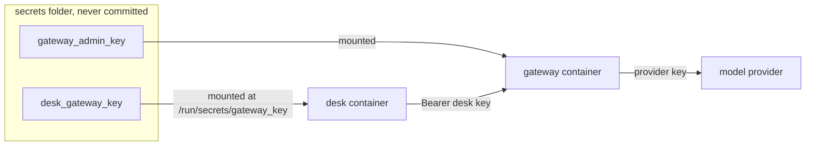

# Move secrets out

## The problem

The desk's image carries the gateway's admin key. The key went in as a build argument. Docker keeps build
arguments in the image's history and in its environment. So anyone who can pull the image can read the key
with `docker history` or `docker inspect`.

This is bad for two reasons:

- The admin key has no budget. A leaked copy can spend money without limit.
- Every call is billed to "admin". Nobody can tell the desk's spend from anyone else's.

The council's gateway gives each service its own key with its own budget. The desk should use its own key.
That key should never be inside the image or its environment.

Anthropic made the same choice for its cloud sandboxes. Secret keys, such as git credentials or signing keys,
are never inside the sandbox. A proxy outside the sandbox holds them
([Anthropic Engineering, "Beyond permission prompts"](https://www.anthropic.com/engineering/claude-code-sandboxing)).

## Your challenge

1. See the leak for yourself:

```bash
docker image inspect hdc-desk-desk --format '{{json .Config.Env}}'
```

Expect: a list that includes `GATEWAY_KEY=hdc-admin-...`

2. Remove the `ARG` and `ENV` lines for `GATEWAY_KEY` from the `Dockerfile`. Remove the build `args` from
   `compose.yaml`.
3. In `compose.yaml`, declare a top-level secret `gateway_key`. Its `file` is
   `${HDC_SECRETS:-../../../../secrets}/desk_gateway_key`. List it under the `desk` service. Compose then
   mounts it at `/run/secrets/gateway_key`.
4. In `src/config.ts`, read the key from that file. If the file is missing, print which file is missing.
   Then stop with `process.exit(1)`. This way a broken deploy fails at start, before the first resident
   arrives.

For example, when the file is missing, the finished desk prints this line and stops:
`The desk cannot start: its gateway key file /run/secrets/gateway_key is missing.`



## Done when

- No layer, config or history entry of the image holds a gateway key or a provider key.
- The running desk has no key in its environment.
- `compose.yaml` mounts `secrets/desk_gateway_key` as a secret for the `desk` service.
- The gateway's spend log bills model calls from the desk to its own key ("desk").
- Without its key file, the desk stops at once and says which file is missing.

```bash
bun run verify move-secrets-out
```

Expect: `Done. All 5 rules pass.`

## If you get stuck

- Rebuild after every change: `bun run up move-secrets-out` builds and restarts the desk.
- `secrets/` is in `.gitignore`. `bun run world` made the files in it, so they are only on your machine.
- Look at what the gateway billed:

```bash
curl -s -H "Authorization: Bearer $(cat ../../../../secrets/gateway_admin_key)" localhost:7002/admin/spend
```

Expect: a JSON list where each line has `"key": "desk"` once you are done.

- Compare with `../solution/` when you are done.

## Words you will use

- **Secret**: a value that gives access, such as a key or a password. It belongs outside code and images.
- **Build argument**: a value passed to `docker build`. It stays in the image's history, so it is not safe
  for secrets.
- **Compose secret**: a file that Docker Compose mounts into a container under `/run/secrets/`.
- **Gateway key**: the key a service shows the model gateway. Each key has its own budget and its own lines
  in the spend log.
