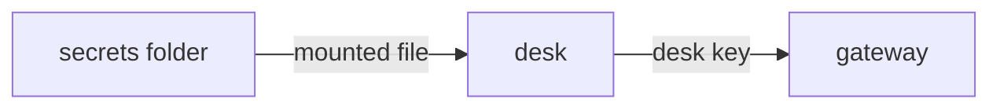

# Move secrets out

## The problem

The desk's image carries the gateway's admin key, passed in as a build argument. Docker keeps build arguments in the image's history and environment, so anyone who can pull the image can read the key. The admin key has no budget, so a leaked copy can spend without limit.

## Watch it done

Before, the image shows the key to anyone:

```text
["GATEWAY_KEY=hdc-admin-...", ...]
```

After, the key is a file mounted at `/run/secrets/gateway_key`, and the image holds no key. For example, with the file missing, the desk stops with this line:

```text
The desk cannot start: its gateway key file /run/secrets/gateway_key is missing.
```



## Your turn

Run every command from the top of the repo.

1. Build this step's desk, then see the leak for yourself.

```bash
bun run up move-secrets-out
docker image inspect hdc-desk-desk --format '{{json .Config.Env}}'
```

Expect: a list that includes `GATEWAY_KEY=hdc-admin-...`

2. Remove the `ARG` and `ENV` lines for `GATEWAY_KEY` from the `Dockerfile`. Remove the build `args` from `compose.yaml`.
3. In `compose.yaml`, declare a top-level secret `gateway_key`. Its `file` is `${HDC_SECRETS:-../../../../secrets}/desk_gateway_key`. List it under the `desk` service. Compose then mounts it at `/run/secrets/gateway_key`.
4. In `src/config.ts`, read the key from that file. If the file is missing, print which file is missing. Then stop with `process.exit(1)`. A broken deploy then fails at start.
5. Rebuild and look again.

```bash
bun run up move-secrets-out
docker image inspect hdc-desk-desk --format '{{json .Config.Env}}'
```

Expect: a list with no `GATEWAY_KEY` in it.

## Do it on your work

Find one key in your own project. Move it into a file that git ignores, and read it from that file at start. Good looks like this: the image shows no key, and the app stops at start with a clear line when the file is missing.

## Done when

- No layer, config or history entry of the image holds a gateway key or a provider key.
- The running desk has no key in its environment.
- `compose.yaml` mounts `secrets/desk_gateway_key` as a secret for the `desk` service.
- The gateway's spend log bills model calls from the desk to its own key ("desk").
- Without its key file, the desk stops at once and says which file is missing.

```bash
bun run verify move-secrets-out
```

Expect: `Done. All 5 rules pass.`

## Solution

After: no key in the Dockerfile, a Compose secret, and a config that reads the file. See `../solution/` and compare with `diff -r . ../solution/`.

## If you get stuck

- `secrets/` is in `.gitignore`. `bun run world` made its files, so they stay on your machine.
- Look at what the gateway billed:

```bash
curl -s -H "Authorization: Bearer $(cat secrets/gateway_admin_key)" localhost:7002/admin/spend
```

Expect: a JSON list where each line has `"key": "desk"` once you are done.

- Compare with `../solution/` when you are done.

## Words you will use

- **Secret**: a value that gives access, such as a key or a password. It belongs outside code and images.
- **Build argument**: a value passed to `docker build`. It stays in the image's history, so it is not safe
  for secrets.
- **Compose secret**: a file that Docker Compose mounts into a container under `/run/secrets/`.
- **Gateway key**: the key a service shows the model gateway. Each key has its own budget and its own lines
  in the spend log.
