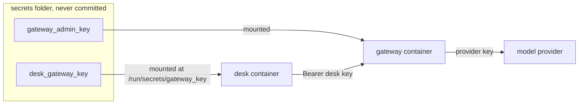

# Move secrets out

## The problem

The desk's image carries the gateway's admin key. It went in as a build argument, and Docker keeps build
arguments in the image's history and its environment. Anyone who can pull the image can read the key with
`docker history` or `docker inspect`. The admin key has no budget, so a leaked copy can spend without limit,
and every call is billed to "admin", so nobody can tell the desk's spend from anyone else's.

The council's gateway gives each service its own key with its own budget. The desk should use its own key,
and that key should never be inside the image or its environment.

Anthropic made the same choice for its cloud sandboxes: sensitive credentials such as git credentials or
signing keys are never inside the sandbox, and a proxy outside it holds them
([Anthropic Engineering, "Beyond permission prompts"](https://www.anthropic.com/engineering/claude-code-sandboxing)).

## Your challenge

1. See the leak for yourself:

```bash
docker image inspect hdc-desk-desk --format '{{json .Config.Env}}'
```

Expect: a list that includes `GATEWAY_KEY=hdc-admin-...`

2. Remove the `ARG` and `ENV` lines for `GATEWAY_KEY` from the `Dockerfile`, and the build `args` from
   `compose.yaml`.
3. In `compose.yaml`, declare a top-level secret `gateway_key` whose `file` is
   `${HDC_SECRETS:-../../../../secrets}/desk_gateway_key`, and list it under the `desk` service. Compose
   mounts it at `/run/secrets/gateway_key`.
4. In `src/config.ts`, read the key from that file. If the file is missing, print which file is missing and
   stop with `process.exit(1)`, so a broken deploy fails loudly at start instead of at the first resident.



## Done when

- No layer, config or history entry of the image holds a gateway key or a provider key.
- The running desk has no key in its environment.
- `compose.yaml` mounts `secrets/desk_gateway_key` as a secret for the `desk` service.
- Model calls from the desk are billed to its own key ("desk") in the gateway's spend log.
- Without its key file the desk stops at once and says which file is missing.

```bash
bun run verify move-secrets-out
```

Expect: `Done. All 5 rules pass.`

## If you get stuck

- Rebuild after every change: `bun run up move-secrets-out` builds and restarts the desk.
- `secrets/` is in `.gitignore`. `bun run world` made the files in it, so they are on your machine only.
- Look at what the gateway billed:

```bash
curl -s -H "Authorization: Bearer $(cat ../../../../secrets/gateway_admin_key)" localhost:7002/admin/spend
```

Expect: a JSON list where each line has `"key": "desk"` once you are done.

- Compare with `../solution/` when you are done.

## Words you will use

- **Secret**: a value that grants access, such as a key or a password. It belongs outside code and images.
- **Build argument**: a value passed to `docker build`. It stays in the image's history, so it is not safe for
  secrets.
- **Compose secret**: a file Docker Compose mounts into a container under `/run/secrets/`.
- **Gateway key**: the key a service shows the model gateway. Each has its own budget and its own line in
  the spend log.
