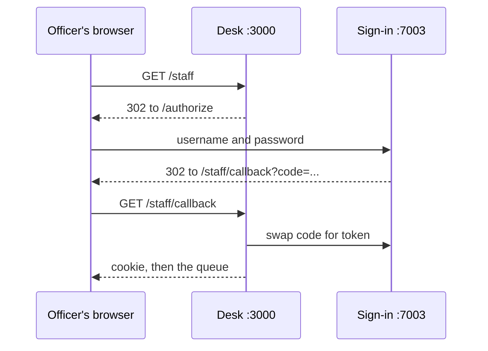
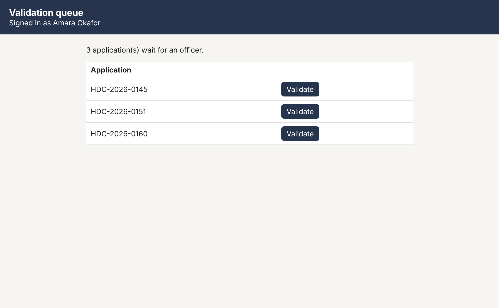

# Sign in staff

## The problem

Open http://localhost:3000/staff today. You see the validation queue, with a Validate button on every
application, whoever you are. `POST /v1/applications/<id>/validate` works for anyone too.

Validated is the status that sends an application to a planning officer. So a resident, a script, or the
agent itself could push an application through.

The council has a sign-in service at http://localhost:7003. It signs tokens that carry the person's `roles`.
The desk must trust only those tokens. Only a `validation_officer` may validate.

The desk also has its own service identity, the `permit-desk` client. Its tokens carry the role `agent`. The
agent must never be able to validate its own work.

For example, `world/data/people.json` gives `amara.okafor` the role `validation_officer`, so she may
validate. It gives `sam.hollis` the role `resident`, so the desk answers him with 403.

## Your challenge

1. In `src/auth.ts`, write `verify(token)`. Use `jwtVerify` with the `keys` set, the `ISSUER` and the
   audience `permit-desk`. Return `{ sub, name, roles }`, or `null` for a missing, forged or expired token.
   `signInUrl` and `exchangeCode` are already written.
2. In `src/server.ts`, guard the staff routes:
   - `GET /staff` with no valid session cookie redirects to `signInUrl()`.
   - Add `GET /staff/callback`. Swap the `code` for a token with `exchangeCode`, keep the token in an
     `httpOnly` cookie, and redirect to `/staff`.
   - `POST /v1/applications/:id/validate` reads `Authorization: Bearer <token>`. Answer 401 when `verify`
     fails, and 403 when the roles do not include `validation_officer`. Only then call the register.
   - Do the same for the queue's form route `POST /staff/validate/:id`.



Sign in as an officer. The world made the passwords:

```bash
cat ../../../../secrets/passwords
```

Expect: a JSON object with a password for `amara.okafor`, `tom.reid`, `priya.shah` and `sam.hollis`.



## Done when

- `GET /staff` with no session sends the browser to the council's sign-in page.
- An officer who signs in lands on the validation queue with their name.
- Validate with no token answers 401, and with a forged token answers 401.
- A signed-in resident gets 403 on validate.
- The agent's own service identity gets 403 on validate.
- Every refused call leaves the register unchanged, and an officer's call validates the application.

```bash
bun run verify sign-in-staff
```

Expect: `Done. All 6 rules pass.`

## If you get stuck

- Get a token from the command line to try your route:

```bash
curl -s localhost:7003/token -d grant_type=password -d username=sam.hollis -d password=<from the file>
```

Expect: `{"access_token":"eyJ...","id_token":"eyJ...","token_type":"Bearer","expires_in":3600}`

- `decodeJwt` only reads a token, and anyone can write one. Use `jwtVerify`, which checks the signature.
- `getCookie` and `setCookie` come from `hono/cookie`.
- Compare with `../solution/` when you are done.

## Words you will use

- **OpenID Connect (OIDC)**: a standard way to sign people in through a separate sign-in service.
- **Token (JWT)**: a signed piece of JSON that says who someone is and what roles they have.
- **Signature check**: proof, with the sign-in service's public key, that the council made the token.
- **401 and 403**: 401 means "I do not know who you are". 403 means "I know you, and you may not do this".
- **Service identity**: an account for a program, not a person, with only the roles it needs.
