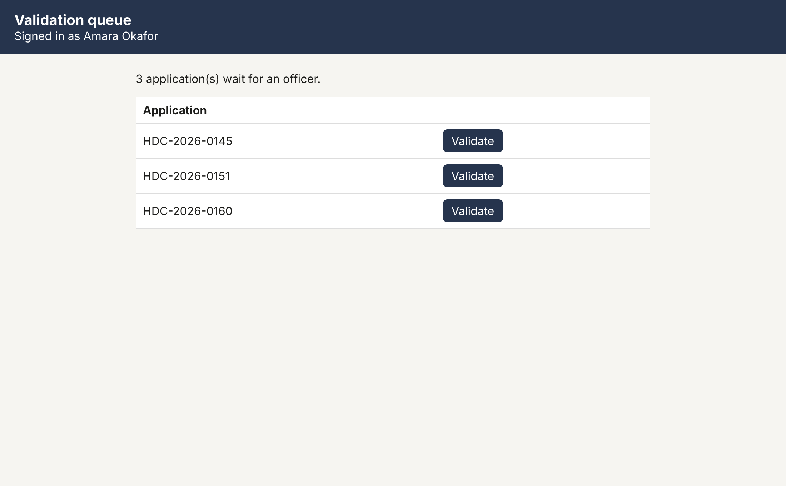

# Sign in staff

## The problem

Open http://localhost:3000/staff today and you see the validation queue, whoever you are. The validate route works for anyone too. Validating sends an application to a planning officer. So anyone, even the agent, could push one through. Only a `validation_officer` should be allowed to validate.

## Watch it done

The council has a sign-in service at http://localhost:7003. It signs tokens that carry the person's `roles`.

For example, `world/data/people.json` gives `amara.okafor` the role `validation_officer`, so she may validate. It gives `sam.hollis` the role `resident`, so the desk answers him with 403. The desk's own service identity, the `permit-desk` client, carries the role `agent`. It must never validate its own work.



## Your turn

1. In `src/auth.ts`, write `verify(token)`. Use `jwtVerify` with the `keys` set, the `ISSUER` and the audience `permit-desk`. Return the person's `sub`, `name` and `roles`. Return `null` for a missing, forged or expired token.
2. In `src/server.ts`, make `GET /staff` redirect to `signInUrl()` when there is no valid session cookie.
3. Add `GET /staff/callback`. Swap the `code` for a token with `exchangeCode`. Keep the token in an `httpOnly` cookie. Then redirect to `/staff`.
4. Guard `POST /v1/applications/:id/validate`. It reads the `Authorization` header with a bearer token. Answer 401 when `verify` fails. Answer 403 when the roles do not include `validation_officer`. Only then call the register.
5. Add `POST /staff/validate/:id`, where the queue's Validate button posts. A visitor with no session is redirected to `signInUrl()`. A user who is not an officer gets 403.
6. Read the passwords, then sign in as an officer.

```bash
cat secrets/passwords
```

Expect: a JSON object with a password for `amara.okafor`, `tom.reid`, `priya.shah` and `sam.hollis`.

## Do it on your work

Pick one risky route in your own project. Make it read a signed token. Refuse with 401 for a bad token and 403 for a wrong role. Good looks like this: three callers (no token, wrong role, right role) get three different answers. Only the last one changes anything.

## Done when

- `GET /staff` with no session sends the browser to the council's sign-in page.
- An officer who signs in lands on the validation queue with their name.
- Validate with no token or a forged token answers 401.
- A signed-in resident gets 403 on validate.
- The agent's own service identity gets 403 on validate.
- Every refused call leaves the register unchanged. An officer's call validates the application.

```bash
bun run verify sign-in-staff
```

Expect: `Done. All 6 rules pass.`

## Solution

After: a `verify` function and guards on the staff routes. See `../solution/`. To compare, run `diff -r . ../solution/`.

## If you get stuck

- Get a token with the password of `sam.hollis` from `secrets/passwords`:

```bash
curl -s localhost:7003/token -d grant_type=password -d username=sam.hollis -d password=<from the file>
```

Expect: `{"access_token":"eyJ...","id_token":"eyJ...","token_type":"Bearer","expires_in":3600}`

- `decodeJwt` only reads a token. Use `jwtVerify`, which checks the signature.
- `getCookie` and `setCookie` come from `hono/cookie`.
- Compare with `../solution/` when you finish.

## Words you will use

- **OpenID Connect (OIDC)**: a standard way to sign people in through a separate sign-in service.
- **Token (JWT)**: a signed piece of JSON. It says who someone is and what roles they have.
- **Signature check**: proof, with the sign-in service's public key, that the council made the token.
- **401 and 403**: 401 means "I do not know who you are". 403 means "I know you, and you may not do this".
- **Service identity**: an account for a program, not a person. It has only the roles it needs.
