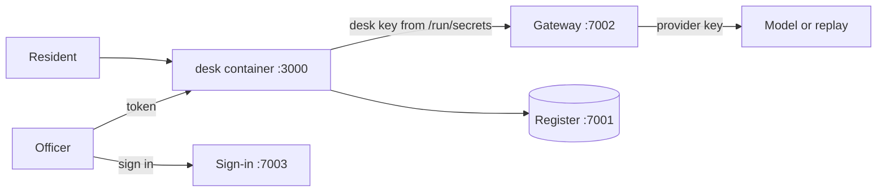

# Part 1: Ship the desk

## After this part you can

- Package an agent as a container that starts the same way on any machine and says when it is healthy.
- Keep a secret key out of an image, and prove it with a command.
- Let only the right staff use a risky route, and refuse everyone else.

## You leave with

A permit desk that runs as a container and streams its answer. It holds its own key in a file, and only an officer can validate an application. You also have a short note on one of your own services, from the project below.

## The problem

Harrowby's validation agent works on one laptop. It answers in one block at the end of a run, so a resident waits and sees nothing. The model key is stored inside its image, so anyone with the image can read it. Anyone can use the staff queue to validate an application. Before any resident uses the desk, you fix all three.

## Why it matters

Keys that live next to the code leak with the code. Anthropic built its cloud sandboxes with this rule in
mind. A sandbox is a closed space where code runs with limited access. Secret keys, such as git credentials
or signing keys, are never inside the sandbox. A proxy holds them outside the sandbox. A proxy is a program that sits between two sides and passes calls on. Anthropic reports that
sandboxing cut permission prompts by 84% in its own use
([Anthropic Engineering, "Beyond permission prompts"](https://www.anthropic.com/engineering/claude-code-sandboxing)).

The permit desk uses the same shape:

- The gateway holds the provider key.
- The desk holds only its own key, which has a budget.
- The sign-in service decides who is an officer.

For example, the starter `Dockerfile` in `move-secrets-out` has the line `ENV GATEWAY_KEY=${GATEWAY_KEY}`. So
`docker image inspect` shows `GATEWAY_KEY=hdc-admin-...` to anyone who has the image. After this part, the key
is a file in `/run/secrets/`, and the image holds no key at all.



## Steps

| Step                | You make                                                                              | The check reads                                                                                    |
| ------------------- | ------------------------------------------------------------------------------------- | -------------------------------------------------------------------------------------------------- |
| `package-the-agent` | a Dockerfile, a Compose service with a healthcheck, `/healthz`, a streamed `/v1/runs` | container health and user, the event stream of 3 replay runs, the register's decisions and letters |
| `move-secrets-out`  | the desk's own key as a Compose secret, read from a file                              | every layer of the image, the container's environment, the gateway's spend log                     |
| `sign-in-staff`     | token checks and role guards on the staff routes                                      | the redirect to sign-in, the answers to five callers, the register's status                        |

## Watch and read

| Kind  | Title                                                     | Made by               | Why                                                          | Link                                                           |
| ----- | --------------------------------------------------------- | --------------------- | ------------------------------------------------------------ | -------------------------------------------------------------- |
| video | Docker in 100 Seconds                                     | Fireship              | Shows what a container is before you write a Dockerfile.     | <https://www.youtube.com/watch?v=Gjnup-PuquQ>                  |
| video | OAuth and OpenID Connect (in plain English)               | Nate Barbettini, Okta | Explains the sign-in flow that the sign-in step uses.        | <https://www.youtube.com/watch?v=996OiexHze0>                  |
| read  | Beyond permission prompts: making Claude Code more secure | Anthropic Engineering | Shows why a proxy holds the keys, not the sandbox.           | <https://www.anthropic.com/engineering/claude-code-sandboxing> |
| read  | Use secrets in Compose                                    | Docker                | Shows the secret file that you mount in the second step.     | <https://docs.docker.com/compose/how-tos/use-secrets/>         |
| read  | Streaming Helper                                          | Hono team             | Shows `streamSSE`, which sends the events in the first step. | <https://hono.dev/docs/helpers/streaming>                      |

## Project

Pick one small service of your own that has a key in its code, its image or its settings. Move that key into a file that is not in git. Then add one check that refuses a caller who should not get in. Write three lines in `ship-notes.md`: where the key was, where it is now, and the command that shows the key is gone from the image.

## Walkthrough

Work in each step's `problem/` folder. Start the world first.

```bash
bun run world
```

Expect: `The world is running. Model provider: replay.`

```bash
bun run up package-the-agent
bun run verify package-the-agent
```

Expect: `Done. All 8 rules pass.` once your Dockerfile, Compose service and stream work.

```bash
bun run up move-secrets-out
bun run verify move-secrets-out
```

Expect: `Done. All 5 rules pass.` once the key lives only in `secrets/`.

```bash
bun run up sign-in-staff
bun run verify sign-in-staff
```

Expect: `Done. All 6 rules pass.` once only an officer can validate.

```bash
bun run verify part ship-the-desk
```

Expect: `Part ship-the-desk is done: 3/3 steps pass.`
