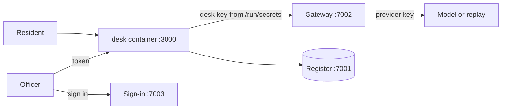

# Part 1: Ship the desk

## The problem

Harrowby's validation agent works on one laptop. It answers in one block at the end of a run, the model key
is baked into its image, and the staff queue lets anyone validate an application. Before a single resident
uses it, it has to run as a container anyone on the team can start, keep its key out of reach, and let only
officers do officers' work.

## Why it matters

Keys that live next to the code leak with it. Anthropic built its cloud sandboxes so that sensitive
credentials such as git credentials or signing keys are never inside the sandbox, with a proxy outside
holding them, and reports that sandboxing cut permission prompts by 84% in its own use
([Anthropic Engineering, "Beyond permission prompts"](https://www.anthropic.com/engineering/claude-code-sandboxing)).
The permit desk follows the same shape: the gateway holds the provider key, the desk holds only its own
budgeted key, and the sign-in service decides who is an officer.



## Steps

| Step | Minutes | You make | The check reads |
|---|---|---|---|
| `package-the-agent` | 20 | a Dockerfile, a Compose service with a healthcheck, `/healthz`, a streamed `/v1/runs` | container health and user, the event stream of 3 replay runs, the register's decisions and letters |
| `move-secrets-out` | 15 | the desk's own key as a Compose secret, read from a file | every layer of the image, the container's environment, the gateway's spend log |
| `sign-in-staff` | 20 | token checks and role guards on the staff routes | the redirect to sign-in, the answers to five callers, the register's status |

## Walkthrough

Work in each step's `problem/` folder. The world must be running.

```bash
bun run world
```

Expect: `The world is running. Model provider: replay.`

```bash
bun run up package-the-agent
bun run verify package-the-agent
```

Expect: `Done. All 8 rules pass.` once your Dockerfile, Compose service and stream work.

```bash
bun run up move-secrets-out
bun run verify move-secrets-out
```

Expect: `Done. All 5 rules pass.` once the key lives only in `secrets/`.

```bash
bun run up sign-in-staff
bun run verify sign-in-staff
```

Expect: `Done. All 6 rules pass.` once only an officer can validate.

```bash
bun run verify part ship-the-desk
```

Expect: `Part ship-the-desk is done: 3/3 steps pass.`
