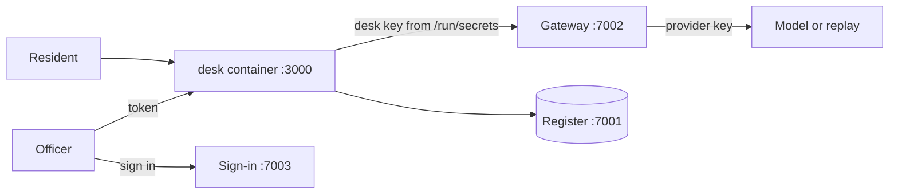

# Part 1: Ship the desk

## The problem

Harrowby's validation agent works on one laptop. It has three problems:

- It answers in one block at the end of a run. The resident waits and sees nothing until then.
- The model key is stored inside its image. Anyone with the image can read the key.
- Anyone can use the staff queue to validate an application.

Before any resident uses the desk, you fix all three. The desk runs as a container that anyone on the team
can start. Its key is not inside the image. And only officers can do an officer's work.

## Why it matters

Keys that live next to the code leak with the code. Anthropic built its cloud sandboxes with this rule in
mind. A sandbox is a closed space where code runs with limited access. Secret keys, such as git credentials
or signing keys, are never inside the sandbox. A proxy holds them outside the sandbox. A proxy is a program that sits between two sides and passes calls on. Anthropic reports that
sandboxing cut permission prompts by 84% in its own use
([Anthropic Engineering, "Beyond permission prompts"](https://www.anthropic.com/engineering/claude-code-sandboxing)).

The permit desk uses the same shape:

- The gateway holds the provider key.
- The desk holds only its own key, which has a budget.
- The sign-in service decides who is an officer.

For example, the starter `Dockerfile` in `move-secrets-out` has the line `ENV GATEWAY_KEY=${GATEWAY_KEY}`. So
`docker image inspect` shows `GATEWAY_KEY=hdc-admin-...` to anyone who has the image. After this part, the key
is a file in `/run/secrets/`, and the image holds no key at all.



## Steps

| Step                | Minutes | You make                                                                              | The check reads                                                                                    |
| ------------------- | ------- | ------------------------------------------------------------------------------------- | -------------------------------------------------------------------------------------------------- |
| `package-the-agent` | 20      | a Dockerfile, a Compose service with a healthcheck, `/healthz`, a streamed `/v1/runs` | container health and user, the event stream of 3 replay runs, the register's decisions and letters |
| `move-secrets-out`  | 15      | the desk's own key as a Compose secret, read from a file                              | every layer of the image, the container's environment, the gateway's spend log                     |
| `sign-in-staff`     | 20      | token checks and role guards on the staff routes                                      | the redirect to sign-in, the answers to five callers, the register's status                        |

## Walkthrough

Work in each step's `problem/` folder. Start the world first.

```bash
bun run world
```

Expect: `The world is running. Model provider: replay.`

```bash
bun run up package-the-agent
bun run verify package-the-agent
```

Expect: `Done. All 8 rules pass.` once your Dockerfile, Compose service and stream work.

```bash
bun run up move-secrets-out
bun run verify move-secrets-out
```

Expect: `Done. All 5 rules pass.` once the key lives only in `secrets/`.

```bash
bun run up sign-in-staff
bun run verify sign-in-staff
```

Expect: `Done. All 6 rules pass.` once only an officer can validate.

```bash
bun run verify part ship-the-desk
```

Expect: `Part ship-the-desk is done: 3/3 steps pass.`
