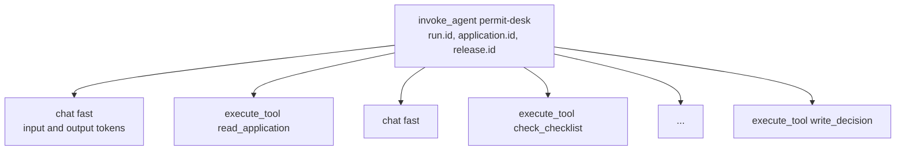
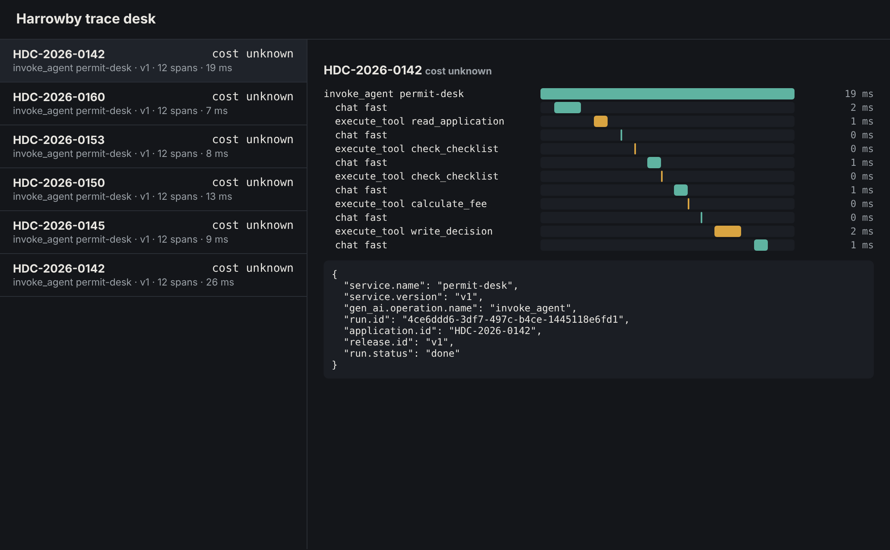

# Trace every run

## The problem

A resident says the desk asked for a fee they had already paid. You want to see that run: which tools
it called, how many model calls it made, and in what order. Today the desk keeps no record of a run.
When the stream ends, the run is gone.

The trace desk at http://localhost:7004 is waiting for spans, but your desk sends none. Open it and you
see "No traces yet."

For example, the finished desk sends a trace for every run. For HDC-2026-0142 it shows one root span,
`invoke_agent permit-desk`. Under it are six green `chat fast` spans and five amber `execute_tool`
spans, such as `execute_tool calculate_fee`.

## Your challenge

`src/telemetry.ts` is ready. It sets up OpenTelemetry and sends spans to the trace desk. It gives you
`tracer` and a helper, `inChildSpan(name, attributes, work)`. Now use them in `src/agent.ts`:

1. **One root span per run.** In `runAgent`, start a span called `invoke_agent permit-desk` with
   `tracer.startSpan`. Give it three attributes: `run.id`, `application.id` and `release.id`. End it
   when the run ends, also when the run fails.
2. **Make it the parent.** Run the loop inside
   `context.with(trace.setSpan(context.active(), runSpan), ...)`. Then every span that the loop starts
   becomes a child of the root span, in the same trace.
3. **One span per model call.** Wrap each `chat()` call in `inChildSpan(`chat ${release.role}`, ...)`.
   Put the token counts on it as `gen_ai.usage.input_tokens` and `gen_ai.usage.output_tokens`. The
   gateway sends them in `usage.prompt_tokens` and `usage.completion_tokens`, so read them in
   `src/model.ts`.
4. **One span per tool call.** Wrap each `runTool` call in `inChildSpan(`execute_tool ${name}`, ...)`.
5. **Keep residents out of spans.** Put names and counts on spans. Never put the messages, a tool's
   answer or the letter on a span. They hold the resident's name.



Rebuild your desk and run one application:

```bash
bun run up trace-every-run
bun run run-application HDC-2026-0142 --desk
```

Expect: `Run <run id> ended: done, cost $0.0141`, and a trace for HDC-2026-0142 at http://localhost:7004.



## Done when

- Each of 5 replayed runs has one root span with `run.id`, `application.id` and `release.id`.
- Every model call is a `chat` span in the run's trace, one for each call the gateway billed.
- The token counts on the `chat` spans add up to the gateway's spend log for the run.
- Every tool call is an `execute_tool` span in the run's trace.
- No span holds a resident's name, email or phone number.

```bash
bun run verify trace-every-run
```

Expect: `Done. All 5 rules pass.`

## If you get stuck

- Do the chat spans show up as separate traces, each with one span? Then they lost their parent.
  `tracer.startSpan` does not make a span active. Wrap the loop in `context.with(...)`.
- No traces at all? Spans leave in batches every half second. Wait a moment and reload the page.
- Read what reached the trace desk:

```bash
curl -s localhost:7004/api/spans | head -c 600
```

Expect: JSON spans with names such as `chat fast` and attributes such as `run.id`.

- Compare with `../solution/` when you are done.

## Words you will use

- **Trace**: the record of one run, made of spans that share one trace id.
- **Span**: one piece of work with a start, an end and attributes. One model call is one span.
- **Root span**: the span with no parent. Here it covers the whole run.
- **Attribute**: a name and a value on a span, such as `run.id` or `gen_ai.usage.input_tokens`.
- **Context**: the record of which span is active now, so a new span knows its parent.
- **OTLP**: the format OpenTelemetry uses to send spans to a trace desk or a collector.
