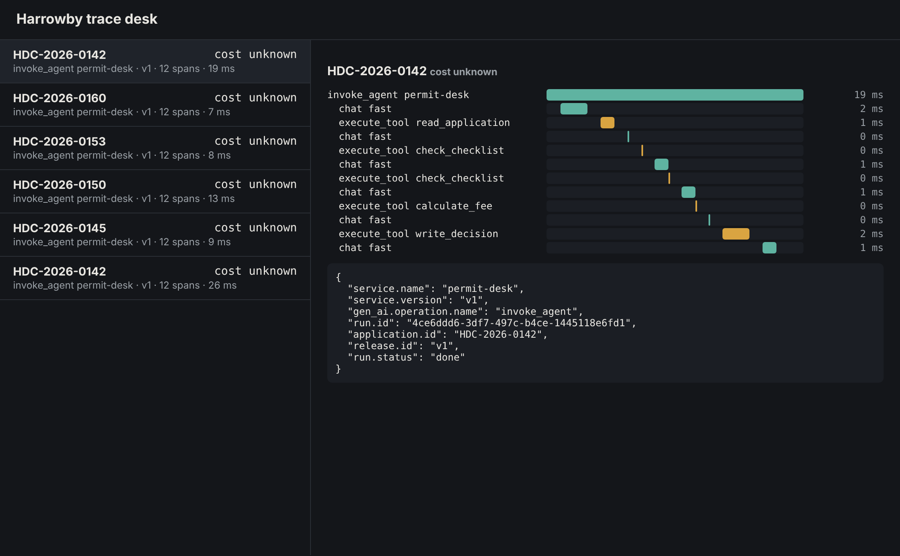

# Trace every run

## The problem

A resident says the desk asked for a fee they had already paid. You want to see that run: its tools and model calls, in order. Today the run is gone when the stream ends. The trace desk at http://localhost:7004 waits for spans, but your desk sends none.

## Watch it done

Before, the trace desk is empty. For example, the finished desk shows HDC-2026-0142 as one root span, `invoke_agent permit-desk`. Under it are six green `chat fast` spans and five amber `execute_tool` spans.



## Your turn

`src/telemetry.ts` gives you `tracer` and a helper, `inChildSpan(name, attributes, work)`. Use them in `src/agent.ts`.

1. **One root span per run.** In `runAgent`, start a span called `invoke_agent permit-desk` with `tracer.startSpan`. Give it three attributes: `run.id`, `application.id` and `release.id`. End it when the run ends, also on failure.
2. **Make it the parent.** Run the loop inside `context.with(trace.setSpan(context.active(), runSpan), ...)`. Every span the loop starts then becomes a child of the root span. You cannot `yield` inside that callback. So move the loop into its own generator. Call each `steps.next()` inside `context.with`.
3. **One span per model call.** Wrap each `chat()` call in ``inChildSpan(`chat ${release.role}`, ...)``. Put the token counts on it as `gen_ai.usage.input_tokens` and `gen_ai.usage.output_tokens`. The gateway sends them in `usage.prompt_tokens` and `usage.completion_tokens`, so read them in `src/model.ts`.
4. **One span per tool call.** Wrap each `runToolCall` in ``inChildSpan(`execute_tool ${name}`, ...)``.
5. **Keep residents out of spans.** Never put messages, a tool's answer or the letter on a span. They hold the resident's name.
6. Rebuild your desk, and run one application.

```bash
bun run up trace-every-run
bun run run-application HDC-2026-0142 --desk
```

Expect: `Run <run id> ended: done, cost $0.0141`, and a trace for HDC-2026-0142 at http://localhost:7004.

## Do it on your work

Take one program of your own. Give each run one root span with its id. Give each call one child span. Good looks like this: one run is one tree, and no span holds a name, email or phone number.

## Done when

- Each of 5 replayed runs has one root span with `run.id`, `application.id` and `release.id`.
- Every model call is a `chat` span, one for each call the gateway billed.
- The token counts on the `chat` spans match the gateway's spend log.
- Every tool call is an `execute_tool` span.
- No span holds a resident's name, email or phone number.

```bash
bun run verify trace-every-run
```

Expect: `Done. All 5 rules pass.`

## Solution

After: a root span with a child span for each model call and tool call. See `../solution/`. To compare, run `diff -r . ../solution/`.

## If you get stuck

- Chat spans in separate traces lost their parent. `tracer.startSpan` does not make a span active. So call `steps.next()` inside `context.with(...)`.
- See what reached the trace desk:

```bash
curl -s localhost:7004/api/spans | head -c 600
```

Expect: JSON spans with names such as `chat fast` and attributes such as `run.id`.

- Compare with `../solution/` when you finish.

## Words you will use

- **Trace**: the record of one run, made of spans.
- **Span**: one piece of work with a start, an end and attributes. One model call is one span.
- **Root span**: the span with no parent. Here it is the whole run.
- **Attribute**: a name and a value on a span, such as `run.id` or `gen_ai.usage.input_tokens`.
- **Context**: which span is active now. So a new span knows its parent.
- **OTLP**: how OpenTelemetry sends spans.
