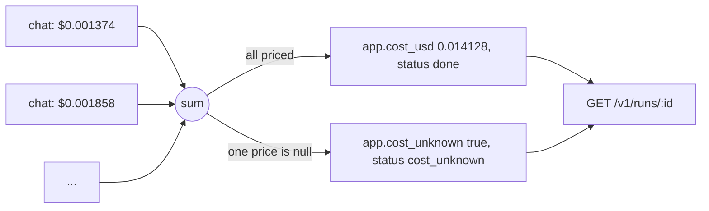
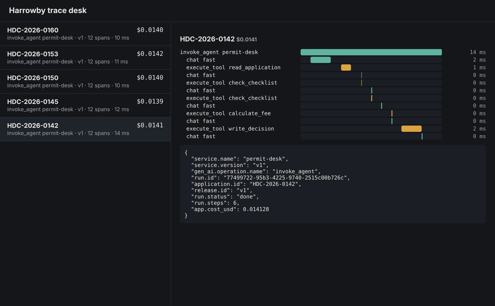

# Price each run

## The problem

The finance team asks: what does one validation cost the council? Your traces show every model call,
but the trace desk still says "cost unknown" next to each run.

The gateway knows the price. It puts `usage.cost_usd` on every answer and writes it to its spend log.
But the desk never puts the run's total on the root span, and it forgets each run when it ends.

There is a trap. Sometimes the gateway cannot price a call, for example when a model has no
price in its list. Then `cost_usd` is `null`. A desk that counts `null` as 0 reports a run as free.
That is a wrong number, and it looks like a good one.

For example, the finished desk prices HDC-2026-0142 at `0.014128` dollars over 6 model calls. The
gateway's spend log for that run has 6 lines that add up to the same number.

## Your challenge

1. **Keep each run.** Make `src/runs.ts` with a `Map` from `run_id` to a run:
   `{ run_id, application_id, status, steps, cost_usd }`. `steps` is the number of model calls.
2. **Add up the cost.** `src/agent.ts` already adds each call's `costUsd` to a total with `addCost`.
   Once one call has no price, the total is `null`, and it stays `null`. Keep that total, and the
   number of model calls, on the run in your `Map`.
3. **Put the cost on the root span.** When the run ends, set `app.cost_usd` on the root span, rounded
   to 6 decimal places. When the total is `null`, set `app.cost_unknown` to `true` instead, and end
   the run with the status `cost_unknown`. Never write `0` for an unknown cost.
4. **Answer `GET /v1/runs/:id`** in `src/server.ts` with the run, or 404 with
   `{"error": "no such run"}`.



Rebuild, run one application, and ask the desk about the run:

```bash
bun run up price-each-run
bun run run-application HDC-2026-0142 --desk
curl -s localhost:3000/v1/runs/<run id from the line above>
```

Expect: `{"run_id":"...","application_id":"HDC-2026-0142","status":"done","steps":6,"cost_usd":0.014128}`



## Done when

- The root span of each of 5 replayed runs carries `app.cost_usd`, and it matches the gateway's spend
  log. The five add up within 1 cent.
- Each `done` event says `status` done and the same `cost_usd`.
- `GET /v1/runs/:id` answers `run_id`, `status`, `steps` and `cost_usd`, and 404 for a run it never saw.
- A run the gateway cannot price ends as `cost_unknown`, with `cost_usd` null. This shows on the span,
  the `done` event and `GET /v1/runs/:id`.

```bash
bun run verify price-each-run
```

Expect: `Done. All 4 rules pass.`

## If you get stuck

- Compare with the gateway. Its spend log has one line per model call, with `run_id` and `cost_usd`:

```bash
curl -s -H "Authorization: Bearer $(cat secrets/gateway_admin_key)" localhost:7002/admin/spend
```

Expect: a JSON list of lines such as `{"key":"desk","role":"fast","run_id":"...","input_tokens":507,"cost_usd":0.001374}`.

- The check tests an unknown price for you, with a copy of your desk behind a gateway that sends
  `cost_usd: null`.
- Compare with `../solution/` when you are done.

## Words you will use

- **Spend log**: the gateway's record of every model call: which key, which run, how many tokens and
  what it cost.
- **Cost per run**: the sum of the prices of the run's model calls.
- **Unknown cost**: a run where at least one call has no price. Its total is `null`, not 0.
- **Rounding**: costs are fractions of a cent, so keep 6 decimal places.
