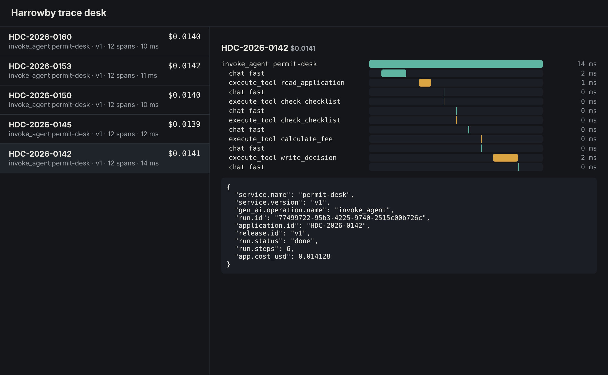

# Price each run

## The problem

The finance team asks what one validation costs. The gateway prices every call, but the desk never puts the run's total on the root span, and it forgets each run. There is a trap too. When a call has no price, the cost is `null`. A desk that counts it as 0 reports a free run.

## Watch it done

Before, the trace desk says "cost unknown" for each run. For example, the finished desk prices HDC-2026-0142 at `0.014128` dollars over 6 model calls, and the gateway's 6 spend lines add up to the same. Asking the desk about the run answers:

```json
{
  "run_id": "...",
  "application_id": "HDC-2026-0142",
  "status": "done",
  "steps": 6,
  "cost_usd": 0.014128
}
```



## Your turn

1. **Keep each run.** Make `src/runs.ts` with a `Map` from `run_id` to a run that holds `run_id`, `application_id`, `status`, `steps` and `cost_usd`. Here `steps` counts model calls.
2. **Add up the cost.** `addCost` in `src/agent.ts` already sums each call's `costUsd`, and the total stays `null` once one call has no price. Keep that total and the call count on the run.
3. **Put the cost on the root span.** When the run ends, set `app.cost_usd` on the root span, rounded to 6 decimal places. When the total is `null`, set `app.cost_unknown` to `true` instead, and end the run with the status `cost_unknown`. Never write `0` for an unknown cost.
4. **Answer `GET /v1/runs/:id`** in `src/server.ts` with the run, or 404 with an error body that says there is no such run.
5. Rebuild, run one application, and ask the desk about the run.

```bash
bun run up price-each-run
bun run run-application HDC-2026-0142 --desk
curl -s localhost:3000/v1/runs/<run id from the line above>
```

Expect: `{"run_id":"...","application_id":"HDC-2026-0142","status":"done","steps":6,"cost_usd":0.014128}`

## Do it on your work

Do the same for one program of your own that pays for calls. Add up the price of each call in a run, and store the total with the run id. Good looks like this: your total matches the provider's bill, and a call with no price makes the run say "unknown", not 0.

## Done when

- The root span of each of 5 replayed runs carries `app.cost_usd`, and it matches the gateway's spend log. The five add up within 1 cent.
- Each `done` event says `status` done and the same `cost_usd`.
- `GET /v1/runs/:id` answers `run_id`, `status`, `steps` and `cost_usd`, and 404 for a run it never saw.
- A run the gateway cannot price ends as `cost_unknown`, with `cost_usd` null. This shows on the span, the `done` event and `GET /v1/runs/:id`.

```bash
bun run verify price-each-run
```

Expect: `Done. All 4 rules pass.`

## Solution

After: each run kept in `src/runs.ts`, the cost on the root span, and the run route. See `../solution/` and compare with `diff -r . ../solution/`.

## If you get stuck

- Compare with the gateway. Its spend log has one line per model call, with `run_id` and `cost_usd`:

```bash
curl -s -H "Authorization: Bearer $(cat secrets/gateway_admin_key)" localhost:7002/admin/spend
```

Expect: a JSON list of lines such as `{"key":"desk","role":"fast","run_id":"...","input_tokens":507,"cost_usd":0.001374}`.

- Compare with `../solution/` when you are done.

## Words you will use

- **Spend log**: the gateway's record of every model call: key, run, tokens and cost.
- **Cost per run**: the sum of the prices of the run's model calls.
- **Unknown cost**: a run with an unpriced call. Its total is `null`, not 0.
- **Rounding**: keep 6 decimal places.
