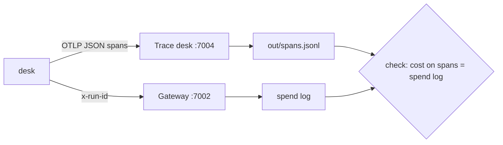

# Part 2: See every run

## The problem

A resident complains. The desk asked them for a fee that they had already paid. Which run was it? What did
the agent read? Which tools did it call? What did that run cost? Today the desk keeps no record, so nobody
can answer.

The finance team also asks a question: what does one validation cost the council? Nobody can answer that
either.

In this part you add two things:

- A trace is the record of one run. It is made of spans.
- A span is one piece of work, with a start and an end. For example, one model call is one span.

## Why it matters

Three bugs in Anthropic's systems once made Claude's answers worse. Because it had records, Anthropic could
measure the harm. About 30% of Claude Code users in that period had at least one message sent to the wrong
type of server. Read the details in
[Anthropic Engineering, "A postmortem of three recent issues"](https://www.anthropic.com/engineering/a-postmortem-of-three-recent-issues).
You can only give a number like that when you have a record of every request.

Cost needs the same record. Anthropic reports that agents usually use about 4 times more tokens than chat
([Anthropic Engineering, "How we built our multi-agent research system"](https://www.anthropic.com/engineering/built-multi-agent-research-system)).
A token is a small piece of text, often part of a word. Providers charge per token.

For example, the finished desk already does this. Run `bun run run-application HDC-2026-0142` and open the
trace desk at http://localhost:7004. The trace has one root span for the whole run. Under it are green
`chat fast` spans (model calls) and five amber `execute_tool` spans (tool calls). The root span carries
`app.cost_usd`, which is 0.0141 for this run.



## Steps

| Step              | Minutes | You make                                                                                                                     | The check reads                                                                                                                                                                        |
| ----------------- | ------- | ---------------------------------------------------------------------------------------------------------------------------- | -------------------------------------------------------------------------------------------------------------------------------------------------------------------------------------- |
| `trace-every-run` | 20      | OpenTelemetry tracing: a root span per run, a `chat <role>` span per model call, an `execute_tool <name>` span per tool call | `out/spans.jsonl` for 5 replayed applications: one root span each with `run.id`, `application.id`, `release.id`; token counts on every model span; no name, email or phone in any span |
| `price-each-run`  | 15      | `app.cost_usd` on the root span and `GET /v1/runs/:id` returning it                                                          | the sum of `app.cost_usd` over the replay against the gateway's spend log (within 1 cent); a run with no price is `cost_unknown`, never 0                                              |

## Walkthrough

Work in each step's `problem/` folder. Start the world first.

```bash
bun run world
```

Expect: `The world is running. Model provider: replay.`

Step 1: give every run a trace. Then rebuild, run one application and open http://localhost:7004.

```bash
bun run up trace-every-run
bun run run-application HDC-2026-0142 --desk
bun run verify trace-every-run
```

Expect: `Done. All 5 rules pass.` once each run has a root span, `chat` spans and `execute_tool` spans.

Step 2: put a price on every run, and keep each run so staff can ask about it later.

```bash
bun run up price-each-run
bun run verify price-each-run
```

Expect: `Done. All 4 rules pass.` once the cost on each root span matches the gateway's spend log.

Check the whole part:

```bash
bun run verify part see-every-run
```

Expect: `Part see-every-run is done: 2/2 steps pass.`

```
Part see-every-run:
  PASS   trace-every-run  (5/5 rules)
  PASS   price-each-run  (4/4 rules)
Part see-every-run is done: 2/2 steps pass.
```

## Assignment: price the worst application

Finance asks which kind of application costs the council most to check. Nobody can answer yet. Now
you can.

For example, HDC-2026-0142 is a `change_of_use` application, and its run costs $0.014128 in replay.

1. Reset the world with `bun run world reset`. Then send all 40 applications to your desk with
   `bun run run-application <id> --desk`, for example `bun run run-application HDC-2026-0140 --desk`.
2. Read the root spans from `out/spans.jsonl` (or `GET http://localhost:7004/api/spans`). Group the
   runs by application type. The type is in `world/data/applications/<id>.json`.
3. Write `out/cost-by-type.md`: a table with each type, its number of runs, its total cost and its
   average cost per run. Below it, name the one costliest run and its trace id.

Hand in `out/cost-by-type.md` on a branch of your fork. It is graded yes or no on each question:

- Do `bun run verify trace-every-run` and `bun run verify price-each-run` pass?
- Does the table's total match the gateway's spend log within 1 cent?
- Does the named trace id exist in `out/spans.jsonl`?
- Is a run with an unknown cost listed as unknown, not as $0?

Extension: show the cost per run of release `v1` and release `v2` side by side. Read
`release.id` on the root spans.

## Finished

You now have a desk that you can see into and put a price on:

- Every run is one trace, with a root span that names the run, the application and the release.
- Every model call and every tool call is a span, with token counts on the model calls.
- No span holds a resident's name, email or phone number.
- Every run has a cost that matches the gateway's spend log, or says plainly that it is unknown.
- `GET /v1/runs/:id` answers the status, the number of model calls and the cost of any run.

You can now see how much each run costs. You cannot yet stop a run that costs too much. In Part 3,
bound the runs, you add brakes: a step limit and a dollar limit per run, a limit per resident, and a
run journal so a run survives a restart.
