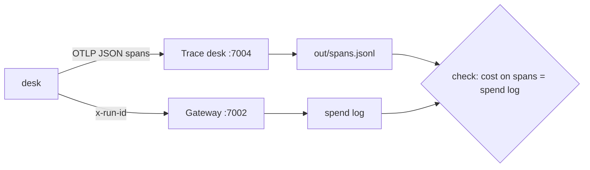

# Part 2: See every run

## After this part you can

- Turn one run into a trace, with a span for each model call and each tool call.
- Keep a resident's name, email and phone out of the record.
- Put a price on every run, and say "unknown" when a price is missing.

## You leave with

A desk that records every run as a trace and says what any run cost. You also leave with a short note on the costliest run of one of your own programs.

## The problem

A resident complains that the desk asked for a fee they had already paid. The finance team asks what one check costs the council. Nobody can answer either one, because the desk keeps no record of a run.

In this part you add two things:

- A trace is the record of one run. It is made of spans.
- A span is one piece of work with a start and an end, such as one model call.

You also put a price on each run.

For example, the finished desk already does this. Run `bun run run-application HDC-2026-0142` and open the trace desk at http://localhost:7004. The trace has one root span for the whole run. Under it are green `chat fast` spans (model calls) and five amber `execute_tool` spans (tool calls). The root span carries `app.cost_usd`, which is 0.0141 for this run.

Here is where the numbers come from:



Notice: Two records must agree. The desk's spans and the gateway's spend log give the same cost.

Records let a team put a number on a bug. In one Anthropic bug, about 30% of Claude Code users had a message sent to the wrong type of server. Anthropic could say that only because it had a record of every request ([Anthropic Engineering, "A postmortem of three recent issues"](https://www.anthropic.com/engineering/a-postmortem-of-three-recent-issues)).

Cost needs the same record. Agents use about 4 times more tokens than chat ([Anthropic Engineering, "How we built our multi-agent research system"](https://www.anthropic.com/engineering/built-multi-agent-research-system)). A token is a small piece of text, often part of a word. Providers charge for each token.

## Steps

| Step              | You make                                                   | You know it works when                                                                   |
| ----------------- | ---------------------------------------------------------- | ---------------------------------------------------------------------------------------- |
| `trace-every-run` | A root span for each run, with a span for each call        | 5 runs give 5 root spans. No name, email or phone is in any span                         |
| `price-each-run`  | A cost on the root span, and `GET /v1/runs/:id` returns it | The costs match the gateway's spend log within 1 cent. A missing price is unknown, not 0 |

## Walkthrough

Work in each step's `problem/` folder. Start the world first.

```bash
bun run world
```

Expect: `The world is running. Model provider: replay.`

Step 1: give every run a trace. Then rebuild, run one application and open http://localhost:7004.

```bash
bun run up trace-every-run
bun run run-application HDC-2026-0142 --desk
bun run verify trace-every-run
```

Expect: `Done. All 5 rules pass.` once each run has a root span, `chat` spans and `execute_tool` spans.

Step 2: put a price on every run, and keep each run so staff can ask about it later.

```bash
bun run up price-each-run
bun run verify price-each-run
```

Expect: `Done. All 4 rules pass.` once the cost on each root span matches the gateway's spend log.

Check the whole part:

```bash
bun run verify part see-every-run
```

Expect: `Part see-every-run is done: 2/2 steps pass.`

```
Part see-every-run:
  PASS   trace-every-run  (5/5 rules)
  PASS   price-each-run  (4/4 rules)
Part see-every-run is done: 2/2 steps pass.
```

## Watch and read

| Kind  | Title                                        | Made by                     | Why                                                       | Link                                                                        |
| ----- | -------------------------------------------- | --------------------------- | --------------------------------------------------------- | --------------------------------------------------------------------------- |
| video | OpenTelemetry explained for beginners        | The OpenTelemetry community | Shows traces and spans before you write them.             | <https://www.youtube.com/watch?v=r8UXuZ3GQhQ>                               |
| video | Distributed tracing in plain words           | Honeycomb                   | Shows how one run becomes a tree of spans.                | <https://www.youtube.com/watch?v=rIrNIzy6U_g>                               |
| read  | Traces                                       | OpenTelemetry project       | Defines trace, span and attribute in the words used here. | <https://opentelemetry.io/docs/concepts/signals/traces/>                    |
| read  | A postmortem of three recent issues          | Anthropic Engineering       | Shows how records let a team put a number on a bug.       | <https://www.anthropic.com/engineering/a-postmortem-of-three-recent-issues> |
| read  | How we built our multi-agent research system | Anthropic Engineering       | Shows why agents use far more tokens than chat.           | <https://www.anthropic.com/engineering/built-multi-agent-research-system>   |

## Project

Finance asks which kind of application costs the council most to check. Nobody could answer before. Now you can.

For example, HDC-2026-0142 is a `change_of_use` application, and its run costs $0.014128 in replay.

1. Reset the world with `bun run world reset`. Then send all 40 applications to your desk with `bun run run-application <id> --desk`, for example `bun run run-application HDC-2026-0140 --desk`.
2. Read the root spans from `out/spans.jsonl` (or `GET http://localhost:7004/api/spans`). Group the runs by application type. The type is in `world/data/applications/<id>.json`.
3. Write `out/cost-by-type.md`: a table with each type, its number of runs, its total cost and its average cost per run. Below it, name the one costliest run and its trace id.

Hand in `out/cost-by-type.md` on a branch of your fork. Each question is graded yes or no:

- Do `bun run verify trace-every-run` and `bun run verify price-each-run` pass?
- Does the table's total match the gateway's spend log within 1 cent?
- Does the named trace id exist in `out/spans.jsonl`?
- Is a run with an unknown cost listed as unknown, not as $0?

Extension: show the cost per run of the first release and the second release side by side. Read `release.id` on the root spans.

Then do the same on your own work. Pick one program that calls a model or another paid service. Record each run with an id, the number of calls and the cost, in a file. Find the costliest run.

Write two lines in `run-notes.md`: the run id and why it cost the most. If a price is missing, write "unknown", not 0.

## What comes next

You can now see what each run costs. You cannot yet stop a run that costs too much. In Part 3 you add brakes. Each run gets a step limit and a dollar limit, and so does each resident. A run journal lets a run survive a restart.
