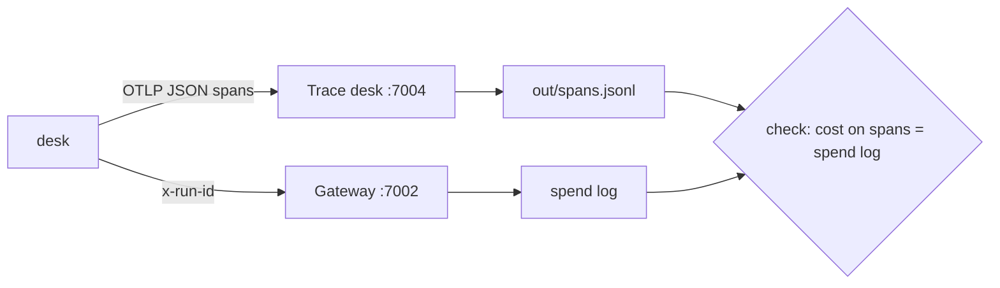

# Part 2: See every run

## The problem

A resident complains that the desk asked them for a fee they had paid. Which run was it? What did the agent
read, which tools did it call, and what did that run cost? Today the desk keeps no record. The finance team
also asks what one validation costs the council, and nobody can answer.

## Why it matters

When three infrastructure bugs lowered the quality of Claude's answers, Anthropic could say that about 30% of Claude
Code users who made requests in that period had at least one message routed to the wrong server type
([Anthropic Engineering, "A postmortem of three recent issues"](https://www.anthropic.com/engineering/a-postmortem-of-three-recent-issues)).
You can only say a number like that with a record of every request. Cost needs the same record: Anthropic
reports that agents typically use about 4 times more tokens than chat interactions
([Anthropic Engineering, "How we built our multi-agent research system"](https://www.anthropic.com/engineering/built-multi-agent-research-system)).



## Steps

| Step | Minutes | You make | The check reads |
|---|---|---|---|
| `trace-every-run` | 20 | OpenTelemetry tracing: a root span per run, a `chat <role>` span per model call, an `execute_tool <name>` span per tool call | `out/spans.jsonl` for 5 replayed applications: one root span each with `run.id`, `application.id`, `release.id`; token counts on every model span; no email or phone in any span |
| `price-each-run` | 15 | `app.cost_usd` on the root span and `GET /v1/runs/:id` returning it | the sum of `app.cost_usd` over the replay against the gateway's spend log (within 1 cent); a run with no price is `cost_unknown`, never 0 |

## Walkthrough

TODO(part session): the commands for each step, each with its Expect line.

```bash
bun run verify part see-every-run
```

Expect: `Part see-every-run is done: 2/2 steps pass.`
