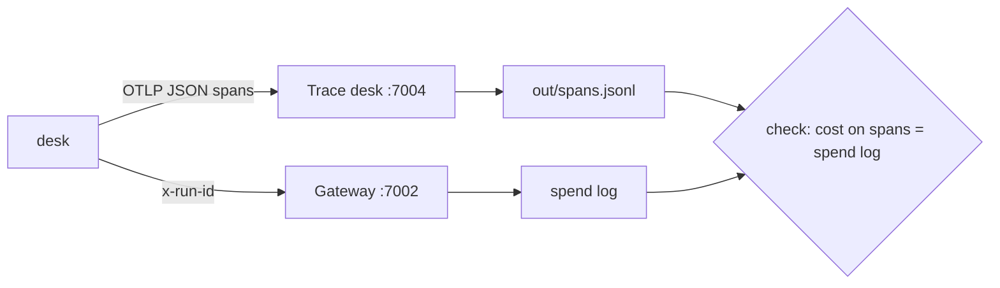

# Part 2: See every run

## The problem

A resident complains. The desk asked them for a fee that they had already paid. Which run was it? What did
the agent read? Which tools did it call? What did that run cost? Today the desk keeps no record, so nobody
can answer.

The finance team also asks a question: what does one validation cost the council? Nobody can answer that
either.

In this part you add two things:

- A trace is the record of one run. It is made of spans.
- A span is one piece of work, with a start and an end. For example, one model call is one span.

## Why it matters

Three bugs in Anthropic's systems once made Claude's answers worse. Because it had records, Anthropic could
measure the harm. About 30% of Claude Code users in that period had at least one message sent to the wrong
type of server. Read the details in
[Anthropic Engineering, "A postmortem of three recent issues"](https://www.anthropic.com/engineering/a-postmortem-of-three-recent-issues).
You can only give a number like that when you have a record of every request.

Cost needs the same record. Anthropic reports that agents usually use about 4 times more tokens than chat
([Anthropic Engineering, "How we built our multi-agent research system"](https://www.anthropic.com/engineering/built-multi-agent-research-system)).
A token is a small piece of text, often part of a word. Providers charge per token.

For example, the finished desk already does this. Run `bun run run-application HDC-2026-0142` and open the
trace desk at http://localhost:7004. The trace has one root span for the whole run. Under it are green
`chat fast` spans (model calls) and five amber `execute_tool` spans (tool calls). The root span carries
`app.cost_usd`, which is 0.0141 for this run.



## Steps

| Step              | Minutes | You make                                                                                                                     | The check reads                                                                                                                                                                  |
| ----------------- | ------- | ---------------------------------------------------------------------------------------------------------------------------- | -------------------------------------------------------------------------------------------------------------------------------------------------------------------------------- |
| `trace-every-run` | 20      | OpenTelemetry tracing: a root span per run, a `chat <role>` span per model call, an `execute_tool <name>` span per tool call | `out/spans.jsonl` for 5 replayed applications: one root span each with `run.id`, `application.id`, `release.id`; token counts on every model span; no email or phone in any span |
| `price-each-run`  | 15      | `app.cost_usd` on the root span and `GET /v1/runs/:id` returning it                                                          | the sum of `app.cost_usd` over the replay against the gateway's spend log (within 1 cent); a run with no price is `cost_unknown`, never 0                                        |

## Walkthrough

TODO(part session): the commands for each step, each with its Expect line.

```bash
bun run verify part see-every-run
```

Expect: `Part see-every-run is done: 2/2 steps pass.`
