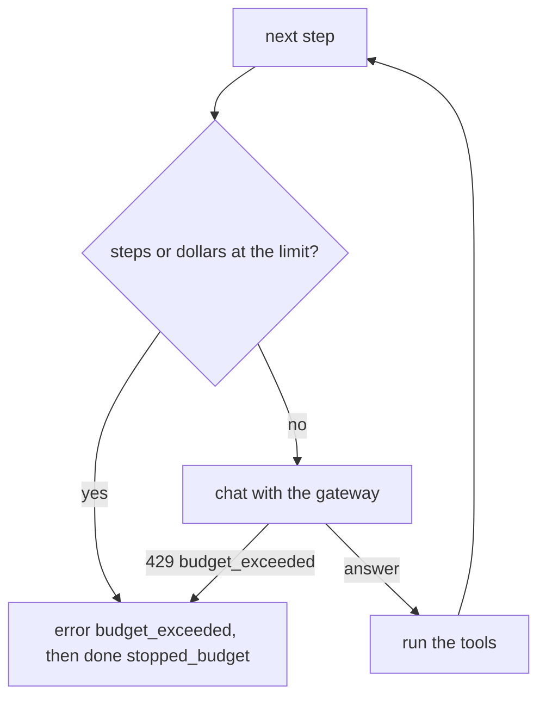
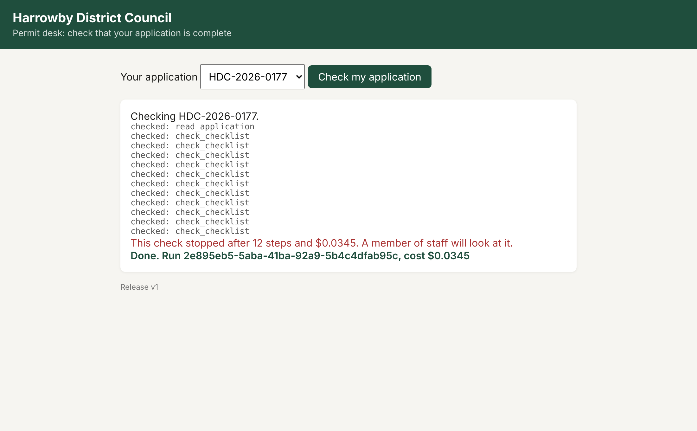

# Cap the spend

## The problem

Application HDC-2026-0177 has an attachment list that never ends. Every checklist page says
`"more": true`, so the agent asks for the next page, and the next. Each page costs one paid model call.

Your desk has no brake. It stops only when the gateway refuses the desk's key, after the key's whole
budget of $2 is gone. Then the resident sees a `model_error` and the run is marked `failed`.

An alert tells you about spending after it happened. A limit refuses the next call before it happens.

For example, `release.json` already holds two limits: `"max_steps": 12` and `"max_cost_usd": 0.05`.
Nothing in `src/agent.ts` reads them yet.

## Your challenge

Add two brakes in `src/agent.ts`, and make the third one clean.

1. **Step limit.** Before each model call, compare `run.steps` with `release.max_steps`.
2. **Dollar limit.** Before each model call, compare `run.cost_usd` with `release.max_cost_usd`.
   Steps are not money. Late steps cost more than early ones, because the conversation grows.
3. When a limit is reached, send the resident an `error` event with the code `budget_exceeded` and a
   plain sentence. Then end the run with the status `stopped_budget`.
4. **The gateway's budget.** When `chat()` throws a `GatewayError` whose `type` is
   `budget_exceeded`, do the same. Do not retry it: the budget will not refill in a few seconds. Any
   other gateway error still ends the run as `failed`.



Rebuild, then send the runaway application:

```bash
bun run up cap-the-spend
bun run chaos runaway --desk
```

Expect: `The run ended: stopped_budget after 12 model calls, $0.0345` and
`The resident saw: This check stopped after 12 steps and $0.0345.`



## Done when

- The runaway application HDC-2026-0177 ends as `stopped_budget`, in under 25 model calls and under
  $0.10.
- The resident sees an `error` event with the code `budget_exceeded` before `done`, and
  `GET /v1/runs/:id` says `stopped_budget`.
- The dollar limit stops a run by itself. The check runs a copy of your desk with 100 steps and
  $0.01, and the run must stop near $0.01.
- When the gateway refuses the desk's key, the run ends as `stopped_budget` within 10 seconds.
- A normal application still finishes as `done`.

```bash
bun run verify cap-the-spend
```

Expect: `Done. All 5 rules pass.`

## If you get stuck

- Check the limits at the top of the loop, before `askModelInSpan`. A check after the call is one
  call too late.
- You do not need to spend $2 to test the gateway's brake. The check sets the desk key's budget to
  $0 for one run, then puts it back to $2.
- Watch a runaway run on the resident's page: pick HDC-2026-0177 at http://localhost:3000.
- Compare with `../solution/` when you are done.

## Words you will use

- **Brake**: a limit that stops a run, such as a step limit or a dollar limit.
- **Step**: one model call. Tool calls are not steps.
- **Runaway run**: a run that never reaches an answer and keeps calling the model.
- **Budget**: the most money a gateway key may spend. The gateway answers 429 `budget_exceeded` after
  that.
- **stopped_budget**: the status of a run that a brake stopped. Nobody waits forever.
