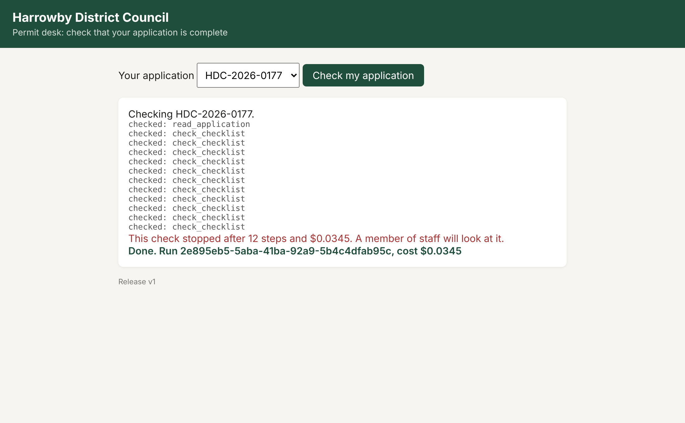

# Cap the spend

## The problem

Application HDC-2026-0177 has an attachment list that never ends. Every page says `"more": true`. So the agent asks for the next page, and the next. Each page is one paid model call.

Your desk stops only when the key's whole budget of $2 is gone. An alert tells you after the money is spent. A limit refuses the call before.

## Watch it done

Before, the runaway run burns the whole $2 key budget. The resident sees a `model_error`, and the run is marked `failed`. The file `release.json` holds two limits, `"max_steps": 12` and `"max_cost_usd": 0.05`. Nothing in `src/agent.ts` reads them.

After, the same run stops by itself. For example, the resident sees "This check stopped after 12 steps and $0.0345."



## Your turn

Work in `src/agent.ts`. Add two brakes, and make the third one clean. A brake is a limit that stops a run.

1. Before each model call, compare `run.steps` with `release.max_steps`. A step is one model call.
2. Before each model call, compare `run.cost_usd` with `release.max_cost_usd`. Steps are not money, because late steps cost more.
3. At a limit, send the resident an `error` event with the code `budget_exceeded` and a plain sentence. End the run as `stopped_budget`.
4. When `chat()` throws a `GatewayError` whose `type` is `budget_exceeded`, do the same, and do not retry. Any other gateway error still ends the run as `failed`.
5. Rebuild, then send the runaway application.

```bash
bun run up cap-the-spend
bun run chaos runaway --desk
```

Expect: `The run ended: stopped_budget after 12 model calls, $0.0345`

6. Run the check.

```bash
bun run verify cap-the-spend
```

Expect: `Done. All 5 rules pass.`

## Do it on your work

Open the loop in your own agent that calls a model. Count the calls and the cost. Stop at a limit you pick. Good looks like a runaway run that ends with a clear stop status and a plain sentence, for less than your limit. For example, a limit of 12 calls.

## Done when

- HDC-2026-0177 ends as `stopped_budget`, in under 25 model calls and under $0.10.
- The resident sees an `error` event with the code `budget_exceeded` before `done`. `GET /v1/runs/:id` says `stopped_budget`.
- The dollar limit works alone: a copy of your desk with 100 steps and $0.01 stops near $0.01.
- When the gateway refuses the desk's key, the run ends as `stopped_budget` within 10 seconds.
- A normal application still finishes as `done`.

## Solution

The after state checks both limits at the top of the loop. It turns the gateway's refusal into the same clean stop. The files are in `../solution/`. See the diff from the `problem/` folder:

```bash
diff -ru . ../solution -x node_modules -x images -x README.md
```

Expect: the lines that changed.

## If you get stuck

- Check the limits at the top of the loop, before `askModelInSpan`. A check after the call is one call too late.
- Watch a runaway run at http://localhost:3000. Pick HDC-2026-0177.

## Words you will use

- **Brake**: a limit that stops a run, such as a step limit or a dollar limit.
- **Step**: one model call. Tool calls are not steps.
- **Runaway run**: a run that never reaches an answer and keeps calling the model.
- **Budget**: the most money a gateway key may spend. After that the gateway answers 429 `budget_exceeded`.
- **stopped_budget**: the status of a run that a brake stopped. Nobody waits forever.
