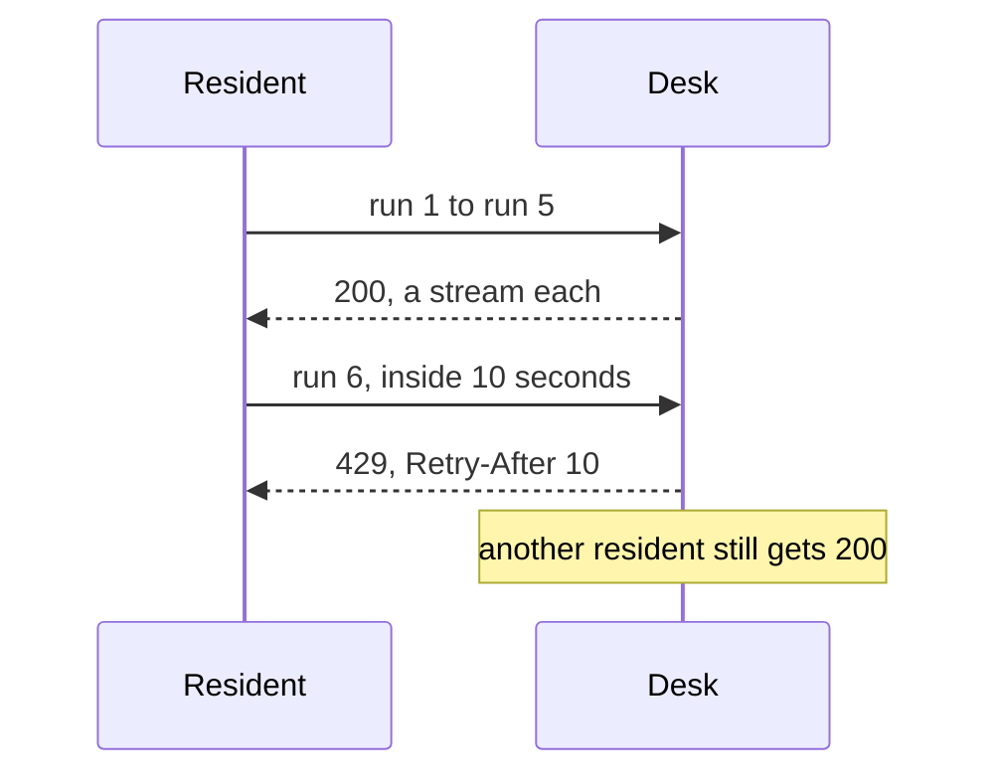

# Rate limit residents

## The problem

A resident waits for their check and reloads the page. Then they reload it again, twenty times. Each
reload starts a new run, and each run pays for model calls. Twenty reloads cost twenty runs.

The step limit and the dollar limit cap one run. Nothing caps how many runs one resident starts.

For example, today six quick requests from the same resident all start a run:
`200 200 200 200 200 200`.

## Your challenge

Add a limit per resident in `src/server.ts`, before the stream opens:

1. **Who is the resident?** Use the `x-resident-id` header. When there is none, use the first address in
   `x-forwarded-for`. That header can hold a list, such as `203.0.113.7, 10.0.0.1`.
2. **Count their runs.** Keep the start times of each resident's runs in a `Map`. Allow 5 runs in each
   window of 10 seconds.
3. **Refuse the sixth.** Answer 429 with a `Retry-After` header: the whole number of seconds until the
   oldest run leaves the window. The body is
   `{"error": {"code": "rate_limited", "message": "Too many checks. Try again in 10 seconds."}}`.
4. Refuse before the run starts, so a refused request costs nothing.



Try it after you rebuild:

```bash
bun run up rate-limit-residents
for i in 1 2 3 4 5 6; do curl -s -o /dev/null -w "%{http_code} " -X POST localhost:3000/v1/runs -H 'content-type: application/json' -H 'x-resident-id: ines' -d '{"application_id":"HDC-2026-0142"}'; done
```

Expect: `200 200 200 200 200 429`

## Done when

- 6 runs from one resident inside 10 seconds: 5 start, the 6th gets 429.
- The 429 has a `Retry-After` header in whole seconds and the error code `rate_limited`.
- Another resident in the same 10 seconds still gets 200.
- A resident with no `x-resident-id` is known by the first address in `x-forwarded-for`.

```bash
bun run verify rate-limit-residents
```

Expect: `Done. All 4 rules pass.`

## If you get stuck

- One list for the whole desk is a common mistake. Then one busy resident blocks everyone.
- Forget start times older than the window each time you count, so the list stays short.
- Compare with `../solution/` when you are done.

## Words you will use

- **Rate limit**: the most requests one caller may make in a window of time.
- **Window**: the stretch of time you count over, here the last 10 seconds.
- **429 Too Many Requests**: the answer to a caller who went over the limit.
- **Retry-After**: a header that tells the caller how many seconds to wait.
