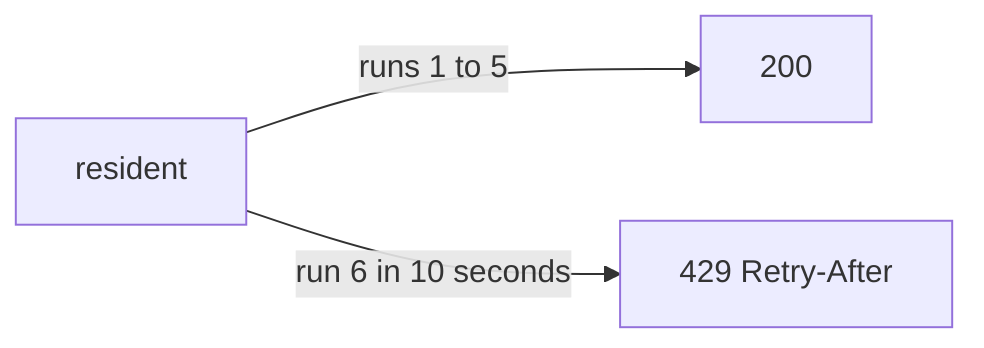

# Rate limit residents

## The problem

A resident waits for their check and reloads the page. Then they reload it again, twenty times. Each reload starts a new run, and each run pays for model calls. The step limit and the dollar limit cap one run, but nothing caps how many runs one resident starts. Today six quick requests all start a run.

## Watch it done

Before, six quick requests from one resident all get through:

```text
200 200 200 200 200 200
```

After, the sixth is refused:

```text
200 200 200 200 200 429
```



## Your turn

Work in `src/server.ts`, before the stream opens.

1. Find out who the resident is. Use the `x-resident-id` header. When there is none, use the first address in `x-forwarded-for`. That header can hold a list, such as `203.0.113.7, 10.0.0.1`.
2. Count their runs. Keep the start times of each resident's runs in a `Map`. Allow 5 runs in each window of 10 seconds.
3. Refuse the sixth. Answer 429 with a `Retry-After` header: the whole number of seconds until the oldest run leaves the window. The body is `{"error": {"code": "rate_limited", "message": "Too many checks. Try again in 10 seconds."}}`.
4. Refuse before the run starts, so a refused request costs nothing.
5. Rebuild, then send six requests.

```bash
bun run up rate-limit-residents
for i in 1 2 3 4 5 6; do curl -s -o /dev/null -w "%{http_code} " -X POST localhost:3000/v1/runs -H 'content-type: application/json' -H 'x-resident-id: ines' -d '{"application_id":"HDC-2026-0142"}'; done
```

Expect: five 200 answers, then one 429.

6. Run the check.

```bash
bun run verify rate-limit-residents
```

Expect: `Done. All 4 rules pass.`

## Do it on your work

Find where your own project starts an expensive job for a caller. Count jobs per caller in a window, and refuse the extra ones before money is spent. Good looks like a clear refusal with a wait time, while a different caller is still served. For example, 5 jobs in 10 seconds.

## Done when

- 6 runs from one resident inside 10 seconds: 5 start, the 6th gets 429.
- The 429 has a `Retry-After` header in whole seconds and the error code `rate_limited`.
- Another resident in the same 10 seconds still gets 200.
- A resident with no `x-resident-id` is known by the first address in `x-forwarded-for`.

## Solution

The after state counts runs per resident and answers 429 before a run starts. The files are in `../solution/`. See the diff from the `problem/` folder:

```bash
diff -ru . ../solution -x node_modules -x README.md
```

Expect: the lines that changed.

## If you get stuck

- One list for the whole desk is a common mistake. Then one busy resident blocks everyone.
- Forget start times older than the window each time you count.
- The `Map` lives inside one container, so a restart empties it. That is fine here. Many copies of the desk would share one store, such as Redis.

## Words you will use

- **Rate limit**: the most requests one caller may make in a window of time.
- **Window**: the stretch of time you count over, here the last 10 seconds.
- **429 Too Many Requests**: the answer to a caller who went over the limit.
- **Retry-After**: a header that tells the caller how many seconds to wait.
