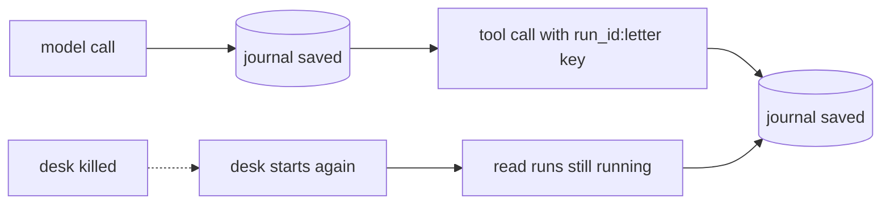

# Survive a restart

## The problem

Containers stop. A deploy replaces them, a machine reboots, or the kernel kills one for memory. If the
desk stops in the middle of a run, two bad things can happen:

- The run is lost. The resident never gets a letter, and `GET /v1/runs/:id` answers 404.
- A careless retry starts the run again. It pays for every model call twice, and it may send a
  second letter.

For example, `bun run chaos kill --desk` sends HDC-2026-0142. The register holds the letter call open,
and the desk is killed while it waits. Today, after the restart, nothing finishes the run.

## Your challenge

1. **Keep a run journal.** Save each run to SQLite (`bun:sqlite`) in `/data/runs.db`: its status,
   steps, cost and the whole conversation (`messages`). Save after every model call and after every
   tool result.
2. **Give the journal a home.** In `compose.yaml`, mount a volume at `/data`. In the `Dockerfile`, make
   `/data` and give it to the `bun` user before `USER bun`.
3. **Resume, do not restart.** When the desk starts, find every run whose status is still `running` and
   go on from its last saved message:
   - The last message asks for tools that have no answer yet: run those tools.
   - The last message is the model's answer: finish the run.
   - Otherwise: ask the model for the next step.
4. **Keep the same keys.** `src/tools.ts` sends `idempotency-key: <run_id>:decision` and
   `<run_id>:letter`. A resumed run keeps its `run_id`, so the register sees the same keys and does
   not write twice.



Rebuild, then kill the desk in the middle of a run:

```bash
bun run up survive-a-restart
bun run chaos kill --desk
```

Expect: `Register: 1 decision(s) and 1 letter(s) for HDC-2026-0142. The goal is exactly 1 and 1.`

The starter prints this line too, because the register finishes the letter that was on its way. The
starter never finishes the run, so trust the check below.

## Done when

- After `bun run chaos kill --desk`, the killed run finishes: `GET /v1/runs/:id` says `done`.
- The register holds exactly one decision and one letter for HDC-2026-0142 after the kill.
- No finished model step was asked again. The killed run billed as many model calls as a clean run of
  the same application.

```bash
bun run verify survive-a-restart
```

Expect: `Done. All 3 rules pass.`

## If you get stuck

- Did the restarted run call the model 11 times instead of 6? It started from the first message
  again. Resume from the saved messages.
- Read what the desk did when it started again:

```bash
docker compose -p hdc-desk logs desk | grep resuming
```

Expect: a line such as `resuming run 3f2a... for HDC-2026-0142 at step 5`.

- `GET /v1/runs/:id` must not show `messages`. They hold the resident's name and the letter.
- Compare with `../solution/` when you are done.

## Words you will use

- **Run journal**: a saved record of each run, written after every step.
- **Resume**: go on from the last saved step, without doing finished steps again.
- **Idempotency key**: a name for one action. The register does the action once for each key, however
  often it is asked.
- **Volume**: storage that Docker keeps outside the container, so it outlives the container.
