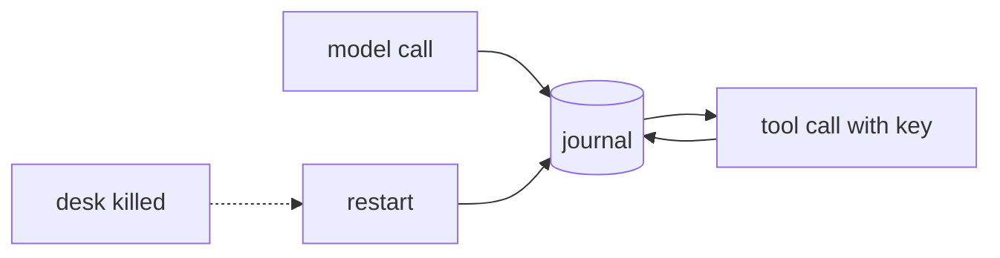

# Survive a restart

## The problem

A container can stop at any time. A run cut off in the middle is lost, or a careless retry pays for every call twice. For example, `bun run chaos kill --desk` kills the desk while HDC-2026-0142 waits on its letter. After the restart, nothing finishes the run.

## Watch it done

Before, the run is lost, and `GET /v1/runs/:id` answers 404. The starter still prints the register line, so trust the check.

After, the run says `done`, and the log shows the desk going on from its saved step:

```text
resuming run 3f2a... for HDC-2026-0142 at step 5
```

## Your turn

1. Keep a run journal. Save each run to SQLite (`bun:sqlite`) in `/data/runs.db`: status, steps, cost and the whole conversation (`messages`). Save after every model call and tool result.
2. Give the journal a home. In `compose.yaml`, mount a volume at `/data`. In the `Dockerfile`, make `/data` and give it to the `bun` user before `USER bun`.
3. Resume, do not restart. At start-up, find every run still `running` and go on from its last saved message. If tools have no answer yet, run them. If the last message is the model's answer, finish the run. Otherwise, ask the model for the next step.
4. Keep the same keys. `src/tools.ts` sends `idempotency-key: <run_id>:decision` and `<run_id>:letter`. A resumed run keeps its `run_id`, so the register writes once.



5. Rebuild, then kill the desk in the middle of a run.

```bash
bun run up survive-a-restart
bun run chaos kill --desk
```

Expect: `Register: 1 decision(s) and 1 letter(s) for HDC-2026-0142. The goal is exactly 1 and 1.`

6. Run the check.

```bash
bun run verify survive-a-restart
```

Expect: `Done. All 3 rules pass.`

## Do it on your work

Pick a long job in your project that a restart would cut in half. Save progress after each step, and give each outside action a key. Good looks like a job you kill midway, start again, and it ends with one result and no repeated paid call.

## Done when

- After `bun run chaos kill --desk`, the killed run finishes: `GET /v1/runs/:id` says `done`.
- The register holds exactly one decision and one letter for HDC-2026-0142 after the kill.
- No finished model step was asked again: the killed run billed as many calls as a clean run.

## Solution

The after state has a journal, a volume and a start-up resume. The files are in `../solution/`. See the diff from the `problem/` folder:

```bash
diff -ru . ../solution -x node_modules -x README.md
```

Expect: the lines that changed.

## If you get stuck

- Did the restarted run call the model 11 times, not 6? Resume from the saved messages.
- Read what the desk did when it started again:

```bash
docker compose -p hdc-desk logs desk | grep resuming
```

Expect: a line such as `resuming run 3f2a... for HDC-2026-0142 at step 5`.

- `GET /v1/runs/:id` must not show `messages`. They hold the resident's name.

## Words you will use

- **Run journal**: a saved record of each run, written after every step.
- **Resume**: go on from the last saved step, without doing finished steps again.
- **Idempotency key**: a name for one action. The register does the action once for each key, however often it is asked.
- **Volume**: storage that Docker keeps outside the container, so it outlives the container.
