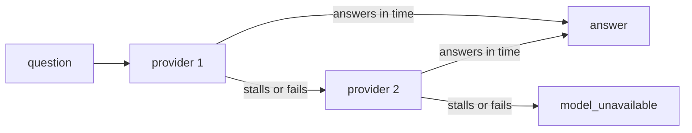

# Fall back when a provider stalls

## The problem

A model provider can go quiet. The call does not fail. It never answers.

For example, one provider stalls for 4 seconds on every call. The desk waits, the resident watches a blank page, and the run holds its slot. A second provider is ready, but nothing asks it.

## Watch it done

Before, the check waits the full 4 seconds for the stalled provider and then fails. After, the check passes without Docker, because it starts three small fake providers on your machine:

```text
Done. All 4 rules pass.
```



## Your turn

Work in `src/ask.ts`. It has one function, `askWithFallback`. It gets a list of providers, a question and a time limit in milliseconds.

1. Set a timeout. Give `fetch` a `signal` made with `AbortSignal.timeout(timeoutMs)`. A call that takes longer is cut off and throws.
2. Treat a bad answer like a stall. If the provider answers with an error code, throw too.
3. Try the next provider. Ask the providers one at a time, in order. Keep a short reason for each one that failed.
4. Give up clearly. When every provider has failed, throw an error whose message starts with `model_unavailable`, and list the reasons.
5. Run the check.

```bash
bun run verify fall-back-when-a-provider-stalls
```

Expect: `Done. All 4 rules pass.`

## Do it on your work

Open the file where your own agent calls a model. Find the `fetch` call. Does it have a time limit? Add one, and name your second provider.

Good looks like this. You point the first provider at a server that never answers. Your agent gives up soon and uses the second one.

## Done when

- A provider that stalls is given up on after the timeout, and the next one answers.
- A provider that answers with an error code is skipped.
- When no provider answers, the error starts with `model_unavailable` and comes soon.
- A healthy first provider answers alone, and the spare is never asked.

## Solution

The after state is one function that asks each provider in turn with a timeout and collects the reasons. See `../solution/` for the file. To see the diff, run this in the `problem/` folder:

```bash
diff -u src/ask.ts ../solution/src/ask.ts
```

Expect: the lines that changed.

## If you get stuck

- Did the check wait for 4 seconds and then fail? The timeout is missing from `fetch`.
- Did the spare provider get a call it should not have? You asked all providers at once. Ask one at a time. Every extra call is paid for.

## Words you will use

- **Timeout**: a time limit. When it ends, the call is cut off.
- **Fallback**: a second choice that is used when the first one fails.
- **Stall**: the call neither answers nor fails. It just waits.
