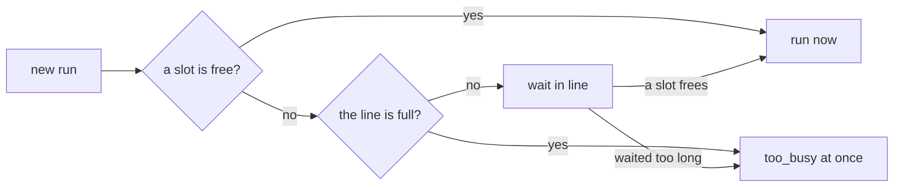

# Hold the latency goal

## The problem

A rush of residents starts forty runs in the same moment. Each run calls the model, so the model gives
errors and every run gets slow. A slow answer that comes late is as bad as no answer.

A latency goal is a promise about waiting. For example: a run starts within 5 seconds, or the resident is told
at once to try again.

## Your challenge

Work in `src/queue.ts`. It makes a queue with three limits: `maxRunning`, `maxWaiting` and `maxWaitMs`.

1. **Limit the runs going at once.** Count the runs now going. A new run starts only below `maxRunning`.
2. **Keep a line.** Other runs wait in order, first in, first out. When a run ends, the first one in line starts.
3. **Refuse a full line.** When the waiting line holds `maxWaiting` runs, throw `TooBusy` at once.
4. **Refuse a long wait.** When a run has waited `maxWaitMs`, take it out of the line, never start it, and
   throw `TooBusy`.
5. **Always free the slot.** Use `finally`, so a run that throws still gives its slot back.



```bash
bun run verify hold-the-latency-goal
```

Expect: `Done. All 6 rules pass.`

You do not need Docker for this step.

## Done when

- No more than `maxRunning` runs go at the same time, and all of them finish.
- Waiting runs start in the order they came.
- A full line refuses the next run at once.
- A run that waits too long is refused and never starts.
- A refusal gives `retryAfterSeconds`, a whole number of at least 1.
- A run that throws frees its slot.

## If you get stuck

- Do all the runs go at once? Nothing counts the running ones yet.
- Does the queue stop working after an error? The slot was not freed. Put the free step in `finally`.
- In the desk, answer a `TooBusy` with status 429 and a `Retry-After` header, like the resident limit.
- Compare with `../solution/` when you are done.

Do it on your work: write the latency goal for your own agent in one sentence. How long may a person wait
before the first word of an answer?

## Words you will use

- **Latency goal**: a promise about how long a person waits.
- **Queue**: a line of runs that wait for a free slot.
- **Slot**: room for one run to go at a time.
