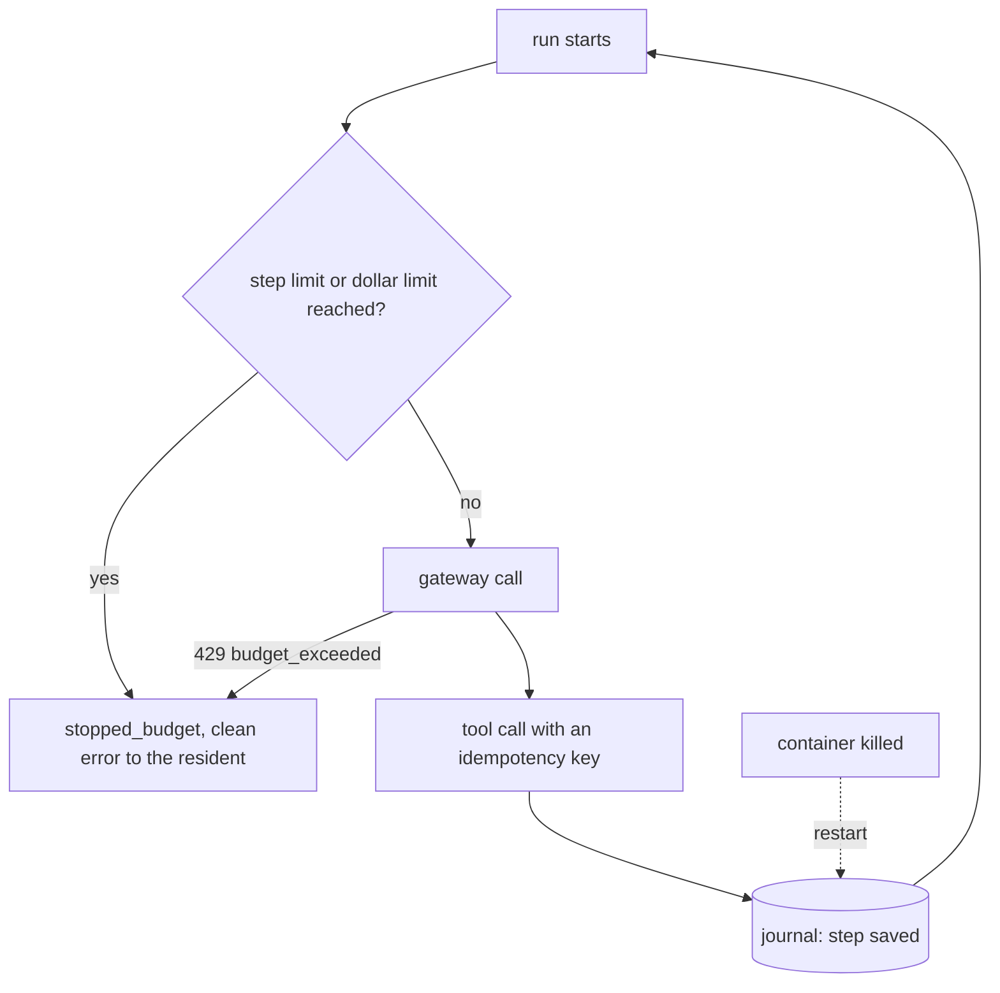

# Part 3: Bound the runs

## The problem

Application HDC-2026-0177 has a list of attachments that "continues on the next page", forever. The desk
keeps reading pages, and every page costs a paid model call.

There are two more problems:

- A resident who reloads the page twenty times starts twenty runs.
- Sometimes the desk's container is killed after it writes a decision but before it sends the letter. Then a
  retry can send the resident two letters, or none.

In this part you add brakes. A brake is a limit that stops a run, such as a limit on steps or on dollars. You
also add a run journal. A run journal saves each finished step, so a restarted run goes on from where it
stopped.

## Why it matters

Anthropic reports that agents use about 4 times more tokens than chat. Systems with many agents use about 15
times more. When an error happens, Anthropic does not restart a long run from the beginning. A restart costs a
lot, and it annoys users. So Anthropic built systems that resume from where the agent was
([Anthropic Engineering, "How we built our multi-agent research system"](https://www.anthropic.com/engineering/built-multi-agent-research-system)).

An alert tells you about spending after it happened. A limit refuses the next call before it happens.

For example, the finished desk has a step limit of 12 in its `release.json` (`"max_steps": 12`). Run
`bun run chaos runaway` against it, and it prints
`The run ended: stopped_budget after 12 model calls, $0.0345`. The resident sees a short message that begins
"This check stopped after". The status `stopped_budget` means a limit stopped the run. Nobody waits
forever.



## Steps

| Step                   | Minutes | You make                                                                        | The check reads                                                                                                                                                                       |
| ---------------------- | ------- | ------------------------------------------------------------------------------- | ------------------------------------------------------------------------------------------------------------------------------------------------------------------------------------- |
| `cap-the-spend`        | 20      | a step limit and a dollar limit per run, and a budget on the desk's gateway key | `bun run chaos runaway`: the run ends `stopped_budget` in under 25 steps and under $0.10 (spend log); a budget refusal from the gateway reaches the resident as `event: error`        |
| `rate-limit-residents` | 10      | a limit per resident (header `x-resident-id`, else address)                     | 6 requests from one resident inside the window get one 429 with `Retry-After`; another resident still gets 200                                                                        |
| `survive-a-restart`    | 20      | a run journal and idempotency keys on the register writes                       | `bun run chaos kill --desk`: after the restart the run finishes, the register holds one decision and one letter, and no completed model step is called again (spend log rows per run) |

## Walkthrough

TODO(part session): the commands for each step, each with its Expect line.

```bash
bun run verify part bound-the-runs
```

Expect: `Part bound-the-runs is done: 3/3 steps pass.`
