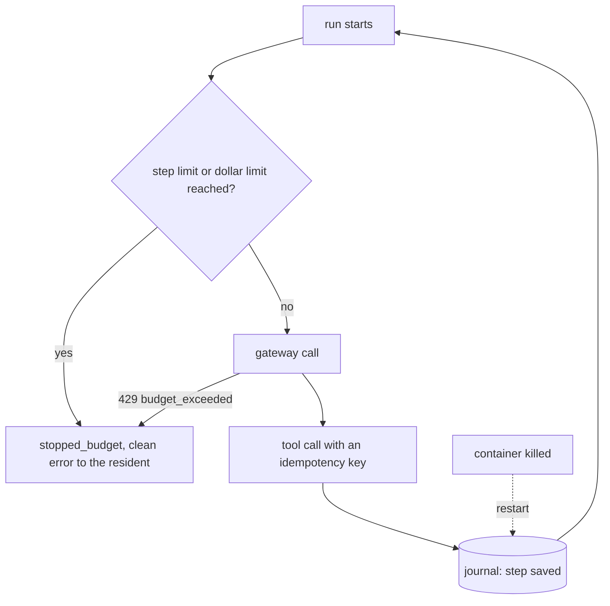

# Part 3: Bound the runs

## The problem

Application HDC-2026-0177 has a list of attachments that "continues on the next page", forever. The desk
keeps reading pages, and every page costs a paid model call.

There are two more problems:

- A resident who reloads the page twenty times starts twenty runs.
- Sometimes the desk's container is killed after it writes a decision but before it sends the letter. Then a
  retry can send the resident two letters, or none.

In this part you add brakes. A brake is a limit that stops a run, such as a limit on steps or on dollars. You
also add a run journal. A run journal saves each finished step, so a restarted run goes on from where it
stopped.

## Why it matters

Anthropic reports that agents use about 4 times more tokens than chat. Systems with many agents use about 15
times more. When an error happens, Anthropic does not restart a long run from the beginning. A restart costs a
lot, and it annoys users. So Anthropic built systems that resume from where the agent was
([Anthropic Engineering, "How we built our multi-agent research system"](https://www.anthropic.com/engineering/built-multi-agent-research-system)).

An alert tells you about spending after it happened. A limit refuses the next call before it happens.

For example, the finished desk has a step limit of 12 in its `release.json` (`"max_steps": 12`). Run
`bun run chaos runaway` against it, and it prints
`The run ended: stopped_budget after 12 model calls, $0.0345`. The resident sees a short message that begins
"This check stopped after". The status `stopped_budget` means a limit stopped the run. Nobody waits
forever.



## Steps

| Step                   | Minutes | You make                                                                        | The check reads                                                                                                                                                                       |
| ---------------------- | ------- | ------------------------------------------------------------------------------- | ------------------------------------------------------------------------------------------------------------------------------------------------------------------------------------- |
| `cap-the-spend`        | 20      | a step limit and a dollar limit per run, and a budget on the desk's gateway key | `bun run chaos runaway`: the run ends `stopped_budget` in under 25 steps and under $0.10 (spend log); a budget refusal from the gateway reaches the resident as `event: error`        |
| `rate-limit-residents` | 10      | a limit per resident (header `x-resident-id`, else address)                     | 6 requests from one resident inside the window get one 429 with `Retry-After`; another resident still gets 200                                                                        |
| `survive-a-restart`    | 20      | a run journal and idempotency keys on the register writes                       | `bun run chaos kill --desk`: after the restart the run finishes, the register holds one decision and one letter, and no completed model step is called again (spend log rows per run) |

## Walkthrough

Work in each step's `problem/` folder. Start the world first.

```bash
bun run world
```

Expect: `The world is running. Model provider: replay.`

Step 1: add the step limit and the dollar limit, and turn the gateway's refusal into a clean stop.

```bash
bun run up cap-the-spend
bun run chaos runaway --desk
bun run verify cap-the-spend
```

Expect: `The run ended: stopped_budget after 12 model calls, $0.0345`, then `Done. All 5 rules pass.`

Step 2: give each resident a limit of 5 runs in 10 seconds.

```bash
bun run up rate-limit-residents
bun run verify rate-limit-residents
```

Expect: `Done. All 4 rules pass.` once the 6th quick request gets 429 with `Retry-After`.

Step 3: keep a run journal, so a killed run finishes after the restart.

```bash
bun run up survive-a-restart
bun run chaos kill --desk
bun run verify survive-a-restart
```

Expect: `Register: 1 decision(s) and 1 letter(s) for HDC-2026-0142.`, then `Done. All 3 rules pass.`
The starter prints the register line too, so trust the check, not that line.

Check the whole part:

```bash
bun run verify part bound-the-runs
```

Expect: `Part bound-the-runs is done: 3/3 steps pass.`

```
Part bound-the-runs:
  PASS   cap-the-spend  (5/5 rules)
  PASS   rate-limit-residents  (4/4 rules)
  PASS   survive-a-restart  (3/3 rules)
Part bound-the-runs is done: 3/3 steps pass.
```

## Assignment: survive the bad night

Picture a bad night at the council. A runaway application loops, and the desk's container is killed
in the middle of a run. In the morning there must be no overspend and no second letter.

For example, after `bun run chaos runaway --desk` and `bun run chaos kill --desk`, the spend log shows
one run stopped at 12 model calls and $0.0345. The register shows 1 decision and 1 letter for
HDC-2026-0142.

1. Run both chaos commands against your desk from `survive-a-restart`.
2. Write `out/bad-night.md`. Say which brake fired first for HDC-2026-0177: the step limit, the dollar
   limit or the key's budget. Say why you chose that order of limits.
3. In the same note, name the idempotency key for the letter and what it is built from.

Hand in your branch and `out/bad-night.md`. It is graded yes or no on each question:

- Do `bun run verify cap-the-spend`, `rate-limit-residents` and `survive-a-restart` pass?
- Did the runaway run end as `stopped_budget`?
- Is there exactly one letter for the killed application?
- Does the note name the idempotency key and what it is built from?

Extension: kill the desk at 10 different points in a run, not only before the letter. Show zero
duplicate letters in all 10.

## Finished

Your desk now has brakes and a memory:

- A runaway run stops itself at the step limit or the dollar limit, and the resident reads why.
- A spent gateway budget ends a run cleanly as `stopped_budget`, never as a hang.
- One resident cannot start more than 5 runs in 10 seconds, and every other resident is still served.
- Every run is saved after each step, so a killed run finishes after the restart with no second letter
  and no model call paid twice.

Next is Part 4, release safely. You change the desk's prompt without hurting residents. A gate of
evals runs before each release. A canary gets a small share of traffic. A bad canary rolls back by
itself, and a runbook tells the people on call what to do.
