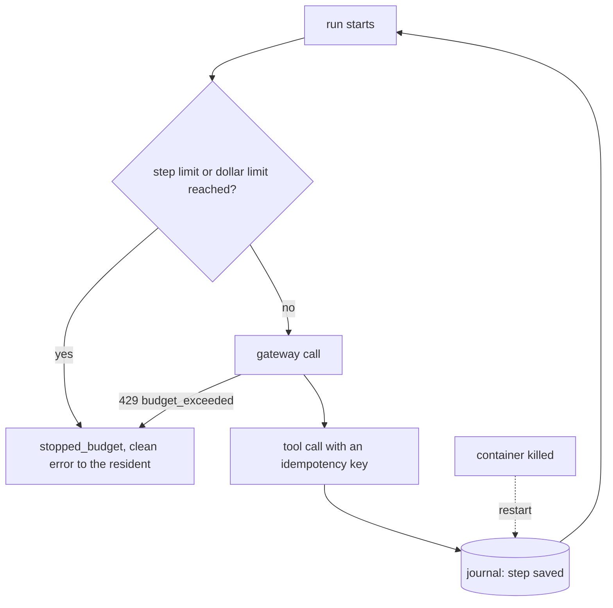

# Part 3: Bound the runs

## After this part you can

- Stop a runaway run with a step limit and a dollar limit.
- Limit how many runs one person can start.
- Finish a killed run without sending a second letter.
- Move to another provider when one stalls.
- Keep waits short with a queue.

## You leave with

A desk with brakes and a memory. A note in `out/bad-night.md` says which brake fired first on a bad night.

## The problem

Application HDC-2026-0177 has an attachment list that "continues on the next page", forever. The desk keeps reading pages. Every page is one paid model call.

Two more things go wrong on a bad night. A resident who reloads 20 times starts 20 runs. And if the container is killed after the decision but before the letter, a retry can send two letters, or none.

For example, the finished desk has a step limit of 12 in `release.json`. Run `bun run chaos runaway` and it prints this:

```text
The run ended: stopped_budget after 12 model calls, $0.0345
```

The resident reads a short message that starts "This check stopped after". Nobody waits forever.

A brake is a limit that stops a run. A run journal saves each finished step. A restarted run carries on from the last saved step.

An alert tells you about spending after it happened. A limit refuses the next call before it happens.

Here is what the desk does with every run:



Notice: Every loop checks the limits first. A killed run restarts from the journal, not from the start.

## Steps

| Step                               | You make                                           | You know it works when                                                  |
| ---------------------------------- | -------------------------------------------------- | ----------------------------------------------------------------------- |
| `cap-the-spend`                    | A step limit, a dollar limit and a key budget      | The runaway run ends as `stopped_budget`, and the resident sees why     |
| `rate-limit-residents`             | A limit for each resident                          | The 6th quick request gets a 429. Another resident still gets a 200     |
| `survive-a-restart`                | A run journal and a key for each register write    | After `bun run chaos kill --desk`: one decision, one letter             |
| `fall-back-when-a-provider-stalls` | A timeout on each provider, then the next provider | A stall or a 500 moves on. No spare is asked when the first one answers |
| `hold-the-latency-goal`            | A queue with a limit on runs going and waiting     | A full queue says `too_busy` and gives a retry time                     |

## Walkthrough

Work in each step's `problem/` folder. Start the world first.

```bash
bun run world
```

Expect: `The world is running. Model provider: replay.`

Step 1: add the step limit and the dollar limit. Turn the gateway's refusal into a clean stop.

```bash
bun run up cap-the-spend
bun run chaos runaway --desk
bun run verify cap-the-spend
```

Expect: `The run ended: stopped_budget after 12 model calls, $0.0345`, then `Done. All 5 rules pass.`

Step 2: give each resident a limit of 5 runs in 10 seconds.

```bash
bun run up rate-limit-residents
bun run verify rate-limit-residents
```

Expect: `Done. All 4 rules pass.` once the 6th quick request gets 429 with `Retry-After`.

Step 3: keep a run journal, so a killed run finishes after the restart.

```bash
bun run up survive-a-restart
bun run chaos kill --desk
bun run verify survive-a-restart
```

Expect: `Register: 1 decision(s) and 1 letter(s) for HDC-2026-0142.`, then `Done. All 3 rules pass.`
The starter prints the register line too, so trust the check, not that line.

Step 4: give each provider call a timeout and a fallback. You do not need Docker for this step.

```bash
bun run verify fall-back-when-a-provider-stalls
```

Expect: `Done. All 4 rules pass.`

Step 5: add a queue with a limit on runs going and on runs waiting. You do not need Docker for this step.

```bash
bun run verify hold-the-latency-goal
```

Expect: `Done. All 6 rules pass.`

Check the whole part:

```bash
bun run verify part bound-the-runs
```

Expect: `Part bound-the-runs is done: 5/5 steps pass.`

```
Part bound-the-runs:
  PASS   cap-the-spend  (5/5 rules)
  PASS   rate-limit-residents  (4/4 rules)
  PASS   survive-a-restart  (3/3 rules)
  PASS   fall-back-when-a-provider-stalls  (4/4 rules)
  PASS   hold-the-latency-goal  (6/6 rules)
Part bound-the-runs is done: 5/5 steps pass.
```

## Watch and read

| Kind  | Title                                                       | Made by                                  | Why                                                                           | Link                                                                      |
| ----- | ----------------------------------------------------------- | ---------------------------------------- | ----------------------------------------------------------------------------- | ------------------------------------------------------------------------- |
| read  | How we built our multi-agent research system                | Anthropic Engineering                    | Shows why agents cost so much and why a long run must resume, not restart.    | <https://www.anthropic.com/engineering/built-multi-agent-research-system> |
| video | SE Radio 596: Maxim Fateev on Durable Execution             | Maxim Fateev, who co-created Temporal    | The maker of a durable run engine explains saving each step and resuming.     | <https://www.youtube.com/watch?v=fMh2ZYJST0E>                             |
| video | Temporal: Open Source Durable Workflows for Apps and Agents | The Temporal team                        | A short tour of runs that survive a crash, with agents as the example.        | <https://www.youtube.com/watch?v=oUZd8tWr6zw>                             |
| read  | Handling Overload                                           | Google Site Reliability Engineering team | Explains refusing work early, which is the idea behind your queue and limits. | <https://sre.google/sre-book/handling-overload/>                          |
| read  | Designing robust and predictable APIs with idempotency      | Brandur Leach at Stripe                  | The clearest write-up of idempotency keys, which stop a second letter.        | <https://stripe.com/blog/idempotency>                                     |

## Project

Picture a bad night at the council. A runaway application loops, and the container is killed in the middle of a run. In the morning there must be no overspend and no second letter.

For example, after `bun run chaos runaway --desk` and `bun run chaos kill --desk`, the spend log shows one run stopped at 12 model calls and $0.0345. The register shows 1 decision and 1 letter for HDC-2026-0142.

1. Run both chaos commands against your desk from `survive-a-restart`.
2. Write `out/bad-night.md`. Say which brake fired first for HDC-2026-0177: the step limit, the dollar limit or the key's budget. Say why you ordered the limits that way.
3. In the same note, name the idempotency key for the letter. Say what it is built from.

Hand in your branch and `out/bad-night.md`. Each question is graded yes or no:

- Do `bun run verify cap-the-spend`, `rate-limit-residents` and `survive-a-restart` pass?
- Did the runaway run end as `stopped_budget`?
- Is there exactly one letter for the killed application?
- Does the note name the idempotency key and what it is built from?

Extension: kill the desk at 10 different points in a run, not only before the letter. Show zero duplicate letters in all 10.

Then do the same on your own work. Pick a loop or a job that calls a paid service. Give it a limit on calls or money, and make it stop with a clear message. Kill it once in the middle. Check that a restart does not repeat a paid step.

## What comes next

Part 4 is about releasing safely. A gate of evals runs before each release. A canary gets a small share of traffic first. A bad canary rolls back by itself. A runbook tells the people on call what to do.
