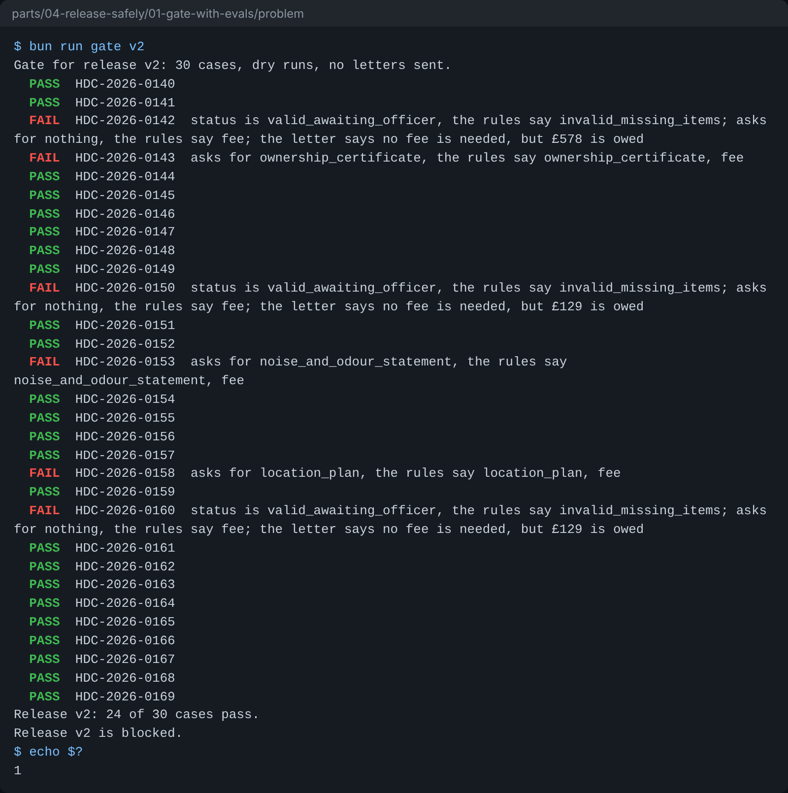

# Gate with evals

## The problem

The planning team has two new prompts. The second says "a missing fee is fine", and nothing stops it. For example, HDC-2026-0143 is a cafe that owes £289 and has no ownership certificate. The first release asks for both. The second asks only for the certificate, yet its status is still `invalid_missing_items`.

## Watch it done

Before, nothing stops the second release, so the next resident who owes a fee gets a letter that says no fee is needed. After, the gate prints six `FAIL` lines for the second release and ends like this:

```text
Release v2 is blocked.
```



## Your turn

This folder has most of the gate. `evals/cases.json` holds 30 fixed applications, `HDC-2026-0140` to `HDC-2026-0169`, with the right answer for each. `src/evals.ts` runs each case as a dry run, so no letters go out. `gate.ts` prints `PASS` or `FAIL` for each.

1. In `evals/checks.ts`, fill in `findProblems`. Push one short sentence for each check that fails. The status must be the case's status. The missing items must match, in any order. When a fee is owed, the letter must never say that no fee is needed.
2. At the end of `gate.ts`, exit with code 1 when any case fails. A script that ships releases reads the exit code, not the words. Also print `Release <name> is blocked.` or `Release <name> may ship.`
3. Run the gate on the second release.

```bash
bun run gate v2
```

Expect: six `FAIL` lines, then the line `Release v2 is blocked.`

4. Run the check.

```bash
bun run verify gate-with-evals
```

Expect: `Done. All 5 rules pass.`

## Do it on your work

Write 10 fixed cases for your own agent, each with the answer you expect. Add a code check for the part that must never be wrong, and make your release script stop when one case fails. Good looks like one release that passes, one known-bad release that fails with the case ids printed, and an exit code you can read.

## Done when

- `bun run gate v1` and `bun run gate v3` exit 0 with no `FAIL` line.
- `bun run gate v2` exits 1.
- It prints `FAIL` for HDC-2026-0142, 0143, 0150, 0153, 0158 and 0160, and no other case.
- The register holds no decision and no letter from the gate.

## Solution

The after state has the three checks in `evals/checks.ts` and the exit code in `gate.ts`. The files are in `../solution/`. See the diff from the `problem/` folder:

```bash
diff -u evals/checks.ts ../solution/evals/checks.ts
diff -u gate.ts ../solution/gate.ts
```

Expect: the lines that changed.

## If you get stuck

- Run `echo $?` after the gate to see the exit code.
- Lists can come back in another order. Sort both before you compare.
- Do not fail every letter that says "fee". The first release writes "The application fee of £578", and that is right.

## Words you will use

- **Eval**: a test of the agent's answers on fixed cases, with the right answer written down.
- **Gate**: a step before a release that says yes or no, by its exit code.
- **Code check**: a check written in code, such as "the status matches". It gives the same answer every time.
- **Release**: one version of the desk's behaviour in one file: its prompt, its model role and its limits.
- **Dry run**: a run that reads real data and writes nothing.
