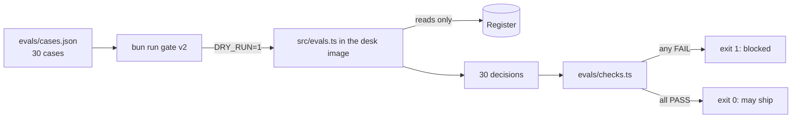
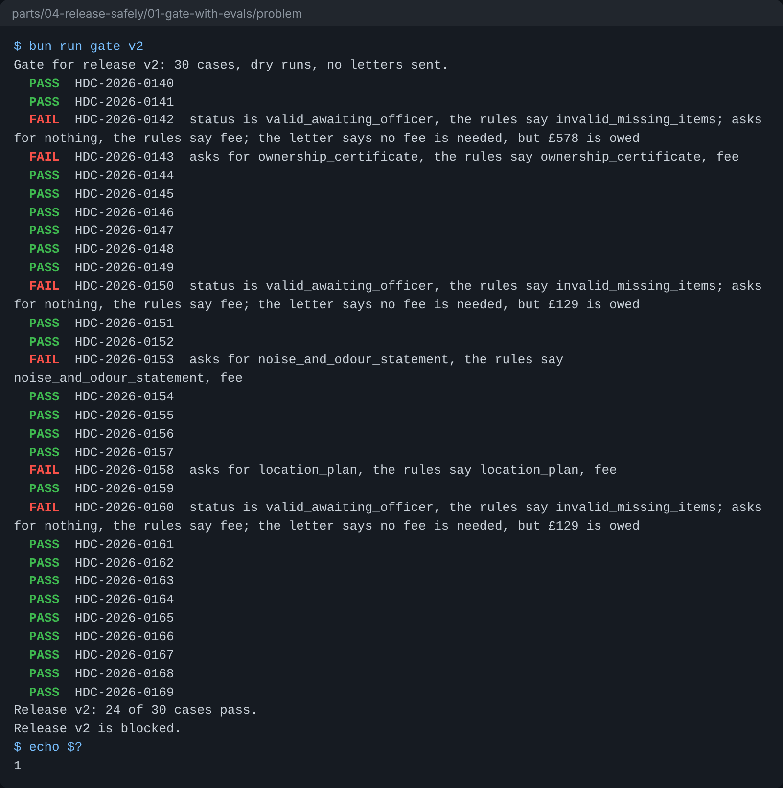

# Gate with evals

## The problem

The planning team has two new prompts in `releases/`. Release v3 is warmer and still asks for every fee.
Release v2 says "a missing fee is fine". Both read well.

Today nothing stops v2. The next resident who owes a fee gets a letter that says "no fee is needed".

An eval is a test of the agent's answers on fixed cases. A gate runs the evals before a release ships, and
says no when a case fails.

For example, HDC-2026-0143 is a cafe that has no ownership certificate and still owes £289. Release v1 asks
for `ownership_certificate` and `fee`. Release v2 asks only for `ownership_certificate`. Its status is still
`invalid_missing_items`, so a check that reads only the status says v2 is fine.

## Your challenge

This folder already has most of the gate:

- `evals/cases.json` holds 30 fixed applications, `HDC-2026-0140` to `HDC-2026-0169`, with the answer the
  council's rules give for each.
- `src/evals.ts` runs the agent once for each case inside the desk's own image, as a dry run. A dry run reads
  the register but never writes to it. So the gate sends no letters.
- `gate.ts` runs the cases and prints a `PASS` or `FAIL` line for each one.

You write two things:

1. In `evals/checks.ts`, fill in `findProblems`. Push one short sentence for each check that fails:
   - the status is the case's status;
   - the missing items are the case's missing items, in any order;
   - when a fee is owed, the letter never says that no fee is needed.
2. At the end of `gate.ts`, exit with code 1 when any case fails. A script that ships releases reads the exit
   code, not the words.



Run it in this folder:

```bash
bun run gate v2
```

Expect: six `FAIL` lines and `Release v2 is blocked.` once your checks work.



## Done when

- `bun run gate v1` and `bun run gate v3` exit 0 with no `FAIL` line.
- `bun run gate v2` exits 1.
- It prints `FAIL` for each case v2 gets wrong: HDC-2026-0142, 0143, 0150, 0153, 0158 and 0160, and for no
  other case.
- The register holds no decision and no letter from the gate.

```bash
bun run verify gate-with-evals
```

Expect: `Done. All 5 rules pass.`

## If you get stuck

- Run `echo $?` after the gate. It prints the exit code.
- Lists can come back in another order. Sort both lists before you compare them.
- Do not fail every letter with the word "fee" in it. Release v1 writes "The application fee of £578", and that
  letter is right.
- Compare with `../solution/` when you are done.

## Words you will use

- **Eval**: a test of the agent's answers on fixed cases, with the right answer written down.
- **Gate**: a step before a release that says yes or no, by its exit code.
- **Code check**: a check written in code, such as "the status matches". It gives the same answer every time.
- **Release**: one version of the desk's behaviour: its prompt, its model role and its limits, in one file.
- **Dry run**: a run that reads real data and writes nothing.
