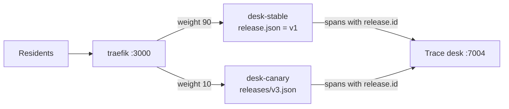
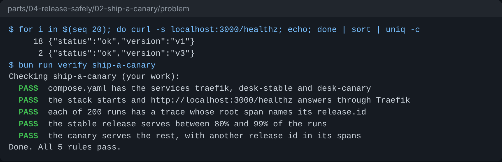

# Ship a canary

## The problem

Release v3 passed the gate. But the gate tests 30 cases, and residents send things no case covers. If v3
goes to every resident at once and something is wrong, every resident gets the wrong letter.

A canary is a new release that serves a small share of residents first. If it goes wrong, only that share
sees it. The rest still get the release that is live today, called stable.

For example, with a 10% canary, 9 of every 10 residents who check an application reach stable (v1). One
reaches the canary (v3). The trace of each run says which release served it in `release.id`. So you can
compare the two releases on real traffic.

## Your challenge

Today `compose.yaml` runs one service, `desk`. Turn it into a canary:

1. In `compose.yaml`, replace `desk` with two services built from this folder:
   - `desk-stable` reads the live release, `RELEASE_FILE: /app/release.json`.
   - `desk-canary` reads the new one, `RELEASE_FILE: /app/releases/v3.json`.
   - Give each one its own volume for `/data`, and publish no port.
2. Add a `traefik` service (image `traefik:v3.7.18`). It owns port 3000. It reads its routes from a folder
   that you mount from `./traefik`.
3. Write `traefik/dynamic.yml`: a router for every path, and a weighted service that sends weight 90 to
   `http://desk-stable:3000` and weight 10 to `http://desk-canary:3000`.

Keep these names. The release controller in the next step writes the same names.



The finished desk and the desks from earlier steps use port 3000 too. Run this from the top of the
repo. It stops them, then starts the canary in this folder:

```bash
bun run down
cd parts/04-release-safely/02-ship-a-canary/problem
docker compose up -d --build --wait --remove-orphans
```

Expect: `Container hdc-desk-traefik-1  Healthy`, and the same line for both desks.

`--remove-orphans` stops the old `desk` service, which is no longer in your `compose.yaml`. Without it, the
old desk keeps port 3000, and Traefik fails with `port is already allocated`.

Then ask Traefik 20 times which release answers:

```bash
for i in $(seq 20); do curl -s localhost:3000/healthz; echo; done | sort | uniq -c
```

Expect: about 18 answers with `"version":"v1"` and about 2 with `"version":"v3"`.



## Done when

- `compose.yaml` has the services `traefik`, `desk-stable` and `desk-canary`.
- http://localhost:3000/healthz answers through Traefik.
- Out of 200 runs, every trace names its `release.id`.
- The stable release serves between 80% and 99% of the runs.
- The canary serves the rest, with another release id.

```bash
bun run verify ship-a-canary
```

Expect: `Done. All 5 rules pass.`

## If you get stuck

- Traefik needs these flags: `--entrypoints.web.address=:3000`,
  `--providers.file.directory=/etc/traefik/dynamic`, `--providers.file.watch=true`, `--ping=true` and
  `--ping.entrypoint=web`.
- Read its logs with `docker compose logs traefik`. A typo in `dynamic.yml` shows up there.
- A YAML anchor (`x-desk: &desk`) keeps the shared settings of the two desks in one place.
- Compare with `../solution/` when you are done.

## Words you will use

- **Canary**: a new release on a small share of the traffic, watched before it gets more.
- **Stable**: the release that is live today and serves most residents.
- **Weighted service**: a Traefik service that shares requests between other services by weight.
- **Release unit**: everything that changes the desk's answers, in one file with one id: the prompt, the
  model role and the limits.
