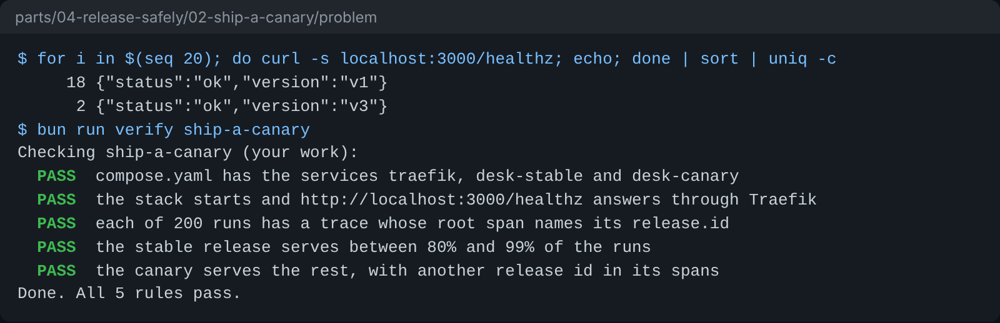
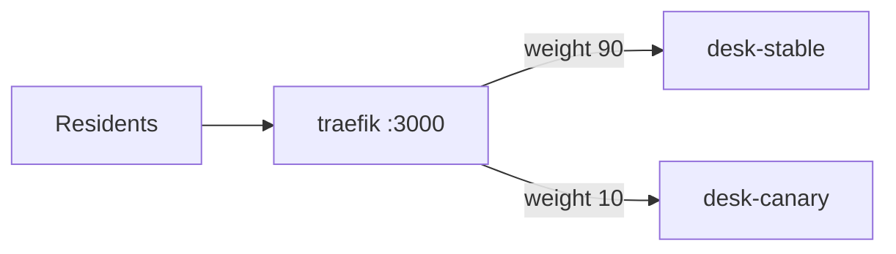

# Ship a canary

## The problem

The third release passed the gate, but the gate tests 30 cases and residents send things no case covers. Sent to everyone at once, a flaw reaches every resident. For example, with a 10% canary, 9 of 10 residents reach stable, the release live today. One reaches the canary. Each trace says which one served it, in `release.id`.

## Watch it done

Before, `compose.yaml` runs one service, `desk`, and every resident gets the same release. After, twenty requests through Traefik split like this:

```text
"version":"v1"  about 18 times
"version":"v3"  about 2 times
```



## Your turn

1. In `compose.yaml`, replace `desk` with two services built from this folder. `desk-stable` has `RELEASE_FILE: /app/release.json`. `desk-canary` has `RELEASE_FILE: /app/releases/v3.json`. Give each its own volume for `/data`, and publish no port.
2. Add a `traefik` service (image `traefik:v3.7.18`). It owns port 3000 and reads its routes from a folder you mount from `./traefik`.
3. Write `traefik/dynamic.yml`: a router for every path, and a weighted service. Weight 90 goes to `http://desk-stable:3000` and weight 10 to `http://desk-canary:3000`. Keep these names, because the next steps write the same ones.



4. Stop the other desks, which use port 3000 too, then start the canary from the top of the repo.

```bash
bun run down
cd parts/04-release-safely/02-ship-a-canary/problem
docker compose up -d --build --wait --remove-orphans
```

Expect: Traefik and both desks report healthy, like this:

```text
Container hdc-desk-traefik-1  Healthy
```

`--remove-orphans` stops the old `desk` service. Without it, the old desk keeps port 3000 and Traefik fails with this message:

```text
port is already allocated
```

5. Ask Traefik 20 times which release answers.

```bash
for i in $(seq 20); do curl -s localhost:3000/healthz; echo; done | sort | uniq -c
```

Expect: about 18 answers with `"version":"v1"` and about 2 with `"version":"v3"`.

6. Run the check.

```bash
bun run verify ship-a-canary
```

Expect: `Done. All 5 rules pass.`

## Do it on your work

Pick one change in your own project, such as a new prompt. Send it to a small share of real use first, and tag every record with the release that served it. Good looks like a count by release that shows the new one on about a tenth of the use.

## Done when

- `compose.yaml` has the services `traefik`, `desk-stable` and `desk-canary`.
- http://localhost:3000/healthz answers through Traefik.
- Out of 200 runs, every trace names its `release.id`.
- Stable serves between 80% and 99% of the runs, and the canary serves the rest with another release id.

## Solution

The after state has the three services and `traefik/dynamic.yml`. The files are in `../solution/`. See the diff from the `problem/` folder:

```bash
diff -ru . ../solution -x node_modules -x images -x README.md
```

Expect: the lines that changed.

## If you get stuck

- Traefik needs these flags: `--entrypoints.web.address=:3000`, `--providers.file.directory=/etc/traefik/dynamic`, `--providers.file.watch=true`, `--ping=true` and `--ping.entrypoint=web`.
- Read its logs with `docker compose logs traefik`. A typo in `dynamic.yml` shows up there.
- A YAML anchor (`x-desk: &desk`) keeps the shared settings of the two desks in one place.

## Words you will use

- **Canary**: a new release on a small share of the traffic, watched before it gets more.
- **Stable**: the release that is live today and serves most residents.
- **Weighted service**: a Traefik service that shares requests between other services by weight.
- **Release unit**: everything that changes the desk's answers, in one file with one id: the prompt, the model role and the limits.
