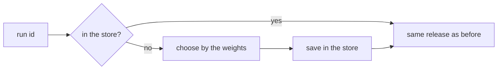

# Pin runs to their release

## The problem

A canary changes the share of traffic from one release to another. A run can last many steps. If each step
picks a release again, one run can start on v1 and end on v2. Its prompt changes in the middle, and its letter
can be wrong.

For example, a run is at step 4 when the canary moves from 10 percent to 100 percent. Step 5 asks which release
to use, and the answer is v2.

## Your challenge

Work in `src/pin.ts`. It makes a router for releases. The store is a `Map` from a run id to a release id.

1. **Look first.** In `releaseFor`, look the run up in the store. If it is there, answer with that release.
2. **Choose once.** If the run is new, choose by the weights, save the choice in the store, and answer.
3. **Forget the finished.** In `finish`, delete the run from the store.

Use the store you are given. A router that keeps its own private map forgets every run when the desk
restarts.



```bash
bun run verify pin-runs-to-their-release
```

Expect: `Done. All 6 rules pass.`

You do not need Docker for this step.

## Done when

- A new run gets a release by the weights, and a weight of 0 is never chosen.
- A run in flight keeps its release after the weights change.
- A run that starts after the change gets the new weights.
- After a restart, the run keeps its release.
- A finished run is forgotten.

## If you get stuck

- Does the run switch release when the weights change? You choose on every call. Look in the store first.
- Does the run switch after a restart? You pinned it in a `Map` you made yourself. Use the store.
- Compare with `../solution/` when you are done.

Do it on your work: write down where your agent picks its model or prompt. Does it pick once for each run, or
once for each step?

## Words you will use

- **Pin**: tie a run to one release for its whole life.
- **In flight**: started, and not finished yet.
- **Weight**: a share of traffic for a release.
