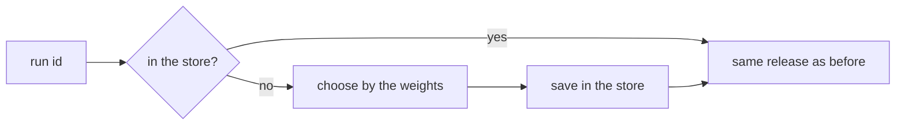

# Pin runs to their release

## The problem

If each step picks a release again, a run can start on the first release and end on the second. Its prompt changes midway, and its letter can be wrong. For example, a run is at step 4 when the canary moves from 10 to 100 percent. Step 5 asks again, and gets the second release.

## Watch it done

Before, the router chooses on every call. So a run in flight switches release when the weights change. After, the run keeps its release, even after a restart:

```text
Done. All 6 rules pass.
```



## Your turn

Work in `src/pin.ts`. It makes a router for releases. The store is a `Map` from a run id to a release id. Use the store you are given. A router with its own private map forgets every run when the desk restarts.

1. In `releaseFor`, look the run up in the store. If it is there, answer with that release.
2. If the run is new, choose by the weights. Save the choice in the store, and answer.
3. In `finish`, delete the run from the store.
4. Run the check. You do not need Docker for this step.

```bash
bun run verify pin-runs-to-their-release
```

Expect: `Done. All 6 rules pass.`

## Do it on your work

Write down where your agent picks its model or prompt. Does it pick once for each run, or once for each step? If it picks each step, save the first choice under the run id. Then read it back. Good looks like a run that keeps one prompt from start to end, while you change the settings under it.

## Done when

- A new run gets a release by the weights, and a weight of 0 is never chosen.
- A run in flight keeps its release after the weights change.
- A run that starts after the change gets the new weights.
- After a restart, the run keeps its release.
- A finished run is forgotten.

## Solution

The after state looks in the store first, saves a new choice, and deletes finished runs. The file is in `../solution/`. See the diff from the `problem/` folder:

```bash
diff -u src/pin.ts ../solution/src/pin.ts
```

Expect: the lines that changed.

## If you get stuck

- Does the run switch release when the weights change? You choose on every call. Look in the store first.
- Does the run switch after a restart? You pinned it in a `Map` you made yourself. Use the store.

## Words you will use

- **Pin**: tie a run to one release for its whole life.
- **In flight**: started, and not finished yet.
- **Weight**: a share of traffic for a release.
