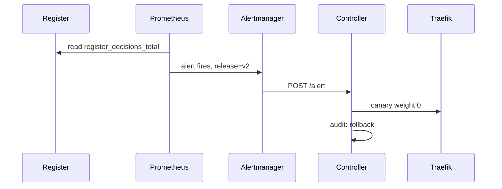
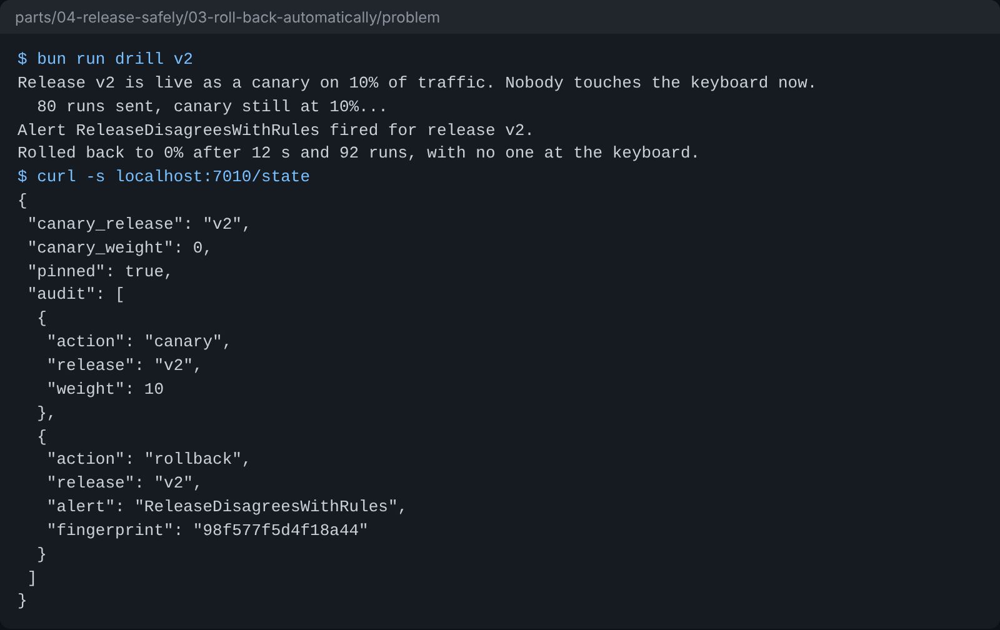

# Roll back automatically

## The problem

A canary limits the harm to 10% of residents. But someone still has to notice the harm and move the traffic
back. In the evening nobody is watching, and v2 keeps writing wrong letters until someone does.

The register already judges every decision. It counts decisions by release, and whether the council's rules
agree, in `register_decisions_total{release, agrees}`. Prometheus reads those counts. What is missing is the
rule that turns them into an alert, and the route that sends the alert to someone who acts.

For example, put v2 on the canary. About 1 in 6 of its decisions are wrong, such as HDC-2026-0142 marked
`valid_awaiting_officer` while £578 is owed. Release v1 gets 0 wrong. A rule that compares the share of wrong
decisions per release catches v2 and leaves v1 and v3 alone.

## Your challenge

This folder runs the canary from `ship-a-canary`, plus three new services:

- `controller` is the release controller. It writes Traefik's file and the canary's release. It rolls the
  canary back to 0% when its webhook, `POST /alert`, gets a firing alert whose `release` label is the
  canary's release. Every change goes in its audit log at http://localhost:7010/state.
- `prometheus` reads the register's counts every 2 seconds.
- `alertmanager` sends each firing alert to a receiver.

You write two files:

1. `prometheus/alerts.yml`: one alert rule named `ReleaseDisagreesWithRules`. It fires when more than 5% of
   a release's decisions disagree with the rules, over at least 3 decisions. Use `sum by (release)`, so
   the alert carries the release label. The runbook in the next step uses the same name.
2. `alertmanager/alertmanager.yml`: a receiver with a webhook to the controller, and a route that uses it.
   Repeat the alert every 10 seconds while it fires.



Start the stack from this folder, then run the drill. The drill puts a release on a 10% canary and sends
residents' runs. You do not touch anything.

```bash
docker compose up -d --build --wait
bun run drill v2
```

Expect: `Alert ReleaseDisagreesWithRules fired for release v2.` and `Rolled back to 0%` within a minute.



## Done when

- Prometheus has loaded an alert rule that reads `register_decisions_total`.
- With v2 on the canary, the canary is at 0% within 3 minutes, with no key pressed.
- The alert fired with the label `release=v2`.
- The controller's audit log holds the rollback, with the alert's name.
- With v3 on the canary, the canary is still at 10% after 20 seconds of traffic.

```bash
bun run verify roll-back-automatically
```

Expect: `Done. All 5 rules pass.`

## If you get stuck

- Open http://localhost:9090/alerts to see your rule and its state.
- Inside a container, `localhost` is that container. Alertmanager reaches the controller at
  `http://controller:7010/alert`.
- Reload a changed file with `docker compose restart prometheus alertmanager`.
- Compare with `../solution/` when you are done.

## Words you will use

- **Alert rule**: a query that Prometheus checks again and again. When it is true for long enough, the alert
  fires.
- **Label**: a name and value on a metric or alert, such as `release="v2"`.
- **Webhook**: a URL that another program calls when something happens.
- **Rollback**: sending all traffic back to the release that worked before.
- **Audit log**: a list of every change, with when and why, that nobody edits afterwards.
