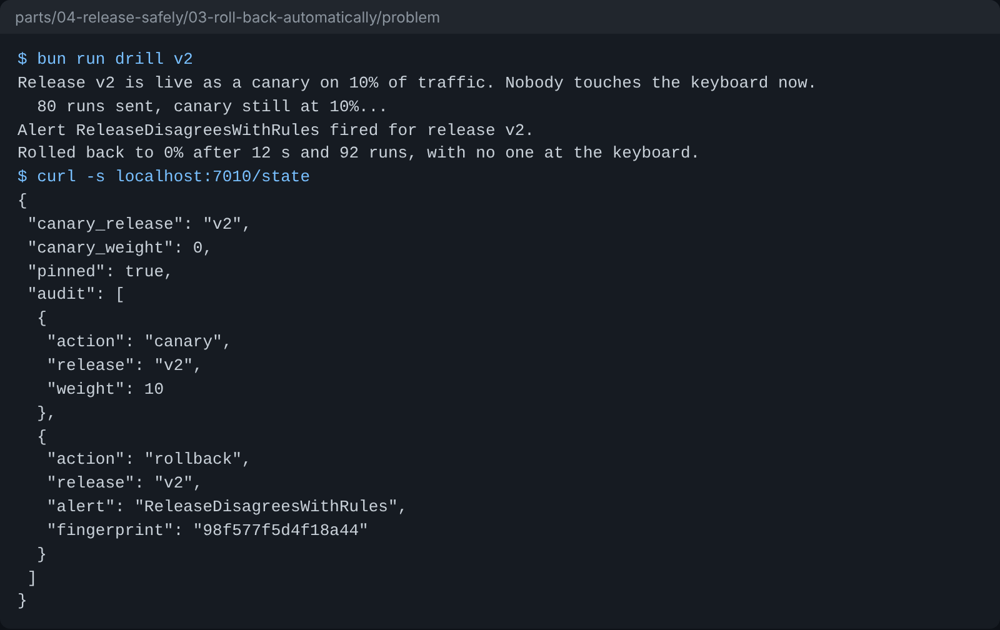
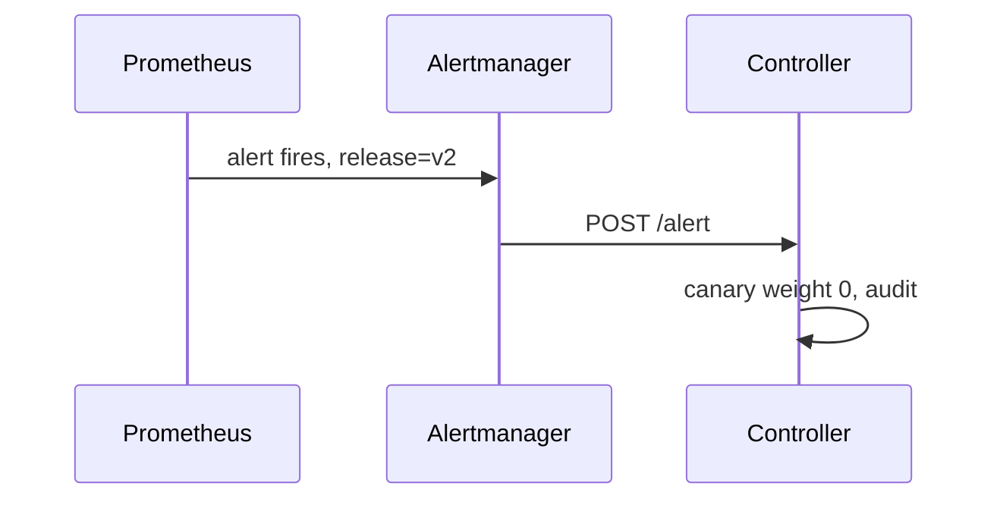

# Roll back automatically

## The problem

A canary limits harm to 10% of residents, but someone must still notice and move the traffic back. In the evening nobody looks. For example, about 1 in 6 decisions of the second release are wrong, such as HDC-2026-0142 marked `valid_awaiting_officer` while £578 is owed.

## Watch it done

Before, the register counts decisions by release in `register_decisions_total{release, agrees}`, but no rule reads them and nobody is told. After, you press nothing, and the drill prints:

```text
Alert ReleaseDisagreesWithRules fired for release v2.
Rolled back to 0%
```



## Your turn

This folder runs the canary from `ship-a-canary`, plus three services. `controller` rolls the canary back to 0% when its webhook, `POST /alert`, gets a firing alert for that release. It logs each change at http://localhost:7010/state. `prometheus` reads the register's counts every 2 seconds. `alertmanager` sends each firing alert on.

1. Write `prometheus/alerts.yml`: one rule named `ReleaseDisagreesWithRules`. It fires when more than 5% of a release's decisions disagree with the rules, over at least 3 decisions. Use `sum by (release)`, so the alert carries the release label. The runbook uses this name.
2. Write `alertmanager/alertmanager.yml`: a receiver with a webhook to the controller, and a route that uses it. Repeat the alert every 10 seconds while it fires.



3. Start the stack from this folder, then run the drill. It puts a release on a 10% canary and sends runs. You touch nothing.

```bash
docker compose up -d --build --wait
bun run drill v2
```

Expect: `Alert ReleaseDisagreesWithRules fired for release v2.` and the line below, within a minute.

```text
Rolled back to 0%
```

4. Run the check.

```bash
bun run verify roll-back-automatically
```

Expect: `Done. All 5 rules pass.`

## Do it on your work

Pick one number that shows your agent went wrong, such as the share of answers a check rejects. Alert on it, and send the alert to something that acts. Good looks like a bad change that undoes itself while you watch nothing.

## Done when

- Prometheus has loaded a rule that reads `register_decisions_total`.
- With the second release on the canary, the canary is at 0% within a few minutes, with no key pressed.
- The alert fired with the label `release=v2`.
- The controller's audit log holds the rollback, with the alert's name.
- With the third release on the canary, it is still at 10% after 20 seconds of traffic.

## Solution

The after state has the alert rule and the Alertmanager route. The files are in `../solution/`. See the diff from the `problem/` folder:

```bash
diff -ru . ../solution -x node_modules -x images -x README.md
```

Expect: the lines that changed.

## If you get stuck

- Open http://localhost:9090/alerts to see your rule.
- Inside a container, `localhost` is that container. Alertmanager reaches the controller at `http://controller:7010/alert`.
- Reload a changed file with `docker compose restart prometheus alertmanager`.

## Words you will use

- **Alert rule**: a query that Prometheus checks again and again. When it is true for long enough, the alert fires.
- **Label**: a name and value on a metric or alert, such as `release="v2"`.
- **Webhook**: a URL that another program calls when something happens.
- **Rollback**: sending all traffic back to the release that worked before.
- **Audit log**: a list of every change, with when and why, that nobody edits.
