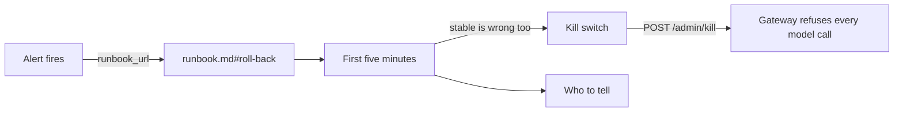

# Write the runbook

## The problem

The rollback works with nobody at the keyboard. But an alert still wakes a person up. That person may never
have seen the desk. They need to know what is wrong, what to do first, how to stop everything, and who to
tell.

A runbook is a page of steps that a person follows when something goes wrong. Each alert links to it, so the
page is one click away from the alert.

For example, the alert `ReleaseDisagreesWithRules` fires for v2. The person on call opens its `runbook_url`,
`runbook.md#roll-back`. The page tells them to check http://localhost:7010/state. If stable is wrong too, it
gives them one command that stops every model call at the gateway, the kill switch.

## Your challenge

1. Fill in `runbook.md`. Keep its six headings: Symptoms, First five minutes, Kill switch, Roll back, Who to
   tell and After. Write at least one line under each. Short numbered steps work best.
2. Under Kill switch, put one bash block that turns on the gateway's kill switch. Its route is
   `POST localhost:7002/admin/kill`, with the admin key from `secrets/gateway_admin_key`. Follow the block
   with an `Expect:` line. The check runs the block from the top of the repo.
3. Under Who to tell, name the people from `world/data/people.json` who need to know. For example, the team
   lead and the budget holder.
4. In `prometheus/alerts.yml`, give every alert a `runbook_url` annotation that points to a heading in
   `runbook.md`, such as `runbook.md#roll-back`.



Try your kill switch from the top of the repo, then turn the gateway back on:

```bash
curl -s -X POST localhost:7002/admin/kill -H "authorization: Bearer $(cat secrets/gateway_admin_key)"
curl -s localhost:7002/health
```

Expect: `{"killed":true}`, then `"killed":true` in the gateway's health.

```bash
curl -s -X POST localhost:7002/admin/revive -H "authorization: Bearer $(cat secrets/gateway_admin_key)"
```

Expect: `{"killed":false}`

## Done when

- `runbook.md` has the six sections, and none is empty or only says TODO.
- Every alert in `prometheus/alerts.yml` has a `runbook_url` that points to a heading in `runbook.md`.
- The Kill switch command, run from the top of the repo, stops every model call within 10 seconds.
- Who to tell names someone on the council's staff list.

```bash
bun run verify write-the-runbook
```

Expect: `Done. All 5 rules pass.`

## If you get stuck

- A heading's anchor is the heading in lower case, with hyphens for spaces: `## Roll back` becomes
  `#roll-back`.
- Stopping the desks is not a kill switch. A restarted desk resumes its runs and calls the model again. The
  gateway is the one place every model call passes through.
- The check turns the gateway back on after it tests your kill switch.
- Compare with `../solution/` when you are done.

## Words you will use

- **Runbook**: a page of steps that a person follows when something goes wrong.
- **Kill switch**: one action that stops every model call at once.
- **On call**: the person whose phone rings when an alert fires.
- **Annotation**: extra text on an alert, such as its summary or its runbook link.
