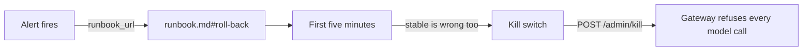

# Write the runbook

## The problem

The rollback works with nobody at the keyboard. But an alert still wakes a person who may never have seen the desk. For example, `ReleaseDisagreesWithRules` fires for the second release. The person on call opens its `runbook_url`, `runbook.md#roll-back`. They need to know what is wrong, what to do first, how to stop everything, and who to tell.

## Watch it done

Before, `runbook.md` has six headings that each say TODO. After, each has real steps. The Kill switch section has one command that stops every model call at the gateway:

```text
{"killed":true}
```



## Your turn

1. Fill in `runbook.md`. Keep its six headings: Symptoms, First five minutes, Kill switch, Roll back, Who to tell and After. Write at least one line under each. Short numbered steps work best.
2. Under Kill switch, put one bash block that turns on the gateway's kill switch. Its route is `POST localhost:7002/admin/kill`, with the admin key from `secrets/gateway_admin_key`. Follow the block with an `Expect:` line. The check runs the block from the top of the repo.
3. Under Who to tell, name people from `world/data/people.json`, such as the team lead and the budget holder.
4. In `prometheus/alerts.yml`, give every alert a `runbook_url` annotation. It points to a heading, such as `runbook.md#roll-back`.
5. Try your kill switch from the top of the repo.

```bash
curl -s -X POST localhost:7002/admin/kill -H "authorization: Bearer $(cat secrets/gateway_admin_key)"
curl -s localhost:7002/health
```

Expect: `{"killed":true}`, then `"killed":true` in the gateway's health.

6. Turn the gateway back on.

```bash
curl -s -X POST localhost:7002/admin/revive -H "authorization: Bearer $(cat secrets/gateway_admin_key)"
```

Expect: `{"killed":false}`

7. Run the check.

```bash
bun run verify write-the-runbook
```

Expect: `Done. All 5 rules pass.`

## Do it on your work

Write a runbook for your own agent with the same six headings. Add one command that stops every paid call from one place. Name a real person to tell. Good looks like a stranger who follows it half asleep and stops the spend.

## Done when

- `runbook.md` has the six sections. None is empty or only says TODO.
- Every alert in `prometheus/alerts.yml` has a `runbook_url` that points to a heading in `runbook.md`.
- The Kill switch command stops every model call within 10 seconds.
- Who to tell names someone on the council's staff list.

## Solution

The after state has a full `runbook.md` and a `runbook_url` on each alert. The files are in `../solution/`. See the diff from the `problem/` folder:

```bash
diff -ru . ../solution -x node_modules -x images -x README.md
```

Expect: the lines that changed.

## If you get stuck

- A heading's anchor is the heading in lower case, with hyphens for spaces. The heading Roll back becomes `#roll-back`.
- Stopping the desks is not a kill switch. A restarted desk resumes its runs and calls the model again. The gateway is the one place every model call passes through.
- The check turns the gateway back on after it tests your kill switch.

## Words you will use

- **Runbook**: a page of steps that a person follows when something goes wrong.
- **Kill switch**: one action that stops every model call at once.
- **On call**: the person whose phone rings when an alert fires.
- **Annotation**: extra text on an alert, such as its summary or its runbook link.
