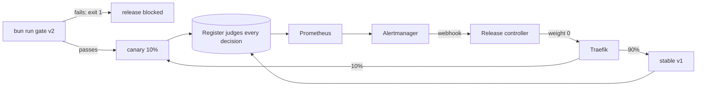

# Part 4: Release safely

## After this part you can

- Block a bad release with a gate of evals.
- Send a new release to a small share of residents first.
- Keep each run on the release it started on.
- Roll a bad canary back with nobody at the keyboard.
- Hand the person on call a runbook.

## You leave with

A release process for the permit desk. You also have a `release-note.md` that names the alert that would roll your release back.

## The problem

The planning team wants a friendlier prompt. The second release reads well, and at first sight its letters look fine. But its prompt tells the agent "a missing fee is fine".

For example, HDC-2026-0142 has paid nothing of a £578 fee. The first release asks for "The application fee of £578". The second writes `valid_awaiting_officer`. Its letter says "It has everything we need, and no fee is needed."

Today a new prompt goes to every resident at once. The only way back is that someone notices and deploys the old release by hand.



## Why it matters

In one month, three separate bugs lowered the quality of Claude's answers. One sent some requests to the wrong servers. At its worst hour, it affected 16% of Sonnet 4 requests. Anthropic fixed that bug, and rolled back the changes behind the other two. It now says it will run quality evals all the time on its real production systems ([Anthropic Engineering, "A postmortem of three recent issues"](https://www.anthropic.com/engineering/a-postmortem-of-three-recent-issues)).

Anthropic also ships agent updates slowly, step by step. Old and new releases run side by side for a while ([Anthropic Engineering, "How we built our multi-agent research system"](https://www.anthropic.com/engineering/built-multi-agent-research-system)).

Four terms to know. An eval is a test of the agent's answers on fixed cases. A gate runs the evals and blocks a release that fails them. A canary sends a new release to a small share of residents first, here 10%. A runbook is a page of steps that a person follows when something goes wrong.

## Steps

| Step                        | You make                                                                                                         | The check reads                                                                                                                                             |
| --------------------------- | ---------------------------------------------------------------------------------------------------------------- | ----------------------------------------------------------------------------------------------------------------------------------------------------------- |
| `gate-with-evals`           | `bun run gate <release>`: 30 fixed applications, code checks first (status, missing items, fee wording)          | exit code and printed case ids: passes the first release, fails the second                                                                                  |
| `ship-a-canary`             | a Traefik weighted service (stable and canary) and `release.json` as one release unit whose id is on every span  | 200 replayed requests: 80 to 100 percent served by stable, read from spans by `release.id`                                                                  |
| `pin-runs-to-their-release` | a router that pins each run to the release it started on, kept in a store                                        | six in-process rules: a run in flight keeps its release when the weights change, and after a restart                                                        |
| `roll-back-automatically`   | a Prometheus alert on decisions the register disagrees with, and an Alertmanager route to the release controller | `bun run chaos bad-canary`: within a few minutes and no key pressed, canary weight is 0, the alert fired, and the rollback is in the controller's audit log |
| `write-the-runbook`         | `runbook.md`: Symptoms, First five minutes, Kill switch, Roll back, Who to tell, After                           | every alert's `runbook_url` points to a heading; the kill switch command stops all model calls in under 10 seconds (gateway health); no empty section       |

## Watch and read

| Kind  | Title                               | Made by                                  | Why                                                                         | Link                                                                        |
| ----- | ----------------------------------- | ---------------------------------------- | --------------------------------------------------------------------------- | --------------------------------------------------------------------------- |
| read  | A postmortem of three recent issues | Anthropic Engineering                    | A real case of quality falling in production, and why ongoing evals matter. | <https://www.anthropic.com/engineering/a-postmortem-of-three-recent-issues> |
| read  | Canarying Releases                  | Google Site Reliability Engineering team | The team that runs Google's services explains how to judge a canary.        | <https://sre.google/workbook/canarying-releases/>                           |
| video | LLM Evals: Common Mistakes          | Hamel Husain, who teaches AI evals       | A maker of an evals course shows how to test an agent on fixed cases.       | <https://www.youtube.com/watch?v=GL0XhAj5LPE>                               |
| video | The Fine Art of Canary Deployments  | Daniel Hinojosa                          | A conference talk that shows a canary release step by step.                 | <https://www.youtube.com/watch?v=7dEumfFkQbU>                               |
| read  | Your AI Product Needs Evals         | Hamel Husain                             | A plain guide to writing the fixed cases and checks behind your gate.       | <https://hamel.dev/blog/posts/evals/>                                       |

## Walkthrough

Start the world and stop the finished desk. It uses the same container names as your desk.

```bash
bun run world
bun run down
```

Expect: `The world is running. Model provider: replay.` and `The desks are stopped. The world is still running.`

### gate-with-evals

Work in `01-gate-with-evals/problem/`. Write the checks in `evals/checks.ts` and the exit code in `gate.ts`.

```bash
cd parts/04-release-safely/01-gate-with-evals/problem
bun run gate v1
bun run gate v2
```

Expect: `Release v1 may ship.`, then six `FAIL` lines and `Release v2 is blocked.`

```bash
bun run verify gate-with-evals
```

Expect: `Done. All 5 rules pass.`

### ship-a-canary

Work in `02-ship-a-canary/problem/`. Split the desk into `desk-stable` and `desk-canary`, and put Traefik in front.

```bash
cd ../../02-ship-a-canary/problem
docker compose up -d --build --wait --remove-orphans
for i in $(seq 20); do curl -s localhost:3000/healthz; echo; done | sort | uniq -c
```

Expect: about 18 answers with `"version":"v1"` and about 2 with `"version":"v3"`.

```bash
bun run verify ship-a-canary
```

Expect: `Done. All 5 rules pass.`

### pin-runs-to-their-release

Work in `03-pin-runs-to-their-release/problem/`. You do not need Docker for this step.

```bash
cd ../../03-pin-runs-to-their-release/problem
bun run verify pin-runs-to-their-release
```

Expect: `Done. All 6 rules pass.`

### roll-back-automatically

Work in `04-roll-back-automatically/problem/`. Write the alert rule and the route to the controller.

```bash
cd ../../04-roll-back-automatically/problem
docker compose up -d --build --wait
bun run drill v2
```

Expect: `Alert ReleaseDisagreesWithRules fired for release v2.` and the line below.

```text
Rolled back to 0%
```

```bash
bun run verify roll-back-automatically
```

Expect: `Done. All 5 rules pass.`

### write-the-runbook

Work in `05-write-the-runbook/problem/`. Fill in `runbook.md` and link each alert to it.

```bash
cd ../../05-write-the-runbook/problem
bun run verify write-the-runbook
```

Expect: `Done. All 5 rules pass.`

### The whole part

```bash
bun run verify part release-safely
```

Expect: `Part release-safely is done: 5/5 steps pass.`

The passing table looks like this:

    Part release-safely:
      PASS   gate-with-evals  (5/5 rules)
      PASS   ship-a-canary  (5/5 rules)
      PASS   pin-runs-to-their-release  (6/6 rules)
      PASS   roll-back-automatically  (5/5 rules)
      PASS   write-the-runbook  (5/5 rules)

## Project

Gate one real change in your own work. Write 10 fixed cases for one prompt or setting you use, with the answers you expect. Make a script that exits with code 1 when any case fails. Then write a short runbook for it. Include a kill switch that stops the paid calls.

## Assignment: ship the third release safely

The planning team wants the third release live. Last time, the second told residents that a missing fee was fine. Show that the third is safe. Show that the desk would undo it if it were not.

Hand in a branch or pull request on your fork with:

- `releases/v3.json`, the release you ship;
- the output of `bun run gate v3` and `bun run gate v2`;
- the output of `bun run drill v3` and `bun run drill v2`;
- `release-note.md`, one page: what changed, the gate result, the canary result and the rollback plan.

The rubric. Each answer is yes or no.

1. Does `bun run verify part release-safely` pass?
2. Does the gate pass the third release and still block the second, with the failing case ids printed?
3. Does every run the canary served carry the third release's id in its `release.id`?
4. Does the release note name the alert that would roll the third release back, and link its runbook heading?
5. Does the runbook's kill switch stop all model calls within 10 seconds when you run it?

## Finished

You now have a release process for the permit desk. A new prompt passes 30 fixed cases before it ships. It then serves 10% of residents, and every trace says which release served it.

If the register disagrees with it, an alert sets it back to 0% with nobody at the keyboard. A runbook tells the person on call what to do. Its kill switch works.

For example, the gate blocks the second release with six failing cases. Ship it anyway as a canary, and the drill rolls it back within a minute.

The last part, `go-further`, is optional. It shows a new release real traffic without letting it answer anyone. That is called a shadow. Then it puts the desk on a container host with a public address.
