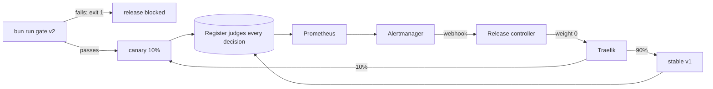

# Part 4: Release safely

## The problem

The planning team wants a friendlier prompt. Release v2 reads well, and on a quick look its letters are
fine. But it tells residents "a missing fee is fine", and the council's word is public. Today a new prompt
goes to every resident at once, and the only way back is someone noticing and redeploying by hand.

## Why it matters

A load balancing change sent some Claude requests to the wrong servers. At its worst point,
16% of Sonnet 4 requests were affected. Anthropic rolled back the faulty changes, and now runs quality
evaluations continuously on true production systems
([Anthropic Engineering, "A postmortem of three recent issues"](https://www.anthropic.com/engineering/a-postmortem-of-three-recent-issues)).
Anthropic also ships agent updates gradually, keeping old and new versions running side by side
([Anthropic Engineering, "How we built our multi-agent research system"](https://www.anthropic.com/engineering/built-multi-agent-research-system)).



## Steps

| Step | Minutes | You make | The check reads |
|---|---|---|---|
| `gate-with-evals` | 20 | `bun run gate <release>`: 30 fixed applications, code checks first (status, missing items, fee wording) | exit code and printed case ids: passes `v1`, fails `v2` |
| `ship-a-canary` | 20 | a Traefik weighted service (stable and canary) and `release.json` as one release unit whose id is on every span | 200 replayed requests: 80 to 100 percent served by stable, read from spans by `release.id` |
| `roll-back-automatically` | 20 | a Prometheus alert on decisions the register disagrees with, and an Alertmanager route to the release controller | `bun run chaos bad-canary`: within 3 minutes and no key pressed, canary weight is 0, the alert fired, and the rollback is in the controller's audit log |
| `write-the-runbook` | 15 | `runbook.md`: Symptoms, First five minutes, Kill switch, Roll back, Who to tell, After | every alert's `runbook_url` points to a heading; the kill switch command stops all model calls in under 10 seconds (gateway health); no empty section |

## Walkthrough

TODO(part session): the commands for each step, each with its Expect line.

```bash
bun run verify part release-safely
```

Expect: `Part release-safely is done: 4/4 steps pass.`
