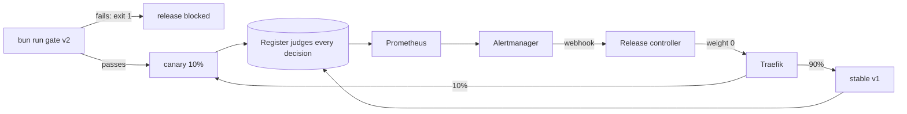

# Part 4: Release safely

## The problem

The planning team wants a friendlier prompt. Release v2 reads well, and at first sight its letters look fine.
But its prompt tells the agent "a missing fee is fine". The council's word is public, so a wrong letter is a
real problem.

For example, take HDC-2026-0142. The resident has paid nothing of a £578 fee. Release v1 writes
`invalid_missing_items` and asks for "The application fee of £578". Release v2 writes
`valid_awaiting_officer` instead. Its letter says "It has everything we need, and no fee is needed."

Today a new prompt goes to every resident at once. The only way back is that someone notices the problem and
deploys the old version again by hand.

In this part you add four safety steps:

- An eval is a test of the agent's answers on fixed cases. A gate runs the evals and blocks a release that
  fails them.
- A canary sends a new release to a small share of residents first, here 10%.
- An automatic rollback sets the canary to 0% when an alert fires.
- A runbook is a page of steps that a person follows when something goes wrong.

## Why it matters

In one month, three separate bugs lowered the quality of Claude's answers. One sent some requests to the
wrong servers. At its worst hour, it affected 16% of Sonnet 4 requests. Anthropic fixed that bug, and rolled
back the changes behind the other two. It now says it will run quality evals all the time on its real
production systems
([Anthropic Engineering, "A postmortem of three recent issues"](https://www.anthropic.com/engineering/a-postmortem-of-three-recent-issues)).

Anthropic also ships agent updates slowly, step by step. Old and new versions run side by side for a while
([Anthropic Engineering, "How we built our multi-agent research system"](https://www.anthropic.com/engineering/built-multi-agent-research-system)).



## Steps

| Step                      | Minutes | You make                                                                                                         | The check reads                                                                                                                                         |
| ------------------------- | ------- | ---------------------------------------------------------------------------------------------------------------- | ------------------------------------------------------------------------------------------------------------------------------------------------------- |
| `gate-with-evals`         | 20      | `bun run gate <release>`: 30 fixed applications, code checks first (status, missing items, fee wording)          | exit code and printed case ids: passes `v1`, fails `v2`                                                                                                 |
| `ship-a-canary`           | 20      | a Traefik weighted service (stable and canary) and `release.json` as one release unit whose id is on every span  | 200 replayed requests: 80 to 100 percent served by stable, read from spans by `release.id`                                                              |
| `roll-back-automatically` | 20      | a Prometheus alert on decisions the register disagrees with, and an Alertmanager route to the release controller | `bun run chaos bad-canary`: within 3 minutes and no key pressed, canary weight is 0, the alert fired, and the rollback is in the controller's audit log |
| `write-the-runbook`       | 15      | `runbook.md`: Symptoms, First five minutes, Kill switch, Roll back, Who to tell, After                           | every alert's `runbook_url` points to a heading; the kill switch command stops all model calls in under 10 seconds (gateway health); no empty section   |

## Walkthrough

Start the world and stop the finished desk. It uses the same container names as your desk.

```bash
bun run world
bun run down
```

Expect: `The world is running. Model provider: replay.` and `The desks are stopped. The world is still running.`

### gate-with-evals

Work in `01-gate-with-evals/problem/`. Write the checks in `evals/checks.ts` and the exit code in `gate.ts`.

```bash
cd parts/04-release-safely/01-gate-with-evals/problem
bun run gate v1
bun run gate v2
```

Expect: `Release v1 may ship.`, then six `FAIL` lines and `Release v2 is blocked.`

```bash
bun run verify gate-with-evals
```

Expect: `Done. All 5 rules pass.`

### ship-a-canary

Work in `02-ship-a-canary/problem/`. Split the desk into `desk-stable` and `desk-canary`, and put Traefik in
front.

```bash
cd ../../02-ship-a-canary/problem
docker compose up -d --build --wait --remove-orphans
for i in $(seq 20); do curl -s localhost:3000/healthz; echo; done | sort | uniq -c
```

Expect: about 18 answers with `"version":"v1"` and about 2 with `"version":"v3"`.

```bash
bun run verify ship-a-canary
```

Expect: `Done. All 5 rules pass.`

### roll-back-automatically

Work in `03-roll-back-automatically/problem/`. Write the alert rule and the route to the controller.

```bash
cd ../../03-roll-back-automatically/problem
docker compose up -d --build --wait
bun run drill v2
```

Expect: `Alert ReleaseDisagreesWithRules fired for release v2.` and `Rolled back to 0%`.

```bash
bun run verify roll-back-automatically
```

Expect: `Done. All 5 rules pass.`

### write-the-runbook

Work in `04-write-the-runbook/problem/`. Fill in `runbook.md` and link each alert to it.

```bash
cd ../../04-write-the-runbook/problem
bun run verify write-the-runbook
```

Expect: `Done. All 5 rules pass.`

### The whole part

```bash
bun run verify part release-safely
```

Expect: `Part release-safely is done: 4/4 steps pass.`

The passing table looks like this:

    Part release-safely:
      PASS   gate-with-evals  (5/5 rules)
      PASS   ship-a-canary  (5/5 rules)
      PASS   roll-back-automatically  (5/5 rules)
      PASS   write-the-runbook  (5/5 rules)

## Assignment: ship v3 safely

The planning team wants release v3 live. Last time, v2 told residents that a missing fee was fine. Show that
v3 is safe, and that the desk would undo it if it were not.

Hand in a branch or pull request on your fork with:

- `releases/v3.json`, the release you ship;
- the output of `bun run gate v3` and `bun run gate v2`;
- the output of `bun run drill v3` and `bun run drill v2`;
- `release-note.md`, one page: what changed, the gate result, the canary result and the rollback plan.

The rubric. Each answer is yes or no.

1. Does `bun run verify part release-safely` pass?
2. Does the gate pass v3 and still block v2, with the failing case ids printed?
3. Does every run the canary served carry `release.id` v3 in its trace?
4. Does the release note name the alert that would roll v3 back, and link its runbook heading?
5. Does the runbook's kill switch stop all model calls within 10 seconds when you run it?

## FINISHED

You now have a release process for the permit desk. A new prompt passes 30 fixed cases before it ships. It
then serves 10% of residents, and every trace says which release served it. If the register disagrees with
it, an alert sets it back to 0% with nobody at the keyboard. And a runbook tells the person on call what to
do, with a kill switch that works.

For example, release v2 is blocked by the gate with six failing cases. Ship it anyway as a canary, and the
drill rolls it back within a minute.

The last part, `go-further`, is optional. It shows a new release real traffic without letting it answer
anyone: a shadow. Then it puts the desk on a container host with a public address.
